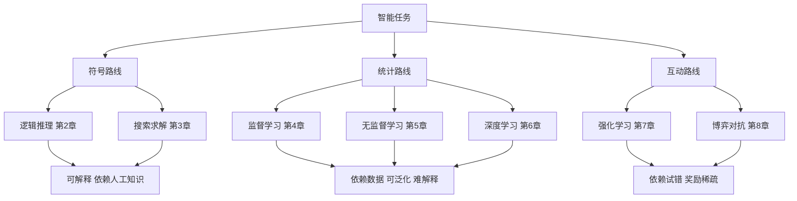

# 《人工智能导论：模型与算法》点化学习系统

## 这本书在讲什么

吴飞在书的前言里把人工智能拆成五种计算：以符号主义为核心的逻辑推理、以问题求解为核心的探寻搜索、以数据驱动为核心的机器学习、以行为主义为核心的强化学习、以博弈对抗为核心的群体智能。全书九章就是这五条线的展开：第 1 章给出这张地图，第 2—3 章讲不依赖数据的符号路线，第 4—6 章讲从数据里学模型的统计路线，第 7—8 章讲在与环境、与对手的互动中改进策略，第 9 章收束到当下的技术形态。

作者的主张很明确：这五种方法都是"计算"，都要落实到可执行的计算载体上，所以书里公式多、算法步骤多，不讲玄学。你读完应该能对每一种方法回答三个问题——它把智能当成什么、它靠什么信息改进、它的代价在哪里。

## 全书心智模型

看图说明：三条路线不是替代关系，而是"信息的来源"不同——符号路线从人写下的规则里来，统计路线从样本里来，互动路线从行动后的反馈里来。看这张图要抓住一点：越往右下走，人给的先验越少，机器自己找规律的比例越高，同时越难说清它为什么这么干。

## 学习路径（推荐顺序）

| 步骤 | 章节 | 主题 | 前置 | 检查点 |
|---|---|---|---|---|
| 01 | ch01 | 五种计算范式与全书地图 | 无 | 能对同一个任务说出五种做法 |
| 02 | ch02 | 命题逻辑、谓词逻辑、知识图谱、因果 | ch01 | 能把一句中文翻成一阶逻辑式 |
| 03 | ch03 | 状态空间搜索、A*、对抗搜索、MCTS | ch02 | 能手算 A* 的扩展顺序 |
| 04 | ch04 | 监督学习六大件：回归、决策树、LDA、AdaBoost、SVM、生成模型 | ch01、概率与向量补讲 | 能解释过拟合与正则化 |
| 05 | ch05 | 无监督：K-means、PCA、特征人脸、LSA、EM | ch04 | 能手推一次 EM 的两个步骤 |
| 06 | ch06 | 深度学习：前馈、CNN、RNN、GAN | ch04、ch05 | 能算一层卷积的输出尺寸 |
| 07 | ch07 | 强化学习：MDP、贝尔曼方程、Q 学习、策略梯度 | ch04 | 能手算一格 Q 值更新 |
| 08 | ch08 | 博弈：纳什均衡、CFR、安全子博弈、机制设计 | ch07 | 能找出一个矩阵博弈的均衡 |
| 09 | ch09 | 类脑、芯片、量子、伦理与框架 | 全部 | 能判断一个场景该用哪条路线 |

## 章节索引

- 第 1 章 绪论：五种计算范式（难度 ★☆☆）→ chapters/ch01-绪论五种计算范式.md
- 第 2 章 逻辑与推理（难度 ★★☆）→ chapters/ch02-逻辑与推理.md
- 第 3 章 搜索求解（难度 ★★☆）→ chapters/ch03-搜索求解.md
- 第 4 章 监督学习（难度 ★★★）→ chapters/ch04-监督学习.md
- 第 5 章 无监督学习（难度 ★★★）→ chapters/ch05-无监督学习.md
- 第 6 章 深度学习（难度 ★★★）→ chapters/ch06-深度学习.md
- 第 7 章 强化学习（难度 ★★★）→ chapters/ch07-强化学习.md
- 第 8 章 人工智能博弈（难度 ★★★）→ chapters/ch08-人工智能博弈.md
- 第 9 章 未来趋势（难度 ★☆☆）→ chapters/ch09-未来发展和趋势.md

## 前置知识（零基础缺口补讲）

| 缺口 | 对应补讲位置 | 学完标志 |
|---|---|---|
| 向量、矩阵、内积 | ch04 开头「三件工具」 | 能算两个二维向量的内积与模长 |
| 概率、条件概率、期望 | ch04 开头、ch05 开头 | 能算 P(A|B) 并能解释"期望是加权平均" |
| 求和记号 Σ 与下标 | ch01 末尾、ch04 | 能把 Σ 展开成具体几项相加 |
| 导数与"变化率" | ch06 开头 | 能说出导数为 0 的点意味着什么 |
| 树结构、图、队列 | ch03 开头 | 能手画一棵二叉搜索树并说出遍历顺序 |

## 术语表 / 模式库 / 速查表 入口

- 术语表：glossary.md（约 60 条，全部给白话定义）
- 模式库：patterns.md（五个可复用的判断框架 + 六个反模式）
- 速查表：cheatsheet.md（公式、算法步骤、复杂度）
- 测验：quiz.md（每章 4 题 + 综合卷）
- 抽认卡：flashcards.md（每章 5 张）
