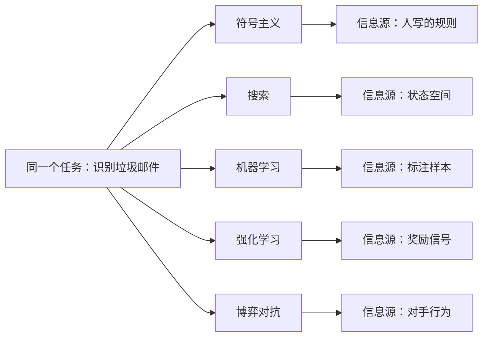

# 第 1 章：绪论——五种计算范式

- **难度**：★☆☆ | **预估学时**：1.5 小时 | **前置**：无

## 学习目标

学完本章，你能：

1. 用一句话说出本书对人工智能的定义，并解释"以机器为载体"这五个字为什么关键。
2. 说出符号主义、搜索、机器学习、强化学习、博弈对抗五种范式各自"从哪里获得改进的信息"。
3. 拿到一个具体任务（比如判断邮件是不是垃圾邮件），能分别用五种范式描述做法。
4. 区分"领域人工智能"与"通用人工智能"，并且不被宣传话术带偏。

## 一句话核心

人工智能不是一种算法，而是五种把"智能"翻译成"计算"的路子；它们的差别不在聪明程度，而在**改进的信息从哪来**——人写的规则、搜索的反馈、样本、环境的奖励、对手的策略。

## 零基础讲解

### 概念 1：人工智能＝以机器为载体的智能（难度：基础）

书里给的定义是"以机器为载体所展示出来的人类智能"，也叫**机器智能**。拆开看有两个词要落实：

- **载体**：得有一台能执行指令的机器。光有想法不算，得能在硅上跑起来。
- **展示出来**：智能是别人看得见的行为，比如识别、推理、说话、走棋。

为什么强调载体？因为同一个"智能"可以用完全不同的机器实现。人脑用神经元，计算机用 0 和 1，纸笔加一个人也能算。本书关心的不是"智能是什么"，而是"用计算装置怎么把它复现出来"。

> 类比：智能像菜谱，载体像厨房。菜谱写得再好，没有灶、没有锅、没有火，菜端不上桌。同一份菜谱，用柴火灶和电磁炉都能做，味道会有差别——这就是不同算法的差别。
>
> 类比失效的边界：厨房做菜是物理过程，菜谱可以含糊；计算要求每一步都能被机器精确执行，含糊一步就卡死。所以书里的每种方法最后都要写成算法步骤。

### 概念 2：可计算载体——图灵机、递归函数、λ 演算（难度：基础）

要说"机器能算智能"，先得说清"机器能算什么"。20 世纪 30 年代有三拨人几乎同时给出了答案：

| 提出者 | 模型 | 一句话说明 |
|---|---|---|
| 图灵 | 图灵机 | 一条无限长的纸带 + 一个读写头 + 一张状态转移表 |
| 哥德尔、克莱尼 | 递归函数 | 从几个最简函数出发，用复合、递归造出新函数 |
| 丘奇 | λ 演算 | 只用"函数定义"和"函数应用"两种操作做计算 |

三个模型长相完全不同，却被证明计算能力等价——这就是**丘奇-图灵论题**的实质：凡是能一步步机械算出来的东西，这三个模型都能算。这条结论对本书的意义是：只要一个智能任务能被写成明确的步骤，它就有资格上机器。

> 类比：三个人用三种语言写同一本字典，词汇表不同，能表达的句子却一样多。

### 概念 3：五种范式，五种信息来源（难度：基础）

这是本章真正要记住的骨架。

**① 符号主义：人是知识的来源。** 把概念写成符号，把判断写成规则，用逻辑推出新结论。比如"所有人都会死；苏格拉底是人；所以苏格拉底会死"。它的强项是可解释——每一步都能摊开给人看；弱项是规则得靠人一条条写，写不全，遇到例外就崩。

**② 搜索求解：问题的结构是来源。** 把问题变成一个状态空间：初始状态、目标状态、可执行的动作。然后系统地试探路径。八数码、路径规划、下棋都这么干。它的强项是只要状态空间能被定义，就一定能找到解；弱项是状态一多就爆炸，所以要靠**启发函数**砍掉没希望的分支。

**③ 机器学习：数据是来源。** 不去写规则，而是给一堆样例，让算法自己找输入到输出的映射。判断垃圾邮件时，不需要人写"含'中奖'二字即垃圾"，而是给几万封标注过的邮件让它统计。它的强项是规则太复杂、人写不动时特别有效；弱项是需要大量标注数据，而且说不清它学到了什么。

**④ 强化学习：环境的奖励是来源。** 智能体在环境里行动，动作之后环境给一个分数（奖励或惩罚），它靠不断试错把"什么状态下做什么动作得分高"记下来。AlphaGo 下棋、机器人走路都是这一类。它的强项是不需要标准答案，只需要一个评分；弱项是奖励往往稀疏——一盘棋下完才知输赢，中间几百步没人告诉它对不对。

**⑤ 博弈对抗：对手的策略是来源。** 当环境里有另一个也在学习的智能体，问题就从"跟环境打交道"变成"跟人斗心眼"。扑克的不完全信息、拍卖的报价、军事推演都属于这类。它的强项是能处理"我知道你知道我知道"这种嵌套；弱项是均衡解往往难算，而且对手不理性时理论保证会失效。

> 类比：五种范式像五种找路的方法。符号主义是拿着别人画好的地图走；搜索是自己一条条试路；机器学习是走过几百趟之后凭记忆认路；强化学习是走错了被扣分、走对了有奖，慢慢摸出来；博弈是路不只你一个人走，别人也在改路。

### 概念 4：领域人工智能与通用人工智能（难度：基础）

**领域人工智能**（也叫弱人工智能）只在某个特定任务上达到或超过人，比如人脸识别、围棋、机器翻译。**通用人工智能**要求在同一套系统里具备跨领域的理解、迁移和自我设定目标的能力。

书里的判断很克制：现在的系统基本都在领域人工智能的范围内，它们擅长从数据里找模式，但还做不到自己提出一个新问题。看清这一条，就能过滤掉大部分"机器要觉醒"的说法。

## 图示

看图说明：横着看是同一个任务，竖着看是五种信息源。这张图想让你形成一个条件反射——听到一种新方法，先问它靠什么信息改进，而不是先问它用什么网络结构。

## 类比与实例

**类比**：五种范式像五个医生看同一个病人。符号主义医生翻指南，按条目对号入座；搜索医生把所有可能的检查组合都试一遍；机器学习医生看几千个同类病例的统计规律；强化学习医生开药后看疗效，好了就继续、坏了就换；博弈医生还要考虑病人家属会不会配合、别的医生会不会抢病人。

失效边界：真实治病往往是五种一起用，而教学时必须分开讲。分开是为了看清各自的假设，不是为了说某一种更高级。

**实例**：一封邮件，标题"恭喜您获得一等奖"，正文含一个陌生短链接。五种做法分别是——

1. 符号主义：规则库写"标题含'一等奖'且含外链 → 垃圾"，命中即判。
2. 搜索：把"判定流程"建模成状态图，从"读标题"走到"判定为垃圾"，找一条最短的判定路径。这一招在真实系统里很少单独用，但能说明搜索的适用边界：它适合"步骤可枚举"的问题，不适合"模式模糊"的问题。
3. 机器学习：拿 5 万封人工标注的邮件，抽出 200 个特征（词频、链接数、发信域名年龄），训练一个分类器，输出"垃圾概率 0.97"。
4. 强化学习：系统先随机拦截一部分邮件，用户点"这是垃圾"给 +1、点"这不是垃圾"给 -1，几个月后策略收敛。代价是会误伤真实用户。
5. 博弈对抗：假设发信方会针对你的规则改写法（把"一等奖"改成"一 等 奖"），那就得把"对手会怎么绕"纳入建模，做双方反复迭代的对抗训练。

同一个任务，五种解法的成本、可解释性、维护方式完全不同。选哪一种，取决于你手上有什么信息，而不是哪种方法更新。

## 常见误解

- **别以为人工智能就是深度学习。** 深度学习只是第 6 章的一种模型族，属于机器学习这条线。逻辑推理、搜索、博弈在今天的系统里仍然在用：卫星任务规划用搜索，芯片布局用搜索加学习，拍卖平台用博弈论定价。
- **别以为数据越多就一定越好。** 数据多解决的是"样本不够"的问题，解决不了"标签有错""分布变了""任务本身定义不清"。第 4 章会讲，错误的标注会让模型把错误学得很牢。
- **别以为能聊天就等于通用智能。** 语言能力可以在大量文本上被拟合得很好，但这与"自己设定目标、跨领域迁移"是两件事。第 9 章会讨论这条边界。
- **别以为符号方法已经过时。** 规则系统的缺点是写不全，优点是可解释、可审计、不需要数据。在医疗、法律、工业控制里，"能说清为什么"经常比"准确率高两个点"更重要。

## 自测题

1. **单选**：本书定义人工智能时强调"以机器为载体"，主要想说明什么？
   - A. 机器比人聪明
   - B. 智能必须能被计算装置执行
   - C. 只有电子计算机才算机器
   - D. 人工智能必须模仿人脑结构
   **答案**：B。解析：定义落在"可执行"上。C 错在把载体限死为电子计算机，图灵机是抽象模型；D 是连接主义的特定主张，不是全书定义。

2. **填空**：五种范式中，靠"环境给的奖励"改进的是________；靠"人工编写的规则"推理的是________。
   **答案**：强化学习；符号主义。解析：前者对应第 7 章，后者对应第 2 章。注意"搜索"靠的是问题结构，不是奖励。

3. **简答**：为什么"说不清为什么"是机器学习路线的一个实质缺点，而不只是心理感受？
   **答案**：因为很多场景要求可审计、可追责。医疗误诊、信贷拒贷、自动驾驶事故都需要给出理由；一个只会输出概率的黑箱无法满足这类要求，也无法在出错后定位是哪个特征导致的。

4. **多选**：下列哪些任务更适合先用搜索而不是先上深度学习？
   - A. 八数码求解
   - B. 卫星观测任务排程
   - C. 判断照片里是不是猫
   - D. 迷宫最短路
   **答案**：A、B、D。解析：这三者都有明确的状态、动作、目标，搜索能给出最优或可证明的解；C 是模式识别，输入是像素、没有离散动作序列，属于监督学习。

## 复习锚点

- 人工智能＝以机器为载体展示的智能，关键是"能执行"。
- 五种范式按信息源区分：规则、状态空间、样本、奖励、对手。
- 丘奇-图灵论题：可机械计算的东西，图灵机、递归函数、λ 演算都能算。
- 今天的系统基本都在领域人工智能范围内。
