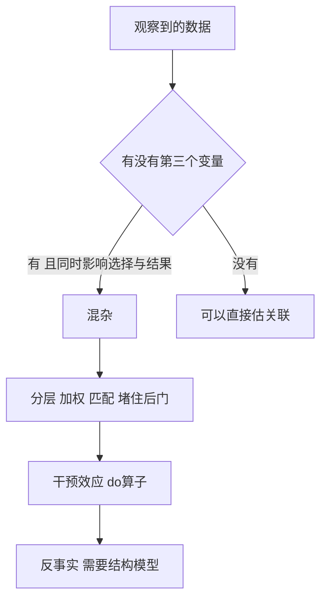

# 第 2 章：逻辑与推理

- **难度**：★★☆ | **预估学时**：3 小时 | **前置**：第 1 章（符号主义）

## 学习目标

学完本章，你能：

1. 把一句中文陈述翻译成命题逻辑式，并列出真值表判断它是否恒真。
2. 说清谓词逻辑比命题逻辑多解决了什么问题，`∀` 和 `∃` 各管什么。
3. 解释知识图谱为什么是"用图存事实"，以及 FOIL、路径排序两种推理各在做什么。
4. 用辛普森悖论说明"相关不等于因果"，并说出干预与反事实的区别。

## 一句话核心

逻辑把"因为所以"变成可以机械检验的符号操作；因果把"看见"变成"做了会怎样"，而这两件事隔着一条鸿沟。

## 零基础讲解

### 概念 1：命题逻辑——把句子缩成一个真假值（难度：基础）

**命题**是能判断真假的陈述句。"今天下雨"是命题，"请关门"不是。

命题逻辑只用五个连接词，全部可以用真值表定义：

| 写法 | 读法 | 什么时候为真 |
|---|---|---|
| `¬P` | 非 P | P 为假时 |
| `P ∧ Q` | P 且 Q | 两个都真 |
| `P ∨ Q` | P 或 Q | 至少一个真 |
| `P → Q` | 如果 P 那么 Q | 只有 P 真 Q 假时为假 |
| `P ↔ Q` | P 当且仅当 Q | 真假相同 |

第三个容易反直觉：`P → Q` 在 P 为假时整体为真。举例，"如果明天下雨，我就带伞"，明天没下雨（P 假），我没带伞，这句话算不算说谎？不算，因为我只承诺了下雨时带伞。这就是所谓**实质蕴含**。

真值表能做什么？能机械判定**重言式**（永远为真的式子）。比如 `P ∨ ¬P` 在所有取值下都为真。把两个式子的真值表逐行比对，就能判断它们是否等价——这是"推理正确性"的机器可检验版本。

### 概念 2：谓词逻辑——把"所有""存在"写进去（难度：基础）

命题逻辑有个硬伤：它把整句当原子，看不见句子内部结构。"所有人都会死"和"苏格拉底是人"，在命题逻辑里是两个不相干的字母 P 和 Q，推不出"苏格拉底会死"。

**谓词逻辑**（一阶逻辑）把句子拆成"对象 + 性质/关系"：

- `Human(x)`：x 是人
- `Mortal(x)`：x 会死
- `∀x`：对所有 x
- `∃x`：存在某个 x

于是三段论写成：

```
∀x (Human(x) → Mortal(x))
Human(Socrates)
────────────────────
Mortal(Socrates)
```

这条推理能被机械验证：把 `∀x` 实例化为 `Socrates`，得到 `Human(Socrates) → Mortal(Socrates)`，再用"肯定前件"规则得出结论。

`∀` 和 `∃` 的搭配是考试和工程里最常见的坑：

- `∀x (Human(x) → Mortal(x))`：所有都是人则都会死。用 `→`。
- `∃x (Human(x) ∧ Mortal(x))`：存在一个既是人又会死的东西。用 `∧`。

写成 `∃x (Human(x) → Mortal(x))` 就错了：只要找到一个不是人的东西，这个式子就为真，等于什么都没说。

**归结原理**是把这套推理变成单一操作的技巧：把所有式子化成子句，反复"消去互补文字"，直到推出空子句（矛盾）。反证法配合归结，就是自动定理证明器的基本工作方式——第 3 章之外，本书第 2.3 节的 FOIL 也建立在类似的规则归纳上。

### 概念 3：知识图谱——事实太多，规则写不完（难度：进阶）

人写规则写不全时，换个思路：不写规则，存**事实**。

知识图谱用三元组 `（头实体，关系，尾实体）` 存事实，例如：

- `（吴飞，任职于，浙江大学）`
- `（浙江大学，位于，杭州）`
- `（杭州，属于，浙江）`

存下来之后，推理就是"在图上找路径"。问"吴飞在哪个省"，答案不直接存在，但可以从 `吴飞→浙江大学→杭州→浙江` 这条路径推出来。这叫**路径排序推理**（PRA）：把不同关系路径当成特征，学习"哪类路径更容易连到正确答案"。

**FOIL** 走的是另一条路：从已有事实里**归纳**出一条新规则。它一步步加条件，让规则覆盖尽可能多的正例、尽可能少的反例。比如从"父母都是教师的孩子也上大学"这类样本里，归纳出"若 x 的父亲是教师且 x 的母亲是教师，则 x 上大学"。归纳出来的规则可能过拟合，所以要有覆盖率和准确率的权衡。

> 类比：知识图谱像一张巨大的关系网，推理像在网里找路；FOIL 像从一堆案例里总结出一句"经验之谈"。
>
> 失效边界：图里没有的事实推不出来；图里有错的事实会被一路传下去。真实图谱的补全和清洗，工作量往往比推理本身大。

### 概念 4：因果推理——相关不是因果（难度：高难）

先看一组真实数据（肾结石两种手术的比较，数字取自已发表的临床统计）：

| | 开放手术 | 经皮手术 |
|---|---|---|
| 轻症 治愈/总数 | 81/87（93.1%） | 234/270（86.7%） |
| 重症 治愈/总数 | 192/263（73.0%） | 55/80（68.8%） |
| 合计 治愈/总数 | 273/350（**78.0%**） | 289/350（**82.6%**） |

分开看，开放手术在轻症和重症两组里都更好；合起来看，经皮手术反而更好。同一个数据，结论完全相反——这就是**辛普森悖论**。

原因在第三个变量：**病症轻重**。医生倾向把重症病人分给开放手术。重症本来就难治，于是开放手术被"拖累"了。合计时两组人数不一样（263 对 80），加权之后就把真实效应翻了过来。

**混杂因子**就是这种"同时影响治疗选择和结果"的变量。不控制它，你算出来的只是相关，不是因果。

**因果图**（有向无环图）把它画出来：节点是变量，箭头是因果方向。`病症轻重 → 手术方式`、`病症轻重 → 治愈`、`手术方式 → 治愈`，形成一条"后门路径"，必须把它堵住（分层、加权、匹配）。

**do 算子**是干预的记号。`P(治愈 | do(开放手术))` 问的是"如果我强行指定手术方式，治愈率是多少"，而不是"接受开放手术的病人里治愈率是多少"。前者要把混杂因子的分布拉平，后者只是观察。

**反事实**再进一步："这个病人如果当时做了另一种手术，会怎样？"这需要假设一个反事实世界，只有模型才能回答，数据本身永远给不出。

书里把因果分成三层，这张表值得记住：

| 层 | 问法 | 数学记号 | 需要什么 |
|---|---|---|---|
| 关联 | 看见 X，Y 会怎样 | `P(Y|X)` | 观测数据 |
| 干预 | 强行让 X=x，Y 会怎样 | `P(Y|do(X=x))` | 因果图 + 可识别性条件 |
| 反事实 | 已经发生的事，如果换一种做法会怎样 | `P(Y_x|X=x', Y=y)` | 结构因果模型 |

> 类比：关联是看天气预报说"下雨天堵车多"；干预是"我下令明天下雨，看堵不堵"；反事实是"昨天那场堵车，如果我没走那条路会不会不堵"。

## 图示



看图说明：这张图是因果推断的作业流程。看到一组"X 和 Y 有关系"的数据，第一件事不是算相关系数，而是问有没有混杂；堵住后门之后，才谈得上干预效应；反事实是最后一层，要求更高。

## 类比与实例

**类比**：逻辑像验算纸，每一步都要留下可核对的痕迹；因果像破案，得先排除"目击者站在哪儿"造成的错觉。

失效边界：逻辑只管"从前提能不能推出结论"，不管前提本身对不对。因果分析只管"在给定模型下效应是多少"，模型错了，结论就是精致地错。

**实例**（真值表判定）：判断 `(P → Q) ∧ P → Q` 是否恒真。列四行：

| P | Q | P→Q | (P→Q)∧P | 整个式子 |
|---|---|---|---|---|
| 真 | 真 | 真 | 真 | 真 |
| 真 | 假 | 假 | 假 | 真 |
| 假 | 真 | 真 | 假 | 真 |
| 假 | 假 | 真 | 假 | 真 |

四行全真，是重言式，即"肯定前件"规则合法。

## 常见误解

- **别以为"如果……那么……"就是日常因果。** 逻辑里的 `→` 只管真假组合，不管时间先后和因果机制。"如果 1+1=3，那么月亮是奶酪做的"在逻辑上为真，因为前件为假。这种句子在自然语言里很怪，但机器只认真值。
- **别以为 `∃` 后面跟 `→` 是对的。** 存在量词配合取，全称量词配蕴含，这是硬规则，写反了句子的意思就变空。
- **别以为相关强就是因果强。** 辛普森悖论说明，连"分组内都更好、合计更差"这种方向反转都可能出现，只看总量表会得出反向结论。
- **别以为知识图谱能自己长出新知识。** 它能补全、能找路径，但补出来的每一条都可能错，都需要置信度评估。

## 自测题

1. **单选**：`∀x (Bird(x) → Fly(x))` 与下列哪句意思最接近？
   - A. 有些鸟会飞
   - B. 所有鸟都会飞
   - C. 会飞的都是鸟
   - D. 存在不会飞的鸟
   **答案**：B。解析：全称量词加蕴含，表示"对每个 x，只要是鸟就会飞"。

2. **填空**：在辛普森悖论的肾结石例子里，导致结论反转的混杂因子是________。
   **答案**：病症轻重（结石大小/严重程度）。解析：它同时影响医生选择术式（重症多分给开放手术）和治愈率，构成后门路径。

3. **简答**：`P(Y|X)` 与 `P(Y|do(X))` 的差别，用一句话说清。
   **答案**：前者是"在看接受 X 的人群里 Y 的比例"，人群由医生/病人自己选出来的；后者是"如果强行让所有人接受 X，Y 的比例是多少"。差别在于是否排除了混杂因子造成的选择偏差。

4. **多选**：下列关于归结原理的说法，正确的有：
   - A. 它把推理化归为子句间的消去操作
   - B. 通常与反证法配合使用
   - C. 它能直接处理所有自然语言句子
   - D. 推出空子句说明前提与否定结论矛盾
   **答案**：A、B、D。解析：C 错，归结要求先把句子化成规范子句形式，"所有自然语言"这一步本身就要靠人翻译，且很多句子无法用一阶逻辑忠实表达。

## 复习锚点

- 命题逻辑管真假组合，`P→Q` 只在 P 真 Q 假时为假。
- 谓词逻辑多了对象、性质、量词：全称配蕴含，存在配合取。
- 知识图谱存三元组，推理＝在图上找路径或归纳规则。
- 相关不等于因果；辛普森悖论是混杂因子的典型症状；三层是关联、干预、反事实。
