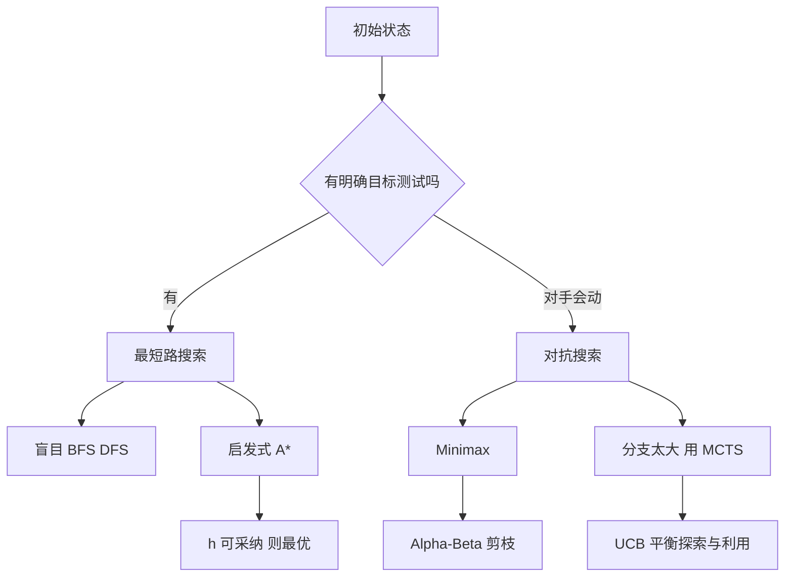

# 第 3 章：搜索求解

- **难度**：★★☆ | **预估学时**：3 小时 | **前置**：第 2 章；树与图的基本概念（见本章开头）

## 学习目标

学完本章，你能：

1. 把一个实际问题写成状态空间：初始状态、动作、转移、目标、代价。
2. 用评价函数 `f = g + h` 手算 A* 的扩展顺序，并说明它为什么能找到最短路。
3. 说清可采纳性与一致性的区别，以及它们各自保证什么。
4. 画出 Minimax 搜索树并手算 Alpha-Beta 剪枝省掉了哪几次评估。
5. 说出蒙特卡洛树搜索的四个阶段，以及它为什么适合围棋这类"分支爆炸"的问题。

## 一句话核心

搜索的本质是"在候选解的空间里按某种顺序试"，一切技巧都在解决同一个矛盾：**试得全**和**试得快**不能兼得，只能靠评价函数把希望大的分支排到前面。

## 零基础讲解

### 概念 0：先补三个词（难度：基础）

- **树**：每个节点最多一个父节点的结构，没有环。搜索树里，根是起点，往下每层是一个决策。
- **队列**：先进先出；**栈**：后进先出。广度优先搜索用队列，深度优先搜索用栈。
- **分支因子 b**：一个状态平均有多少个可选动作。深度为 d 时，全部节点数是 `b^d` 量级——这就是"组合爆炸"的来源。国际象棋 b≈35，围棋 b≈250，所以围棋不可能穷举。

### 概念 1：状态空间与搜索算法的四个评价指标（难度：基础）

把问题写成五元组：

| 要素 | 含义 | 八数码的例子 |
|---|---|---|
| 初始状态 | 从哪儿开始 | 给定的 3×3 盘面 |
| 动作集合 | 能做什么 | 空格上/下/左/右移动 |
| 转移模型 | 做完之后变成什么 | 交换空格与相邻数字 |
| 目标测试 | 什么算成功 | 盘面等于目标排列 |
| 路径代价 | 每步花多少 | 每步记 1 |

任何搜索算法都用四个指标衡量：

- **完备性**：有解的时候一定能找到吗？
- **最优性**：找到的是代价最小的解吗？
- **时间复杂度**：扩展了多少节点，随 b、d 怎么涨？
- **空间复杂度**：同时要存多少节点？

记住一组常见结论就够用了：广度优先**完备且最优**（每步代价相同时），但空间是 `O(b^d)`，内存先炸；深度优先空间只要 `O(bd)`，但不完备（可能掉进无限深的坑），也不最优。

### 概念 2：启发式搜索——用 h 猜还剩多远（难度：进阶）

盲目搜索不知道"哪边离目标近"。**启发函数** `h(n)` 给出"从节点 n 到目标还要多少代价"的估计。它不需要准确，只需要"大致靠谱"。

三个算法只差在排队用的评价函数：

| 算法 | 评价函数 | 排队依据 |
|---|---|---|
| 一致代价搜索 | `f = g` | 已花代价最小的先扩展 |
| 贪婪最佳优先 | `f = h` | 离目标估计最近的先扩展 |
| A* | `f = g + h` | 已花的 + 还要花的，总账最小 |

贪婪最佳优先跑得快，但可能一头扎进死胡同，找到的解很差。A* 把"已经付出的代价"也算进去，所以能在快和好之间取得平衡。

**A* 的两个性质**（本章最重要的一段）：

- **可采纳性**：`h(n)` 永远不高估真实剩余代价。只要可采纳，A* 一定找到最优解。
- **一致性**（也叫单调性）：`h(n) ≤ c(n, n') + h(n')`，即沿着任一条边，h 的下降幅度不超过这条边的代价。一致性比可采纳更强，它保证 A* 一旦扩展某个节点，就不会再找到更短的路径到它——所以每个节点最多被扩展一次。

> 类比：h 像导航软件对剩余时间的估计。估计得偏乐观（可采纳），你最终总能到；估计得偏悲观，它可能带着你绕远还自认为已经最优。
>
> 失效边界：可采纳性只管"最优"，不管"快"。如果 h 恒为 0，A* 退化成广度优先，最优但极慢。

### 概念 3：对抗搜索——假设对手也在算（难度：进阶）

棋类没有"目标状态"可搜，因为对手会动。**Minimax** 的思路是：我走的那层取最大值，对手走的那层取最小值，交替往上回传。

```
MAX 层：选子节点里最大的值
MIN 层：选子节点里最小的值
叶子：用评估函数打分（赢=+∞，输=-∞，或启发式估分）
```

**Alpha-Beta 剪枝**在回传时多带两个边界：α 是 MAX 层已经保证能拿到的最好值，β 是 MIN 层已经保证能拿到的最小值。一旦某个分支不可能改变上层决策，就整枝剪掉。

它不改变结果，只减少评估次数。最好情况下复杂度从 `O(b^d)` 降到 `O(b^(d/2))`——同样时间能多看一倍深度，这是深蓝能赢卡斯帕罗夫的关键工程手段之一。

### 概念 4：蒙特卡洛树搜索——不穷举，抽样估胜率（难度：高难）

围棋的分支因子太大，Alpha-Beta 用不上。MCTS 换了个办法：不追求"算准每一步"，而是反复随机下完很多盘，统计"从这个局面开始，随机走到最后赢的比例"。

每次迭代四步：

1. **选择**：从根往下，按 UCB 公式挑一个最有希望又没被充分探索的子节点。
2. **扩展**：到了叶子，加一个新节点。
3. **模拟**：从新节点开始随机下到终局，记录胜负。
4. **回溯**：把胜负结果沿路径往上传，更新每个节点的访问次数与胜率。

选择用的公式是 **UCB1**：

```
UCB = (该节点累计胜率) + c × 根号下( ln(父节点访问次数) / 该节点访问次数 )
```

前一项是**利用**（挑现在看起来好的），后一项是**探索**（挑还没怎么试过的）。`c` 调节两者比重，常用的理论值是根号 2。

> 类比：选餐馆。一家吃了三次都不错（利用分高），另一家只去过一次没法判断（探索分高）。UCB 就是"既照顾老店，也给新店机会"的规则。
>
> 失效边界：随机模拟在围棋里之所以有效，是因为"随机下到终局"也能大致反映形势；换成需要精确长程规划的任务（比如复杂调度），随机模拟的方差太大，效果会显著下降。

## 图示



看图说明：从左往右是选算法的判断顺序。先问"有没有明确的目标测试"，有就走最短路搜索；再问"对手是不是也在决策"，是就走对抗搜索；最后问"分支是不是爆炸到穷举不可能"，是就上 MCTS。

## 类比与实例

**类比**：盲目搜索像在一栋没有指示牌的楼里逐层找房间；启发式搜索像门口有张平面图，你能估出"这层更可能有"；Minimax 像下棋时不停问"我这么走，他会怎么应"；MCTS 像懒得算，直接抓一百个人从这局面随便下，看赢面。

失效边界：平面图可能画错（h 不可采纳就会错过最优解）；对手可能不按最优走（Minimax 假设理性，遇到乱下的人反而不适应）；抽样需要次数够多（MCTS 在时间极紧时不如直接查表）。

**实例 1（A* 手算）**：3×3 网格，起点 `S(0,0)`，终点 `G(2,2)`，`(1,1)` 是墙，只能上下左右走。用曼哈顿距离 `h = |行差| + |列差|`。

| 扩展顺序 | 节点 | g | h | f=g+h | 说明 |
|---|---|---|---|---|---|
| 1 | (0,0) | 0 | 4 | 4 | 起点 |
| 2 | (0,1) | 1 | 3 | 4 | 右移 |
| 3 | (1,0) | 1 | 3 | 4 | 下移 |
| 4 | (0,2) | 2 | 2 | 4 | 右移 |
| 5 | (2,0) | 2 | 2 | 4 | 下移 |
| 6 | (1,2) | 3 | 1 | 4 | 从 (0,2) 下移 |
| 7 | (2,2) | 4 | 0 | 4 | 目标，结束 |

路径 `(0,0)→(0,1)→(0,2)→(1,2)→(2,2)`，代价 4。注意 (1,1) 是墙，所以必须绕行；直线距离是 4，绕行后仍是最短，说明这个 h 是可采纳且一致的（每走一步 h 最多降 1，正好等于边代价 1）。表中所有 f 都等于 4——这不是巧合，一致性保证 A* 会沿着这条 f 相等的"等高线"一路推进。

**实例 2（Alpha-Beta）**：一棵三层树，根是 MAX，三个子节点 A、B、C 是 MIN，每个 MIN 下两个叶子。

- A 的叶子：3、5 → A = min(3,5) = 3
- B 的叶子：2、9 → B = 2
- C 的叶子：1、7 → C = 1
- 根 = max(3, 2, 1) = **3**

带剪枝走一遍：先算 A 得到 3，α=3。看 B 的第一个叶子 2，2 ≤ α，说明 B 最多是 2，比 A 的 3 差，剩下那个 9 不用看了——剪掉。于是 C 的第一个叶子 1 也 ≤ α，剪掉第二个。总共只评估了 3、5、2、1 四个叶子，省掉 9 和 7 两次。

## 常见误解

- **别以为 A* 一定比贪婪快。** A* 要维护一个按 f 排序的开放表，节点多时开销不小；有些工程场景宁可要"快但可能不最优"的贪婪解。
- **别以为 h 越大越好。** h 越大越接近真值，搜索越快；但一旦超过真值就失去可采纳性，最优性也没了。工程上常把 h 乘以一个略大于 1 的系数来加速，代价是接受次优解。
- **别以为 Alpha-Beta 剪掉的叶子"不重要"。** 剪掉是因为它不可能影响最终决策，前提是搜索顺序合理。如果先看差的分支，剪枝几乎不发生——所以"先试好棋"的排序启发式非常关键。
- **别以为 MCTS 不靠领域知识。** AlphaGo 里策略网络负责缩小分支、价值网络负责替代随机模拟，两者都是学出来的领域知识。纯随机模拟的 MCTS 在围棋上只能到业余水平。

## 自测题

1. **填空**：A* 的评价函数是 `f = ________`；保证它找到最优解的性质叫________。
   **答案**：`g + h`；可采纳性。解析：g 是已花代价，h 是剩余估计；h 不高估真实剩余代价即可采纳。

2. **单选**：某启发函数满足 `h(n) = 2 × 真实剩余代价`，用 A* 会怎样？
   - A. 一定找到最优解，且更快
   - B. 可能错过最优解
   - C. 退化成广度优先
   - D. 一定找不到解
   **答案**：B。解析：高估违反可采纳性，可能提前"以为已经到最优"而停在次优路径上。

3. **简答**：在实例 2 中，如果搜索顺序改成先看 C 再看 A，剪枝次数会变多还是变少？为什么？
   **答案**：变少。先看 C 得到 1，α=1，之后 A 的叶子 3 > 1 不能剪、5 也不能剪；B 的 2 > 1 不能剪，9 也不能剪，几乎不剪。剪枝效果依赖"好分支先出现"。

4. **多选**：MCTS 适合下列哪些问题？
   - A. 围棋
   - B. 需要精确长程规划的车间调度
   - C. 有明确快速胜负判定的对弈类游戏
   - D. 状态空间巨大但可以随机模拟到终局的任务
   **答案**：A、C、D。解析：B 的随机模拟方差过大，且调度对精确性要求高，更适合用约束规划或启发式构造。

## 复习锚点

- 状态空间五要素：初始、动作、转移、目标、代价。
- `f = g + h`；h 可采纳 → 最优；h 一致 → 每节点只扩展一次。
- Minimax 假设对手最优；Alpha-Beta 只剪不影响决策的分支。
- MCTS 四阶段：选择、扩展、模拟、回溯；UCB 平衡探索与利用。
