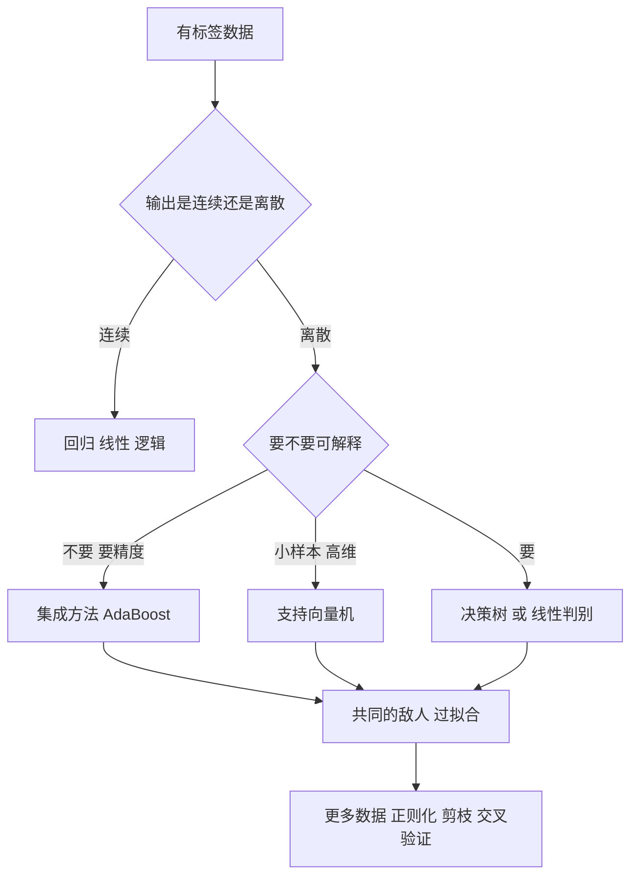

# 第 4 章：监督学习

- **难度**：★★★ | **预估学时**：6 小时 | **前置**：第 1 章；本章开头的三件工具

## 学习目标

学完本章，你能：

1. 用训练集/测试集划分和"过拟合"解释为什么训练准确率高不代表模型好。
2. 手算一元线性回归的最小二乘解，并说明逻辑回归为什么用交叉熵而不是平方误差。
3. 用信息增益判断决策树该先按哪个特征分裂，并说清剪枝在防什么。
4. 写出 AdaBoost 的权重更新公式，算完一轮并解释"为什么错的分样本权重会变大"。
5. 写出硬间隔 SVM 的目标函数与约束，解释间隔为什么是 `2/‖w‖`，核函数在解决什么。

## 一句话核心

监督学习就是"用带答案的样本，找一个从输入到输出的映射"；所有模型都在同一件事上做取舍——**拟合得够准**和**别把噪声也学会**。

## 零基础讲解

### 概念 0：三件工具（难度：基础，必须补）

**① 求和记号。** `Σ` 就是"把一串东西加起来"。`Σ(i=1 到 3) x_i` 展开是 `x_1 + x_2 + x_3`。看到 `Σ` 别慌，先在纸上展开成三项，再算。

**② 向量与内积。** 向量是一串有序的数，`x = (x_1, x_2)`。两个向量的**内积**是"对应位置相乘再相加"：`(1,2)·(3,4) = 1×3 + 2×4 = 11`。内积衡量两个向量的"同向程度"——夹角越小内积越大。**模长** `‖w‖ = 根号下(w_1² + w_2²)`，就是向量的长度。

**③ 概率与期望。** 条件概率 `P(A|B)` 读作"在 B 发生的条件下 A 发生的概率"，等于 `P(A且B) / P(B)`。期望是"按概率加权的平均"，比如掷骰子的期望是 `(1+2+…+6)/6 = 3.5`。

### 概念 1：机器学习的基本形态（难度：基础）

| 类型 | 数据长什么样 | 任务 | 本书章节 |
|---|---|---|---|
| 监督学习 | 输入 + 正确答案 | 分类、回归 | 第 4 章 |
| 无监督学习 | 只有输入 | 聚类、降维 | 第 5 章 |
| 强化学习 | 动作 + 延迟奖励 | 序贯决策 | 第 7 章 |

监督学习里，**分类**的输出是离散类别（垃圾/正常），**回归**的输出是连续数值（房价）。两者模型结构常常一样，只是最后的输出层不同。

训练流程是固定的四步：拿数据 → 定义模型 → 定义"错多少"的损失函数 → 用优化算法把损失降下来。**泛化**指模型在没见过的数据上表现如何。训练集上的误差叫**经验风险**，真实世界的误差叫**期望风险**。这中间有个裂缝，本章后面的每个模型都在想办法缩它。

**过拟合**是模型把训练集的噪声也记住了，表现为训练误差很低、测试误差很高。三个常见对策：加更多数据、加**正则化**（惩罚参数过大）、降低模型复杂度（剪枝、减少层数）。反过来叫**欠拟合**，模型太简单，两边都差。

> 类比：过拟合像学生背下了练习册的答案，换一套题就崩；欠拟合像只记住"选择题选 C"。
>
> 失效边界：真实数据里"噪声"和"真实规律"经常分不清，正则化调多强没有普适答案，只能靠验证集试。

### 概念 2：线性回归——用一条直线拟合（难度：基础）

模型是 `y = w x + b`。损失用**平方误差**：

```
L(w,b) = Σ(i=1 到 m) ( y_i - (w x_i + b) )²
```

对 w 和 b 各求一次导、令其为 0，解出闭式解：

```
w = Σ(x_i - x̄)(y_i - ȳ) / Σ(x_i - x̄)²
b = ȳ - w x̄
```

**算例**：三个点 `(1,2)、(2,4)、(3,5)`。

- `x̄ = 2`，`ȳ = 11/3 ≈ 3.667`
- 分子 `Σ(x_i-2)(y_i-ȳ) = (-1)(-1.667) + 0 + (1)(1.333) = 3`
- 分母 `Σ(x_i-2)² = 1 + 0 + 1 = 2`
- `w = 3 / 2 = 1.5`，`b = 3.667 - 1.5×2 = 0.667`

得到 `y = 1.5x + 0.667`，三个点的预测值是 2.167、3.667、5.167，残差平方和约 0.167。这个解是"使残差平方和最小"的唯一解，所以叫**最小二乘**。

**多元线性回归**只是把 `wx` 换成 `w·x`（内积），闭式解变成矩阵形式；特征多了之后通常改用梯度下降迭代求。

**逻辑回归**做的是分类，但名字里有"回归"：它先算 `z = w·x + b`，再用 **Sigmoid** 函数把 z 压到 0 到 1 之间：

```
σ(z) = 1 / (1 + e^(-z))
```

输出的数值可解释为"属于正类的概率"。为什么不用平方误差？因为平方误差配上 Sigmoid 会让损失函数变成非凸的，容易卡在局部极小；改用**交叉熵** `-Σ[y log ŷ + (1-y) log(1-ŷ)]` 后是凸函数，梯度也更干净。

> 补充一句：逻辑回归里的"几率"是 `p/(1-p)`，取对数后正好等于 `w·x+b`，所以它本质是在**对数几率**上做线性拟合。这就是书里"对数几率回归"这个名字的来历。

### 概念 3：决策树——一层层问问题（难度：进阶）

决策树就是一连串 if-else。核心问题是：**先按哪个特征分裂**？

答案是"选让不确定性下降最多的那个"。不确定性用**信息熵**度量：

```
H(S) = -Σ(k) p_k log₂ p_k
```

p_k 是第 k 类在集合 S 里的比例。全是一类时 H=0（最纯），各类均匀时 H 最大。

**信息增益** = 分裂前的熵 − 分裂后各子集熵的加权平均。增益越大，这次分裂越"值"。

**算例**：10 个样本，7 正 3 负，`H(S) = -0.7log₂0.7 - 0.3log₂0.3 = 0.881`。某特征把数据分成两半：第一半 5 个全是正（H=0），第二半 2 正 3 负（`H = -0.4log₂0.4 - 0.6log₂0.6 = 0.971`）。加权后 `0.5×0 + 0.5×0.971 = 0.486`，增益 `0.881 − 0.486 = 0.395`。

ID3 用信息增益，C4.5 改用**增益率**（因为信息增益偏爱取值多的特征，比如"学号"这种每个样本都不同的特征增益极高但毫无意义），CART 用**基尼指数**。三者都是在挑"分完更纯"的特征。

树长到每个叶子只有一个样本，训练误差为 0，但这几乎必然过拟合。**剪枝**就是往回砍：预剪枝（边建边判断要不要继续分）、后剪枝（建完整棵树再自底向上合并叶子）。

### 概念 4：线性判别分析（LDA）——把两类推远（难度：进阶）

LDA 的想法很直观：找一个投影方向，让**同类**的投影点尽量挤在一起，**异类**的投影点尽量分开。

用两个量描述：类内散度 `S_w`（同类点的分散程度）、类间散度 `S_b`（两类中心之间的距离）。目标是最大化

```
J = (w·S_b·w) / (w·S_w·w)
```

这个比值叫广义瑞利商，解是 `S_w^(-1) (μ_1 - μ_2)` 方向。一句话：**LDA 是把"类内方差小、类间距离大"写成目标函数，然后解出来**。它和 PCA 都是线性投影，区别在 PCA 不管标签、只看方差最大的方向。

### 概念 5：AdaBoost——把一堆弱分类器串起来（难度：高难）

**弱学习器**是只比瞎猜好一点的分类器（错误率略低于 50%）。AdaBoost 的思路是：让一堆弱学习器各自关注不同的难点，最后投票。

算法三步循环：

1. 用当前样本权重训练一个弱分类器 `h_t`，算它的加权错误率 `ε_t`。
2. 给这个分类器一个话语权 `α_t = 0.5 × ln((1-ε_t)/ε_t)`。错误率越低，话语权越大；等于 0.5 时话语权为 0。
3. 更新样本权重：分错的乘 `e^(α_t)`（权重变大），分对的乘 `e^(-α_t)`（权重变小），再归一化。

**算例**：3 个样本，初始权重都是 1/3。第一个分类器把第 3 个分错了，`ε = 1/3`。

- `α = 0.5 × ln((2/3)/(1/3)) = 0.5 × ln2 ≈ 0.347`
- 新权重：前两个 `1/3 × e^(-0.347) ≈ 0.236`，第三个 `1/3 × e^(0.347) ≈ 0.471`
- 归一化后：0.25、0.25、**0.50**

第三个样本的权重从 1/3 涨到 1/2——下一轮分类器会更在意它。这就是"关注错题"的数学实现。

书里还讲了一个理论点：**可学习性**。如果存在一个弱学习器能稳定地把错误率压到 0.5 以下一点，那么经过足够多轮 boosting，就能得到一个错误率任意低的强学习器。这句话的分量在于——它把"强学习器很难造"变成了"弱学习器容易造"。

### 概念 6：支持向量机（难度：高难）

先摆出问题：两类点线性可分时，能把它们分开的直线有无数条。选哪条？

SVM 的答案是：选**离两边最近的点都尽量远**的那条。这些"最近的点"叫**支持向量**，它们决定了这条线，其他点删掉也不影响结果。

设超平面 `w·x + b = 0`，点到它的距离是 `|w·x+b| / ‖w‖`。把约束归一化成 `y_i(w·x_i+b) ≥ 1`，则最近点的距离是 `1/‖w‖`，两边加起来**间隔是 `2/‖w‖`**。

于是优化问题写成：

```
最小化   (1/2)‖w‖²
约束     y_i(w·x_i + b) ≥ 1，对所有 i
```

最大化间隔等价于最小化 `‖w‖`（因为间隔和 ‖w‖ 成反比），平方是为了求导方便，1/2 是为了求导后系数变干净。

**算例**：两个点，`x_1=(2,2)` 标 +1，`x_2=(1,1)` 标 −1。最优超平面是它们连线的垂直平分线：`w=(1,1)`、`b=-3`。验算：`1×2+1×2−3 = 1`，`1×1+1×1−3 = −1`，两个点都正好落在间隔边界上，都是支持向量。`‖w‖ = √2 ≈ 1.414`，间隔 `2/√2 ≈ 1.414`。

**软间隔**：真实数据总有重叠。于是允许一些点越过边界，引入**松弛变量** ξ_i ≥ 0，目标改成

```
最小化  (1/2)‖w‖² + C Σ ξ_i
```

C 越大越不容忍违规（越容易过拟合），C 越小越宽容。这个形式和**合页损失**（hinge loss）`max(0, 1 - y(w·x+b))` 加 L2 正则等价——书里 4.6.3 就是这么讲的。

**核函数**：数据线性不可分时，不必真的把点映射到高维再算。只要模型里所有用到点的地方都是**内积**，就把它换成核函数 `K(x,z) = φ(x)·φ(z)`。常用的是高斯核 `K(x,z) = exp(-‖x-z‖² / (2σ²))`，它隐式地把数据映射到无穷维。这就是"核技巧"：不搬家，只改算距离的方式。

**VC 维**：衡量一个模型族"能拟合多复杂的标签"。二维线性分类器的 VC 维是 3——任意 3 个不共线的点，无论怎么标正负，都能找到一条线分开；但 4 个点有时分不开。VC 维越高，模型越灵活，也越容易过拟合。书里把这套推理叫**结构风险最小化**：不仅看训练误差，还要看模型的复杂度。

### 概念 7：生成式学习（难度：进阶）

前面几个模型学的都是 `P(y|x)`——给定输入，直接输出类别概率，叫**判别式模型**。

**生成式模型**学的是 `P(x,y)` 的联合分布，再用贝叶斯公式反推：

```
P(y|x) = P(x|y) P(y) / P(x)
```

朴素贝叶斯是最典型的例子：假设各特征在给定类别下相互独立（这个假设经常不成立，所以叫"朴素"），于是 `P(x|y)` 变成各特征概率的连乘，参数量从指数级降到线性。

判别式通常分类更准，生成式能生成新样本、能处理缺失值。这条分界线在第 6 章的 GAN 里会再次出现。

## 图示



看图说明：这不是唯一正确的选型路线，而是一条能说清理由的默认路线。看这张图要抓住最后一层：四种模型的技术细节完全不同，但最后都撞在同一个敌人身上——过拟合，对策也高度相似。

## 类比与实例

**类比**：线性回归像用一根直尺量趋势；决策树像医生问诊，一个问题接一个问题；AdaBoost 像一群实习生投票，每个人只擅长一小块，但错的人下次会被重点提醒；SVM 像在两军之间划一条最宽的缓冲带，只有最靠前的哨兵决定线的位置。

失效边界：直尺量不了弯的关系；问诊树遇到没见过的症状组合会失效；实习生们如果都犯同一个错，投票也救不回来；缓冲带只在"两类能被一条线分开"时有效，否则要换核。

**实例**（AdaBoost 的两轮）已在上文算完：第一轮把错样本权重从 0.33 提到 0.50。第二轮如果仍有一个样本被错分，权重继续向它集中——最终所有弱分类器按 α 加权投票，α 大的分类器说话更响。

## 常见误解

- **别以为训练准确率 100% 是好消息。** 小数据集上做到 100% 往往意味着记住了噪声。先看测试集，再看训练集和测试集的差距。
- **别以为逻辑回归只能做二分类。** 用 Softmax 推广到多类，形式和二分类的逻辑回归几乎一样，只是每个类别各算一个分数再归一化。
- **别以为信息增益越大特征越重要。** 取值极多的特征（ID、时间戳）增益虚高，C4.5 用增益率就是为了修这个毛病。
- **别以为 SVM 的 C 越大越好。** C 大意味着死守每一个训练点，间隔变窄，泛化变差。
- **别以为核函数是在"升维"。** 你从来没有真的算过 φ(x)，只是改了内积的算法。这正是它便宜的原因。

## 自测题

1. **计算**：数据 `(1,2)、(2,4)、(3,5)`，用最小二乘求 `w` 和 `b`。
   **答案**：`w=1.5，b≈0.667`。解析：分子 3、分母 2，见正文算例。检验：把三点代入，残差平方和约 0.167，是所有直线里最小的。

2. **单选**：某特征把 10 个样本分成 5 个全正、5 个 2 正 3 负，信息增益是多少？
   - A. 0.395
   - B. 0.486
   - C. 0.881
   - D. 0.971
   **答案**：A。解析：0.881 − 0.486 = 0.395。

3. **填空**：AdaBoost 中错误率 ε=1/3 的弱分类器，话语权 α ≈ ________；它会把错分样本的权重从 1/3 提到约 ________。
   **答案**：0.347；0.50。解析：α=0.5ln2；归一化后为 0.25、0.25、0.50。

4. **简答**：为什么硬间隔 SVM 的最大间隔是 `2/‖w‖` 而不是 `1/‖w‖`？
   **答案**：约束 `y_i(w·x_i+b) ≥ 1` 让最近的点到超平面的距离为 `1/‖w‖`，而超平面两侧各有一组最近点，两侧距离相加才是"间隔"，所以是 `2/‖w‖`。最小化 ‖w‖ 就是最大化这个间隔。

5. **多选**：下列哪些做法能缓解过拟合？
   - A. 增加训练样本
   - B. 给权重加 L2 惩罚
   - C. 把决策树剪得更深
   - D. 减小 SVM 的 C
   **答案**：A、B、D。解析：C 说反了，剪枝是让树变浅。B 限制参数规模，D 放宽对训练点的要求，都能降低模型对训练集的贴合度。

## 复习锚点

- 监督学习四步：数据、模型、损失、优化；真正的敌人是过拟合。
- 最小二乘闭式解：`w = 协方差/方差`，一元情形能手算。
- 决策树分裂看信息增益，增益率修"多取值偏好"，剪枝防过拟合。
- AdaBoost：错的分样本权重按 `e^α` 放大，分类器按 α 加权投票。
- SVM：间隔 `2/‖w‖`，软间隔加 ξ 和 C，核函数只改内积。
