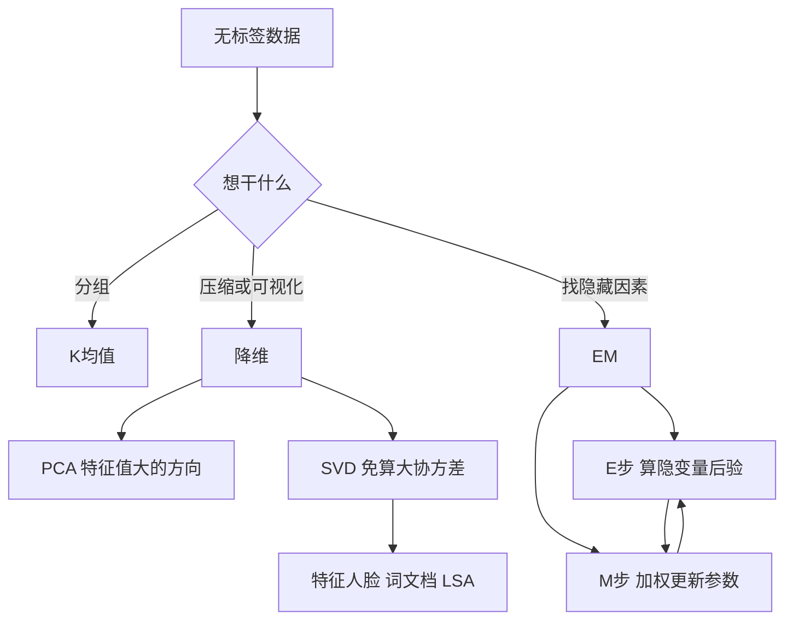

# 第 5 章：统计机器学习——无监督学习

- **难度**：★★★ | **预估学时**：5 小时 | **前置**：第 4 章（损失函数、内积）；本章开头的概率补讲

## 学习目标

学完本章，你能：

1. 手算两轮 K-means 的簇中心，并说出它对初始中心敏感在哪里。
2. 解释 PCA 为什么等价于"找方差最大的方向"，并说清方差、协方差、特征值三者的关系。
3. 用 SVD 说明特征人脸是怎么把一张图压成几十个数的。
4. 写出 EM 的 E 步和 M 步，并用二硬币例子算完一轮。
5. 说出 LSA 的"潜在语义"到底潜在哪儿。

## 一句话核心

无监督学习没有答案，只能靠数据自身的结构：**要么找"哪些点像"（聚类），要么找"哪个方向变化最大"（降维），要么猜"数据由哪些隐藏因素生成"（EM）**。

## 零基础讲解

### 概念 0：概率补讲——期望、方差、协方差（难度：基础）

- **期望**：按概率加权的平均。`E[X] = Σ p_i x_i`。
- **方差**：`Var(X) = E[(X - E[X])²]`，衡量数据离平均值有多散。方差大，说明波动大。
- **协方差**：`Cov(X,Y) = E[(X-E[X])(Y-E[Y])]`。两个量同向变化（一个高于均值时另一个也高）协方差为正，反向为负，无关接近 0。
- **相关系数**：协方差除以两个标准差，把量纲消掉，取值落在 −1 到 1。

记住一句话：**协方差矩阵描述"各个方向上的数据怎么散"**，PCA 就是在读这张矩阵。

### 概念 1：K 均值聚类——反复挪中心（难度：基础）

给一堆没有标签的点，要分成 k 组。算法只有两步，循环到不动为止：

1. **分配**：每个点算到 k 个中心的距离，归给最近的那个。
2. **更新**：每个簇重新算重心（组内所有点的平均），作为新中心。

**算例**：四个二维点 `(1,1)、(2,1)、(4,3)、(5,4)`，k=2，初始中心取 `(1,1)` 和 `(5,4)`。

第一轮分配：`(1,1)` 到 `(1,1)` 距离 0，到 `(5,4)` 距离 5，归簇 1；`(2,1)` 距离 1 对 4.24，归簇 1；`(4,3)` 距离 3.61 对 1.41，归簇 2；`(5,4)` 距离 5 对 0，归簇 2。

更新中心：簇 1 是 `((1+2)/2, (1+1)/2) = (1.5, 1)`；簇 2 是 `((4+5)/2, (3+4)/2) = (4.5, 3.5)`。

第二轮分配：`(2,1)` 到 `(1.5,1)` 距离 0.5，到 `(4.5,3.5)` 距离 3.9，仍归簇 1；`(4,3)` 到 `(4.5,3.5)` 距离 0.7，归簇 2。分配不变，**算法收敛**。

K-means 优化的目标叫**簇内平方和**：`Σ(每个点到它中心的距离平方)`。每一步都会让这个值下降或不变，所以一定收敛。但它只保证收敛到**局部最优**——初始中心选得不好，结果会差很多。实际工程里常用 k-means++ 让初始中心彼此尽量远，或者跑多次取最好的。

> 类比：把一群人按住址分组，先随便指定两个集合点，大家去最近的集合点报到，然后每组重新选一个"中心位置"，再报到一次，直到没人换组。
>
> 失效边界：它默认簇是"球形的、大小差不多"。遇到长条形、密度差别大的簇，或者 k 选错，结果会明显不合理。k 需要人为指定，通常用肘部法（看簇内平方和随 k 的拐点）或轮廓系数来选。

### 概念 2：主成分分析——把数据转到"最舒展"的方向（难度：进阶）

一张 100×100 的人脸图有 10000 个数。但人脸之间的差异其实集中在少数几个方向上（脸的胖瘦、光照方向、眉毛浓淡）。PCA 就是找出这些方向。

做法分四步：

1. 每个特征减去均值（**中心化**），让数据围绕原点。
2. 算协方差矩阵 `C`。如果是 10000 维，`C` 是 10000×10000——直接算很贵。
3. 求 `C` 的特征值和特征向量。特征向量是方向，特征值是"数据在这个方向上的方差"。
4. 取特征值最大的前 k 个方向，把数据投影上去。

**为什么是方差最大的方向？** 因为方差大意味着这个方向上的信息多、区分度强。沿着方差接近 0 的方向走，所有点几乎重合，投影上去等于白扔。

**算例**：三个点 `(0,0)、(1,1)、(2,2)`。均值 `(1,1)`，中心化后是 `(-1,-1)、(0,0)、(1,1)`。协方差矩阵（除以 n−1=2）：

```
C = [[1, 1],
     [1, 1]]
```

这个矩阵的特征值是 2 和 0，对应特征向量 `(1,1)/√2` 和 `(1,-1)/√2`。数据全落在 `(1,1)` 方向上，所以第一个主成分就解释了 100% 的方差，第二个方向上的方差是 0。

> 类比：一叠盘子斜着拍照片，看起来是一团模糊。把镜头转到盘子的正面，形状一下就清楚了——PCA 就是在找"正对镜头的那个角度"。
>
> 失效边界：PCA 是线性变换，只能转方向不能弯曲，遇到"瑞士卷"这种卷曲的数据结构就无能为力（这类要用流形学习）。另外它对量纲敏感，身高用厘米、体重用公斤，方差大的特征会霸占主成分，所以要先标准化。

### 概念 3：特征人脸——用 SVD 而不是硬算协方差（难度：进阶）

10000 维直接算协方差矩阵要 10000² 的内存，不现实。**奇异值分解**（SVD）绕开了这一步：

```
X = U Σ Vᵀ
```

X 是"每行一张人脸"的矩阵。`V` 的每一列就是一个"主方向"，在人脸场景里，这些方向看起来像一张模糊的脸，所以叫**特征人脸**（eigenface）。`Σ` 里的奇异值平方后正比于方差，按从大到小排，前几十个就够描述大部分差异。

一张人脸被压成"在这 50 个特征人脸上各占多少"的 50 个系数，这就是人脸的低维表示。识别时比较系数向量就行；重建时把系数乘回特征人脸再相加，得到一张近似的脸。

这也解释了一个常见现象：特征人脸重建出来的人脸通常"有点平均、有点模糊"，因为被丢掉的后几十个方向里，装的正是细节和噪声。

### 概念 4：潜在语义分析——词和文档的"隐形主题"（难度：进阶）

文档集合可以排成一个矩阵：行是词，列是文档，格子里是这个词在这篇文档里出现的次数（或 TF-IDF 权重）。这个矩阵又大又稀疏。

直接拿它算相似度有个毛病：两篇讲同一件事的文章，可能一个用"手机"、一个用"移动电话"，词完全不重叠，相似度为 0。

**LSA** 对词-文档矩阵做 SVD，只保留前 k 个奇异值对应的部分，得到三个矩阵的低维版本。在这个低维空间里，"手机"和"移动电话"会因为常常出现在相似的上下文里而被拉到相近的位置——这些方向就是**潜在语义**（topic）。"潜在"的意思是：它没有名字，不是人标的标签，而是从共现统计里自己浮出来的。

> 类比：把一堆文章压成一锅汤，词是食材，主题是味道。你说不清这锅汤是什么味，但两锅用相似食材熬的汤，味道就是接近。

### 概念 5：期望最大化——有隐藏变量时怎么估参数（难度：高难）

先看问题。**二硬币模型**：有两枚硬币 A 和 B，偏置（正面概率）θ_A、θ_B 都未知。做了 5 轮实验，每轮**随机取一枚**（但没记录取的是哪枚），投 10 次，记录正面次数：3、9、8、2、7。问 θ_A、θ_B 各是多少。

难在"每轮用的是哪枚"不知道。这是一个**隐变量**。EM 的处理方式是：不知道就先猜，猜完再修正。

- **E 步**（期望）：用当前参数，算每轮数据"来自 A 的概率"。这个概率叫**responsibility** γ。
- **M 步**（最大化）：把 γ 当作权重，加权统计 A 和 B 各自的正面比例，更新参数。

`γ` 的算法是贝叶斯公式：`γ_i = P(数据_i | A) / (P(数据_i | A) + P(数据_i | B))`，其中投 10 次得 h 次正面的概率是 `θ^h (1-θ)^(10-h)`。

**算完一轮**（初始 θ_A=0.55、θ_B=0.75）：

| 轮 | 正面数 | γ（来自 A 的概率） |
|---|---|---|
| 1 | 3 | 0.96 |
| 2 | 9 | 0.10 |
| 3 | 8 | 0.21 |
| 4 | 2 | 0.98 |
| 5 | 7 | 0.40 |

M 步：把每轮的正面数按 γ 加权，A 的正面数合计 `0.960×3 + 0.099×9 + 0.213×8 + 0.983×2 + 0.400×7 = 10.244`，A 承担的总投掷数 `(0.960+0.099+0.213+0.983+0.400)×10 = 26.557`，所以 `θ_A = 10.244/26.557 ≈ 0.386`。同法算 B：正面数 18.756、投掷数 23.443，`θ_B ≈ 0.800`。

继续迭代会稳定在 **θ_A ≈ 0.254、θ_B ≈ 0.800**，γ 收敛到接近 1、0、0、1、0.02——也就是说，第 1、4 轮几乎确定是 A，第 2、3 轮几乎确定是 B，第 5 轮仍然模糊。

> 一个必须知道的坑：如果两个初始值设成一样（比如都是 0.6），γ 会一直等于 0.5，参数永远不动，停在对称点上。EM 和 K-means 一样，只保证局部最优，初始值必须打破对称。

**三硬币模型**是同一个套路的升级版：先掷 A，正面就用 B、反面就用 C，只观测到最后是正是反。隐藏的是"中间用了哪枚"。E 步算"这枚硬币被选中的概率"，M 步按概率加权更新三枚硬币的偏置。书里用它说明：观测数据不变，隐变量假设不同，估出来的参数就不同。

**一般形式**：设观测数据 X、隐变量 Z、参数 θ。EM 在每轮做两件事——

- E：算隐变量的后验 `Q(Z) = P(Z|X, θ_old)`
- M：最大化 `Σ Q(Z) log P(X,Z|θ)`，得到 θ_new

可以证明每一步都不会让对数似然变小，所以一定收敛。但它收敛到的是局部极大，不是全局最优。

## 图示



看图说明：三条分支对应三种"结构"——分组结构、方向结构、生成结构。K-means 和 EM 都有"先猜后修"的循环，所以都有局部最优和初值敏感的问题；PCA 是一次性线性变换，没有迭代，但要求数据是线性可分的结构。

## 类比与实例

**类比**：K-means 像室友按宿舍楼分组；PCA 像把一摞歪着拍的照片摆正；LSA 像从一堆文章里闻出"这几篇在讲同一件事"；EM 像侦探先假设嫌疑人是谁，再按这个假设去找证据，证据又反过来修正假设。

失效边界：室友分组假设"离得近就是一伙"；摆正照片只能旋转不能拉伸；闻味道会被高频常见词干扰；侦探的初始假设错了会一路错到底。

**实例**（K-means 与 PCA 的关系）：把 K-means 的簇中心看成一组"代表点"，它其实也在做一种压缩——用 k 个点代表全部数据。但它的目标是最小化重构误差，不是最大化方差，所以两者结果常常不同。PCA 降维后再 K-means，通常比直接 K-means 更稳，因为噪声方向被丢掉了。

## 常见误解

- **别以为 K-means 一定能找到最好的分法。** 它只保证局部最优。工程上跑 10 次取簇内平方和最小的那次，成本很低。
- **别以为 k 能自动确定。** 没有通用准则。肘部法看拐点、轮廓系数看"簇内紧不紧、簇间远不远"，都需要人判断。
- **别以为 PCA 丢掉的是"没用的信息"。** 丢掉的是方差小的方向，但方差小不等于不重要——如果任务恰恰要看这个细微差别（比如缺陷检测），PCA 会把关键信号扔掉。
- **别以为 EM 一定收敛到正确解。** 它可能停在对称点或局部极大。多组初值、多次重启是常规做法。
- **别以为 LSA 的主题有名字。** 它给出的是方向，需要人去看这个方向上权重最高的词，才能给它起个名字。

## 自测题

1. **计算**：四个点 `(1,1)、(2,1)、(4,3)、(5,4)`，k=2，初始中心 `(1,1)`、`(5,4)`。第一轮更新后，两个中心分别在哪？
   **答案**：`(1.5, 1)` 和 `(4.5, 3.5)`。解析：前两点归第一个中心（距离 0 和 1，另一中心距离 5 和 4.24），后两点归第二个中心。重心取组内平均。

2. **填空**：PCA 中协方差矩阵的特征值代表________，特征向量代表________。
   **答案**：数据在该方向上的方差大小；投影方向。

3. **单选**：二硬币 EM 例子中，γ 在第 2 轮（正面数 9）上的值约为 0.10，说明什么？
   - A. 这一轮几乎肯定用的是 A
   - B. 这一轮几乎肯定用的是 B
   - C. 这一轮两枚硬币各用了一半
   - D. 数据有错
   **答案**：B。解析：γ 是"来自 A 的概率"，0.10 表示来自 A 的可能性很小，即大概率是 B。

4. **简答**：为什么特征人脸要用 SVD 而不是直接对协方差矩阵做特征分解？
   **答案**：一张 100×100 的图有 10000 维，协方差矩阵是 10000×10000，内存和计算都不可行。SVD 直接分解数据矩阵 X（行数远小于列数时可以转成对 XᵀX 或 XXᵀ 的小矩阵分解），代价降到可接受的范围，结果与特征分解等价。

5. **多选**：下列关于 EM 的说法，正确的有：
   - A. 每一步迭代都不会让似然变小
   - B. 它一定能找到全局最优
   - C. 初值相同会导致停在对称点
   - D. E 步计算的是隐变量的后验
   **答案**：A、C、D。解析：B 错，EM 只保证局部最优。

## 复习锚点

- K-means 两步循环：分配、更新；收敛到局部最优，初值敏感。
- PCA 找方差最大的方向；协方差矩阵的特征值＝方差，特征向量＝方向。
- SVD 让高维 PCA 变得可算；特征人脸是 V 的列。
- LSA 在低维空间让"同义不同词"靠近，主题没有名字。
- EM：E 步算 γ，M 步加权更新；局部最优，初值要打破对称。
