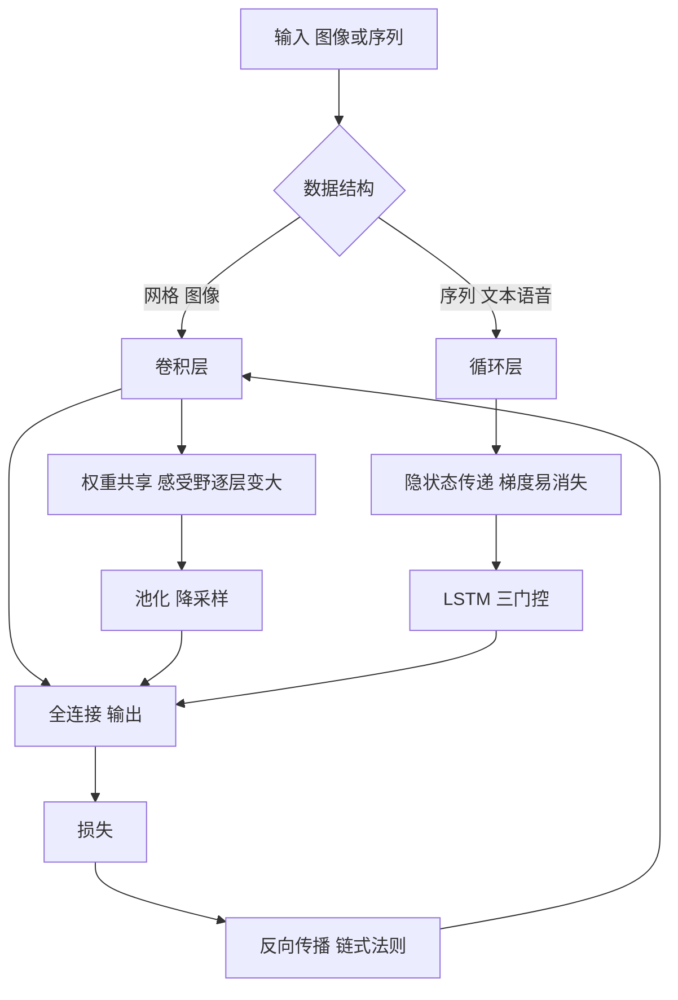

# 第 6 章：深度学习

- **难度**：★★★ | **预估学时**：6 小时 | **前置**：第 4 章（损失、过拟合）、第 5 章（降维）；本章开头的导数补讲

## 学习目标

学完本章，你能：

1. 画出前馈网络的一层结构，说清权重、偏置、激活函数各干什么。
2. 用链式法则手推一个单神经元的梯度，并解释学习率过大过小各会出什么事。
3. 手算一次 3×3 输入配 2×2 卷积核的输出，并用公式算出输出尺寸。
4. 说出 RNN 为什么会有梯度消失，LSTM 的三个门各自管什么。
5. 解释 GAN 的"对抗"是怎么写进一个目标函数里的。

## 一句话核心

深度学习的全部工作可以压缩成一句话：**用一串可微的变换把输入逐层变形，再用链式法则把误差一层层传回去改参数**。卷积、循环、注意力都是在"怎么变形"上做文章。

## 零基础讲解

### 概念 0：导数、梯度、链式法则（难度：基础，必须补）

- **导数**：函数在某一点的"变化速度"。`y = 3x` 的导数是 3，意思是 x 增加 1，y 增加 3。
- **梯度**：多元函数的导数，是一个向量，指向"函数值上升最快的方向"。想让它下降，就往梯度的**反方向**走。
- **链式法则**：复合函数求导，外层导数乘内层导数。`y = (2x+1)²` 的导数是 `2(2x+1)×2 = 8x+4`。神经网络一层套一层，全靠这条法则把误差传回去。

记住一个直觉：梯度是"往哪儿走会让损失变大"的指示牌，训练就是照着指示牌的反方向走一小步，再重新看牌。

### 概念 1：从感知机到多层网络（难度：基础）

**感知机**是最早的神经元模型：输入乘权重、加起来、过一下阈值，输出 0 或 1。

```
输出 = 阶跃( w·x + b )
```

单个感知机能画一条直线做二分类。它的局限在 1969 年被明斯基点破：**异或问题**分不了。异或的四组输入 `(0,0)→0、(0,1)→1、(1,0)→1、(1,1)→0` 在平面上不是一个半平面能切开的。这个批评让神经网络冷了十几年。

解法是"加一层"。两层网络先在第一层把输入映射到新的空间，第二层再切——异或在新空间里就线性可分了。

**激活函数**是非线性的关键。如果只有线性层，多层叠起来还是线性的（`W₂(W₁x) = (W₂W₁)x`），等于没加。常用的三个：

| 函数 | 式子 | 特点 |
|---|---|---|
| Sigmoid | `1/(1+e^(-z))` | 压到 0—1，两端梯度接近 0，深层容易"梯度消失" |
| Tanh | `(e^z - e^(-z))/(e^z + e^(-z))` | 压到 −1—1，零中心，仍有饱和问题 |
| ReLU | `max(0, z)` | 正区间梯度恒为 1，计算便宜，深层网络的主流选择 |

**万能逼近定理**说：只要隐层足够宽，两层网络能以任意精度逼近任意连续函数。这句话解释了"为什么深度网络什么都能学"，但它只管"存在性"，不管"能不能训出来"——后者才是深度学习真正的难点。

### 概念 2：参数优化与反向传播（难度：高难）

训练就是最小化损失 `L`。**梯度下降**的更新规则只有一行：

```
w_new = w_old − 学习率 × ∂L/∂w
```

**反向传播**是算这个偏导的方法。它利用链式法则，从输出层往输入层倒着算：先算损失对最后一层输出的导数，再乘上这一层对上一层的导数，一路传回去。

**手算一个例子**：单输入 x=1，单权重 w=2，无偏置，目标 y=3，损失用平方误差 `L = (wx - y)² / 2`。

- 预测值 `ŷ = 2×1 = 2`，误差 `ŷ − y = −1`
- `∂L/∂ŷ = ŷ − y = −1`
- `∂ŷ/∂w = x = 1`
- `∂L/∂w = −1 × 1 = −1`

学习率取 0.1：`w_new = 2 − 0.1×(−1) = 2.1`。再算一轮，`ŷ = 2.1`，误差 −0.9，梯度 −0.9，`w = 2.19`。会一步步逼近 3。

**学习率**的坑很直观：太大，一步跨过最低点，损失来回震荡甚至发散；太小，走得像蜗牛，训练几天没进展。工程上的常用做法是先试几个值（0.1、0.01、0.001），或者用 Adam 这类自适应方法，给每个参数单独调步长。

**为什么必须用 BP 而不是数值求导？** 一个网络有几百万个参数，逐个"加一点看变化"要算几百万次前向；BP 一次前向加一次反向就得到全部梯度，代价是常数倍。

### 概念 3：卷积神经网络——用"同一把尺子"扫全图（难度：高难）

全连接层处理图像有个致命问题：一张 224×224×3 的图有 15 万个输入，接 1000 个神经元就是 1.5 亿个权重。而且它把每个像素位置都当成独立特征，丢掉了"相邻像素相关"这个先验。

**卷积**换了个思路：拿一个小窗口（卷积核）在图上滑动，每个位置做一次内积。同一把尺子扫全图，参数就共享了——这就是**权重共享**，参数量从"像素数×神经元数"降到"核大小×通道数"。

**算例**：输入 3×3，卷积核 2×2，步长 1，不补零。

```
输入            卷积核          输出
1 2 3           0 1            6  8
4 5 6           1 0           12 14
7 8 9
```

逐位算：左上角 `1×0 + 2×1 + 4×1 + 5×0 = 6`；右上角 `2×0 + 3×1 + 5×1 + 6×0 = 8`；左下 `4×0+5×1+7×1+8×0 = 12`；右下 `6+8 = 14`。

**输出尺寸公式**（务必记住）：

```
输出边长 = (输入边长 − 核边长 + 2×补零) / 步长 + 1
```

本例 `(3 − 2 + 0)/1 + 1 = 2`，输出 2×2。

**池化**是降采样：2×2 最大池化就是"每四个格子取最大"，把图缩一半，减少计算量并让模型对小幅平移不敏感。

**感受野**：输出上一个点，对应输入上的一块区域。层数越深，感受野越大——浅层看边缘和颜色，深层看眼睛、轮子这种部件，最后看整张脸、整辆车。这个"从局部到整体"的层级结构，是 CNN 在图像上成功的关键先验。

### 概念 4：循环神经网络——处理有顺序的输入（难度：高难）

一句话有 20 个词，词与词的顺序有意义。全连接层把每个词独立处理，丢掉了顺序。

**RNN** 加了一个"记忆"：每个时刻的隐状态由"当前输入"和"上一时刻的隐状态"共同决定。

```
h_t = 激活( W_x x_t + W_h h_{t-1} + b )
```

把它按时间展开，就是一条很深的链。**梯度消失**就出在这条链上：反向传播要连乘很多个 `W_h`，如果它的奇异值都小于 1，梯度指数级衰减，远处的信息传不回来——模型记不住开头发生了什么。

**LSTM** 用三个"门"来控制信息流：

| 门 | 作用 | 直觉 |
|---|---|---|
| 遗忘门 | 决定旧记忆保留多少 | 擦掉不重要的旧笔记 |
| 输入门 | 决定新信息写入多少 | 记下关键的新事实 |
| 输出门 | 决定当前对外输出多少 | 只把该说的说出来 |

门本身是 Sigmoid 输出 0—1 的"开关"，乘以信息就是"保留比例"。这条**门控**思路让梯度能沿着"记忆单元"较平稳地传很远。

### 概念 5：生成式深度学习——让两个网络互相为难（难度：高难）

判别模型学 `P(y|x)`，生成模型学 `P(x)`——怎么造出像样的数据。

**GAN** 用两个网络：**生成器** G 把随机噪声变成假样本，**判别器** D 判断"这是真的还是假的"。训练目标是

```
min_G max_D  E[log D(真)] + E[log(1 − D(G(噪声)))]
```

读法：D 想让"真样本判真、假样本判假"的概率最大；G 想让"假样本被判真"的概率最大，也就是让 D 出错。两者互相拆台，最后 G 造出的样本以假乱真，D 只能瞎猜（输出 0.5）。

> 类比：造假币的和验钞的。验钞的越厉害，造假币的就越得升级工艺；到最后验钞机也分不出来，说明假币做得足够真。
>
> 失效边界：这个"猫鼠游戏"很容易失衡。D 太强，G 拿不到有效梯度，学不动；G 太强，D 判什么都对、什么都错，训练震荡。所以实际训练要小心调两者的学习节奏。

**条件 GAN** 多给一个条件（比如"生成数字 7"），让生成可控。**对抗样本**是另一个方向：给一张图加上人眼几乎看不出的扰动，模型就会判错——这说明模型的决策边界离数据太近，是安全问题而不只是好玩。

### 概念 6：深度学习的应用（难度：进阶）

- **词向量**：把词映射成稠密向量，让"国王 − 男人 + 女人 ≈ 女王"这种语义关系变成向量加减。它是第 8 章语言模型的起点。
- **图像分类与目标定位**：分类回答"是什么"，定位回答"在哪"，检测是"有哪些、各在哪"。三者共用卷积主干，后接不同的头。
- **迁移学习**：在大数据集上预训练的主干，换到小数据集上只微调最后几层，往往比从头训练好得多。原因是浅层学到的是边缘、纹理这类通用特征。

## 图示



看图说明：这张图左边是两种数据对应的两种"变形方式"，右边收束到同一个训练循环。要注意的是，无论卷积还是循环，最后都回到"损失 → 反向传播 → 更新参数"这一条主线，深度学习没有第二种训练机制。

## 类比与实例

**类比**：卷积像拿一个放大镜在图上逐块扫，扫到哪儿都用同一片镜片；池化像把大图缩小，细节丢了但轮廓还在；RNN 像读小说时边读边记笔记，读到后面靠笔记回忆前面；Attention 后来居上，像不记笔记而是随时翻回原文任意一页。

失效边界：放大镜只适合"局部模式在各处通用"的图，人脸朝下、文字旋转这类变换需要数据增强；池化丢的细节有时正是关键（医学影像的小病灶）；RNN 的笔记容量有限，很长文档会忘。

**实例**（参数量对比）：224×224×3 的图接 1000 个全连接神经元，权重数 `224×224×3×1000 ≈ 1.5 亿`。换成 3×3×32 的卷积核，权重只有 `3×3×3×32 = 864` 个。差了五个数量级——这就是 CNN 能用小数据训起来的原因。

## 常见误解

- **别以为"深"就是层数越多越好。** 层数增加会带来梯度消失、退化问题。ResNet 用"跳连接"把输入直接加到输出上，才让上百层可训。
- **别以为卷积只能处理图像。** 一维卷积处理音频、文本，三维卷积处理视频和医学体数据，本质都是"局部窗口 + 权重共享"。
- **别以为 GAN 的损失降下去就成功了。** 两个网络的损失同时震荡是常态，判断好坏要看生成样本的质量和多样性，不能只看数值。
- **别以为反向传播是"智能"。** 它只是高效的求导方法，和大脑的学习机制没有直接对应关系。
- **别以为加了 Batch Normalization 就一定更快收敛。** 它确实稳定训练，但对小 batch 或序列数据会引入额外问题，不是万能药。

## 自测题

1. **计算**：输入 3×3、卷积核 2×2、步长 1、不补零，输出尺寸是多少？用例子里的核 `[[0,1],[1,0]]`，输出左上角的值是多少？
   **答案**：2×2；值是 6（`1×0+2×1+4×1+5×0`）。

2. **填空**：若只用线性激活函数，多层网络等价于________；这就是必须引入非线性激活的原因。
   **答案**：一层线性变换（矩阵乘法的复合仍是矩阵乘法）。

3. **简答**：为什么 RNN 会出现梯度消失，LSTM 靠什么缓解？
   **答案**：RNN 反向传播要沿时间连乘权重矩阵，谱半径小于 1 时梯度指数衰减；LSTM 用遗忘门/输入门构成的"记忆单元"给梯度提供了一条近似恒等的传递路径，门控还能主动选择保留或擦除，减缓衰减。

4. **多选**：下列哪些说法正确？
   - A. 卷积的权重共享大幅减少了参数量
   - B. 池化会增大概的感受野
   - C. GAN 的判别器目标是让假样本判真
   - D. 对抗样本说明模型决策边界离数据太近
   **答案**：A、B、D。解析：C 反了，判别器要区分真假，生成器才想让假样本被判真。

5. **计算**：单输入 x=1、w=2、目标 y=3，损失 `(wx−y)²/2`，学习率 0.1。第一次更新后 w 是多少？
   **答案**：2.1。解析：梯度 `(ŷ−y)x = −1`，`w = 2 − 0.1×(−1) = 2.1`。

## 复习锚点

- 深度学习＝可微变换堆叠 + 链式法则回传。
- 激活函数提供非线性；ReLU 是深层网络的默认选择。
- 卷积三件套：局部窗口、权重共享、池化；输出尺寸公式要背。
- RNN 的记忆靠隐状态，梯度消失靠门控缓解。
- GAN 是一个 min-max 博弈，训练平衡比目标函数更重要。
