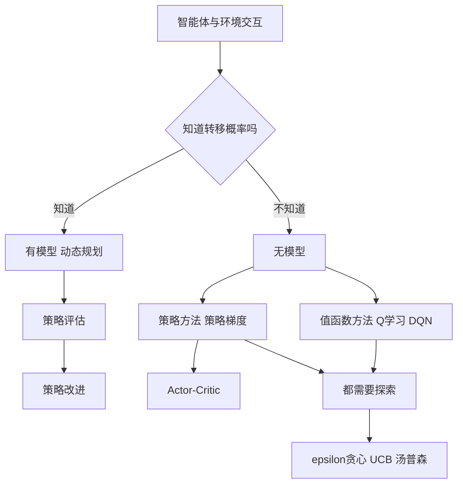

# 第 7 章：强化学习

- **难度**：★★★ | **预估学时**：5 小时 | **前置**：第 4 章（损失、概率）、第 2 章（期望）

## 学习目标

学完本章，你能：

1. 写出马尔可夫决策过程的五个要素，并解释折扣因子 γ 在算什么账。
2. 写出贝尔曼期望方程和贝尔曼最优方程，说清两者差在哪。
3. 手算一次 Q 学习的更新，并解释它为什么能在不知道环境模型的情况下学。
4. 说清"探索与利用"的矛盾，并用 ε-greedy 给出一个可执行的折中。
5. 解释策略梯度和值函数方法的核心区别，以及 Actor-Critic 为什么把两者合起来。

## 一句话核心

强化学习解决的是"动作做完才知道好坏"的问题：它不学"这个输入对应什么答案"，而学"在这个状态下，做哪个动作长期回报最高"。

## 零基础讲解

### 概念 1：五个要素（难度：基础）

| 要素 | 记号 | 含义 | 例子（走迷宫） |
|---|---|---|---|
| 状态 | s | 当前处境 | 在第 3 行第 5 列 |
| 动作 | a | 能做的事 | 上下左右 |
| 奖励 | r | 动作后的即时评分 | 走到出口 +1，撞墙 −0.1 |
| 状态转移 | P(s'|s,a) | 做完动作会到哪儿 | 大概率按方向走，小概率滑一下 |
| 折扣因子 | γ | 未来奖励打几折 | 0.9 表示下一步的 1 分只值 0.9 |

**折扣因子为什么存在？** 两个理由。数学上，它让无穷长的回报和收敛（`1 + γ + γ² + … = 1/(1−γ)`）。直觉上，它表达"现在的糖比明天的糖甜"——延迟越久的奖励越不确定，值越低。γ=0 变成只顾眼前，γ 接近 1 变成很有耐心。

**策略** π 是"在状态 s 下选动作 a 的规则"。强化学习的最终产物就是一个策略。

**价值函数**回答"这个状态有多好"：

```
V(s) = 从 s 出发，按策略 π 走，能拿到的折扣累计奖励的期望
Q(s,a) = 在 s 先做 a，之后按 π 走，能拿到的期望
```

V 和 Q 的关系是 `V(s) = max_a Q(s,a)`（对最优策略而言）。

### 概念 2：马尔可夫决策过程与贝尔曼方程（难度：进阶）

**马尔可夫性**：下一步只取决于当前状态和动作，与之前的历史无关。"现在在哪儿"已经包含了决策所需的全部信息。

**贝尔曼期望方程**把"长期回报"拆成"当下奖励 + 折扣后的未来"：

```
V(s) = Σ_a π(a|s) Σ_s' P(s'|s,a) [ r + γ V(s') ]
```

**贝尔曼最优方程**则把"按策略走"换成"挑最好的动作"：

```
V*(s) = max_a Σ_s' P(s'|s,a) [ r + γ V*(s') ]
```

差别的关键在 `max`：期望方程评价"给定策略"，最优方程求"最好的策略"。前者是线性方程组，后者是非线性的，需要迭代。

**算例**：两个状态 A、B，走到 B 再走到终点得 1 分，γ=0.9。终点价值 0。

- `V(B) = 0 + 0.9 × 1 = 0.9`（B 走一步到终点，拿 1 分）
- `V(A) = 0 + 0.9 × V(B) = 0.81`

如果 A 离终点三步，价值就是 `0.9³ = 0.729`。**距离越远，折扣吃掉的越多**——这就是"奖励稀疏"时远处的信号传不回来的数学原因。

**策略评估**就是反复套用贝尔曼方程直到数值不再变（**值迭代**），或者"评估当前策略 → 按新价值改进策略 → 再评估"（**策略迭代**）。两者都要求知道转移概率 P，属于"有模型"的方法。

### 概念 3：Q 学习——不知道模型也能学（难度：高难）

现实里往往不知道 `P(s'|s,a)`。Q 学习用"试一次看看"替代"算期望"：

```
Q(s,a) ← Q(s,a) + α [ r + γ max_a' Q(s',a') − Q(s,a) ]
```

方括号里那项叫 **TD 误差**（时序差分误差）：`实际拿到的 r + 对未来的估计` 减去 `原来的估计`。α 是学习率，控制"新信息覆盖旧估计的比例"。

**算例**：某状态动作对的旧 Q 值是 0.2，做完动作拿到奖励 0，到了新状态 s'，s' 上最大的 Q 是 0.5，γ=0.9，α=0.1。

- TD 目标 `= 0 + 0.9×0.5 = 0.45`
- TD 误差 `= 0.45 − 0.2 = 0.25`
- 新 Q `= 0.2 + 0.1×0.25 = 0.225`

一次更新只挪一点点，反复更新才会收敛。这就是"自举"（bootstrap）：用一个估计去更新另一个估计。

Q 学习是 **off-policy** 的：它学的是"最优动作的价值"，但实际用来采数据的策略可以是带随机探索的。这个分离让它能从旧数据里学，是 DQN 能用**经验回放**的前提。

### 概念 4：探索与利用（难度：进阶）

- **利用**：按当前估计选最好的动作。短期收益高，但可能一直困在一个还不错的动作上，错过真正更好的。
- **探索**：试一些当前看起来一般的动作。短期吃亏，长期可能发现新大陆。

**ε-greedy** 是最简单的折中：以 ε 的概率随机选，以 1−ε 的概率选当前最优。ε 通常从大变小（前期多探索，后期多利用）。

更精细的做法是"不确定性大的地方多探索"。**UCB** 用访问次数作为不确定性的代理（第 3 章的 MCTS 用的就是它）；**汤普森采样**则维护每个动作的收益分布，从分布里采样来决定选谁。

> 类比：常去的餐馆和没去过的餐馆。一直去常去的（利用），可能永远错过更好吃的；每次随机进一家（探索），可能踩很多坑。ε-greedy 是"十次里有九次去老地方，一次随便进"。
>
> 失效边界：ε-greedy 的探索是"瞎试"，不看哪里更值得试。动作空间很大时（比如推荐系统有百万个物品），瞎试的效率极低。

### 概念 5：参数化与深度强化学习（难度：高难）

状态一多（比如围棋有 10^170 种局面），表格存不下 Q 值，只能用神经网络近似 `Q(s,a; θ)`。这就是 **DQN**。

DQN 有三个关键设计：

1. **经验回放**：把 `(s, a, r, s')` 存进缓冲区，训练时随机抽一批。作用是打破前后样本的相关性——连续走棋的样本高度相似，直接拿去训练会让网络"遗忘"旧经验。
2. **目标网络**：用一个更新较慢的网络算 TD 目标，避免"自己追自己"造成震荡。
3. **奖励裁剪**：把奖励压到 −1 到 1，稳定不同游戏间的尺度差异。

### 概念 6：策略梯度（难度：高难）

值函数方法先学 Q，再间接得到策略；策略梯度直接参数化策略 `π(a|s; θ)`，然后沿"让回报变大"的方向调 θ。

**策略梯度定理**给出的更新方向是：

```
∇J = E[ ∇log π(a|s; θ) × 回报 ]
```

读法：如果一个动作带来的回报高于平均水平，就提高它在那个状态下被选中的概率；低于平均就降低。`log π` 的梯度提供了"往哪个方向调参数能让这个动作更容易被选中"。

**REINFORCE** 是最朴素的做法：跑完一整局，用实际回报更新。缺点是方差极大——同一策略跑两局，回报可能差很多。常见降方差手段是减一个**基线**（比如用状态价值 V(s) 作基准），只保留"比预期好多少"这部分信号。

**Actor-Critic** 把两者合起来：Actor 是策略网络，负责选动作；Critic 是价值网络，负责评价"这个动作比预期好多少"，并把这份评价作为 Actor 的更新信号。Critic 降低了方差，Actor 提供了连续可调的策略。

> 类比：Actor 是演员，Critic 是影评人。演员按影评的反馈改表演风格，影评人也在学习怎么评得更准。

## 图示



看图说明：第一层分叉是"有没有环境模型"，第二层分叉是"学值还是学策略"。最下面一层是共通的：只要是无模型方法，就绕不开探索，否则策略会锁死在当前估计最好的动作上。

## 类比与实例

**类比**：强化学习像教狗。它听不懂"坐下"的抽象含义，但你每次它坐下就给零食、乱跑就不给，几十次之后它就把"坐下"和"零食"连起来了。γ 是"零食给得越晚，它越不当回事"。

失效边界：狗的训练反馈是即时的，强化学习常常奖励延迟几千步；狗能试的动作有限，机器人或推荐系统的动作空间巨大；狗不会因为一次错误就永久学会错误，而神经网络会。

**实例**（折扣的总账）：γ=0.9 时，未来 10 步的奖励总和上限是 `(1−0.9¹⁰)/(1−0.9) ≈ 6.51`。也就是说，"一直每步拿 1 分"的总价值也就 10 分左右，不会无限大。γ 越接近 1，模型看得越远，但方差也越大、收敛越慢。

## 常见误解

- **别以为 Q 学习一定要知道环境怎么转移。** 正相反，它就是为"不知道模型"设计的，靠采样估计期望。
- **别以为奖励设计是小事。** 奖励写错，智能体会找到你没想到的漏洞。比如"清理房间"给"捡起垃圾"加分，它可能把垃圾捡起来再扔下去，反复刷分。
- **别以为 DQN 只是"Q 学习加个网络"。** 没有经验回放和目标网络，Q 学习配神经网络几乎不收敛。这两个设计是工程上的关键。
- **别以为策略梯度比 Q 学习更高级。** Q 学习样本效率通常更高（能从旧数据学），策略梯度更适合连续动作和高维动作空间，各有适用面。
- **别以为 γ=1 总是更好。** 没有终止的任务里 γ=1 会让回报不收敛，价值估计发散。

## 自测题

1. **计算**：γ=0.9，B 走到终点得 1 分，A 走到 B 不得分。V(B) 和 V(A) 各是多少？
   **答案**：V(B)=0.9，V(A)=0.81。解析：V(B)=0+0.9×1；V(A)=0+0.9×V(B)。

2. **计算**：Q(s,a)=0.2，r=0，γ=0.9，s' 上最大 Q 为 0.5，α=0.1。更新后 Q 是多少？
   **答案**：0.225。解析：TD 目标 0.45，误差 0.25，`0.2+0.1×0.25=0.225`。

3. **填空**：贝尔曼期望方程与最优方程的关键差别是后者含________操作。
   **答案**：`max`（对动作取最大）。

4. **简答**：经验回放为什么能帮助 DQN 收敛？
   **答案**：连续采集的样本高度相关，直接训练会让网络在当前局面上过拟合、冲掉之前学到的经验；随机抽取历史样本能打破相关性，让每批数据的分布更接近整体，同时提高样本利用率。

5. **多选**：下列哪些属于"探索"策略？
   - A. ε-greedy 以 ε 概率随机选动作
   - B. 始终选当前 Q 最大的动作
   - C. UCB 优先选访问次数少的动作
   - D. 汤普森采样从后验分布中采样动作
   **答案**：A、C、D。解析：B 是纯利用，会锁死在当前估计最优的动作上。

## 复习锚点

- 五要素：状态、动作、奖励、转移、折扣；策略是产物，价值是中间量。
- 贝尔曼方程把长期回报拆成"当下 + 折扣未来"；最优方程多了 max。
- Q 学习 = 用采样替代期望，TD 误差驱动更新，off-policy。
- 探索与利用是根本矛盾；ε-greedy 是最简折中。
- 策略梯度直接调策略概率；Actor-Critic 用 Critic 降方差。
