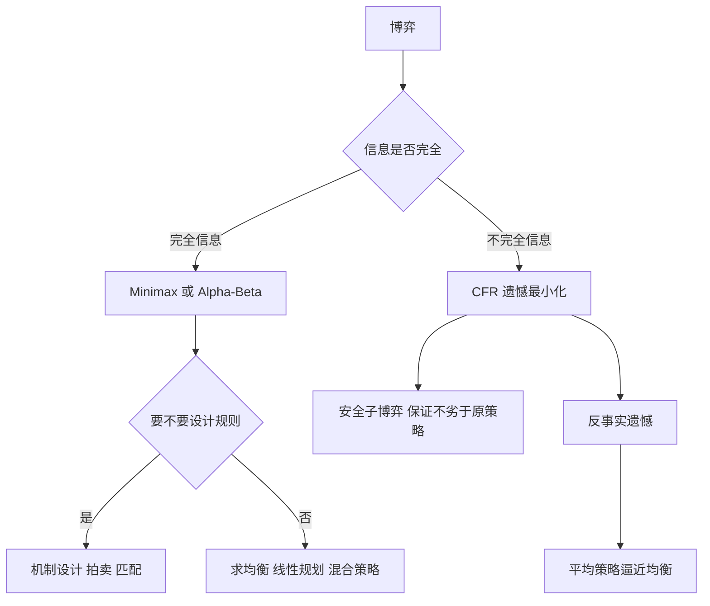

# 第 8 章：人工智能博弈

- **难度**：★★★ | **预估学时**：4 小时 | **前置**：第 3 章（Minimax、MCTS）、第 7 章（策略与价值）

## 学习目标

学完本章，你能：

1. 用囚徒困境说清"个人理性"和"集体最优"为什么会冲突。
2. 在一个 2×2 零和矩阵博弈里手算混合策略纳什均衡。
3. 说清虚拟遗憾最小化（CFR）为什么能处理不完全信息博弈。
4. 解释"安全子博弈"要解决什么工程问题。
5. 说出拍卖与匹配设计里，"激励相容"是什么意思。

## 一句话核心

博弈是"环境的另一部分也在学习"的强化学习；它最核心的解概念是纳什均衡——**没有人能靠单方面改变策略而获益**的状态。麻烦在于：均衡常常难算，对手常常不理性。

## 零基础讲解

### 概念 1：博弈的四个分类维度（难度：基础）

| 维度 | 两种取值 | 含义 | 例子 |
|---|---|---|---|
| 收益关系 | 零和 / 非零和 | 一方所得是否等于另一方所失 | 棋类零和；合作创业非零和 |
| 信息 | 完全 / 不完全 | 是否能看到对方的全部状态与收益 | 象棋完全；扑克不完全 |
| 决策顺序 | 同时 / 序贯 | 是一起出招还是轮流 | 猜硬币同时；下棋序贯 |
| 合作 | 合作 / 非合作 | 是否允许结盟与约束性协议 | 拍卖非合作；联合投标合作 |

「完全信息」容易和「完美信息」搞混：完全指"规则和收益都公开"，完美指"当前局面都看得见"。象棋两者都是，扑克是完全信息（规则公开）但不完美信息（手牌看不到）。书里讨论的德州扑克就属于这种。

### 概念 2：囚徒困境与纳什均衡（难度：基础）

两个嫌疑人分开审讯。都沉默各判 1 年；一个招供一个沉默，招的释放、沉默的判 5 年；都招各判 3 年。收益矩阵（负数表示刑期）：

| | 乙沉默 | 乙招供 |
|---|---|---|
| 甲沉默 | (−1, −1) | (−5, 0) |
| 甲招供 | (0, −5) | (−3, −3) |

甲的想法：如果乙沉默，我招供得 0 年比 1 年好；如果乙招供，我招供得 3 年比 5 年好。所以无论乙怎么做，招供都更优。乙的推理完全对称。结果两人都招，各 3 年——比都沉默（各 1 年）差得多。

这叫**纳什均衡**：给定对方的策略，没有任何一方能通过单方面改变自己的策略获得更高收益。(招供, 招供) 就是均衡。注意它不等于"最优结果"，囚徒困境的全部张力就在这里。

> 类比：剧场里第一排站起来看得更清楚，于是第二排也站起来，最后全场都站着，谁也没比坐着看得多。
>
> 失效边界：纳什均衡假设双方理性、且都知道对方理性。人会在意名誉、会有报复心理，行为经济学的实验结果经常偏离均衡预测。

### 概念 3：混合策略——用概率出招（难度：进阶）

有些博弈没有纯策略均衡。猜硬币：我出正面你猜正面，你赢；我出反面你猜反面，你赢——不管怎么定，对方都能针对。

解法是把策略变成概率分布，让对手**无法针对**。**混合策略纳什均衡**就是这个"无法被针对"的概率组合。

**算例**：零和博弈，行玩家的收益矩阵（列玩家收益取反）：

| | 列选左 | 列选右 |
|---|---|---|
| 行选上 | 3 | 0 |
| 行选下 | 0 | 1 |

设行玩家选"上"的概率为 p，列玩家选"左"的概率为 q。行的期望收益：

```
E = 3pq + 0·p(1−q) + 0·(1−p)q + 1·(1−p)(1−q)
  = 4pq − p − q + 1
```

对 p 求偏导得 `4q − 1`，令其为 0 得 `q = 0.25`；对 q 求偏导得 `4p − 1`，令其为 0 得 `p = 0.25`。

均衡是双方各以 1/4 的概率选"上"和"左"，博弈值 `E = 4×0.0625 − 0.25 − 0.25 + 1 = 0.75`。验算：行玩家固定 p=0.25 时，无论 q 取多少，`E = q − 0.25 − q + 1 = 0.75`，恒定——这正是"无法被针对"的意思。

**零和博弈可以转成线性规划**求解：把"最小化对手能逼我承受的最大损失"写成一族约束，用单纯形法算。这是书里 8.2 节的做法，也是早期计算机下棋求解残局的理论基础。

### 概念 4：虚拟遗憾最小化（难度：高难）

扑克这类不完全信息博弈，Minimax 用不了——你不知道对手的牌，没法穷举"他会怎么应"。

CFR 的思路是：不去算均衡，而是让智能体**后悔**。每轮把"我实际选的策略"和"我事后看来的最优策略"比较，算出**遗憾**；下轮选动作时，按"遗憾大的动作多选"来调整（这叫**遗憾匹配**）。

- **反事实遗憾**：假设"如果我当时一定走到这个信息集，我会后悔多少"。这个"反事实"是数学技巧，用来把不同信息集解耦，让计算能分开做。
- 理论上可以证明，迭代足够多轮后，平均策略逼近纳什均衡，总的遗憾增长速度是 `O(1/√T)`（T 是迭代次数）。

Libratus 在 2017 年击败人类顶级德州扑克选手，靠的就是 CFR 的变体加大量算力。书里 8.2.2 讲的虚拟遗憾最小化就是这套框架。

### 概念 5：安全子博弈求解（难度：高难）

真实对局不能从头算到终局，只能"往前看几步"。但如果只看几步，可能算出一个"局部最优、全局吃亏"的策略。

**安全子博弈**（safe subgame solving）要求：在子博弈里算出的新策略，不能比原来的策略更差——用原策略的价值作为一个下界约束。这样"重新计算"就不会带来风险。它是 Libratus 能实时修正策略的关键技术。

### 概念 6：机制设计——改规则而不是改策略（难度：进阶）

前面都是"规则给定，求最优策略"。机制设计反过来：**给定想达到的目标，设计一套规则让它自动实现**。拍卖是最典型的场景。

- **二价拍卖**（维克里拍卖）：出价最高者得，但付**第二高**的价格。它的性质是"如实报价"是最优策略——你报低了可能丢标，报高了要多付钱，只有报真实估值最划算。这种性质叫**激励相容**（说真话不吃亏）。
- **双边拍卖**：买卖双方都报价，平台撮合。McAfee 机制的做法是先把报价排序，找到一个"双方都能接受"的成交价，再按规则补贴或收费，保证不亏钱且说真话近似最优。
- **匹配**：书里 8.3 讲的双边匹配/单边匹配，典型是盖尔-沙普利算法（延迟接受）：每轮每个未匹配的一方按偏好向最想要的对象"求婚"，对方暂时接受最好的那个，被拒的继续求。它能保证**稳定匹配**——不存在一对男女彼此都更想在一起。

> 类比：机制设计像设计游戏规则。你不是替玩家做决定，而是让规则本身把玩家推向你想要的结果。
>
> 失效边界：激励相容要求参与者理性、且能准确表达自己的偏好。真实拍卖里有人会战略性压价、有合谋、有机器人抢拍，理论保证会打折。

### 概念 7：非完全信息博弈的实际应用（难度：进阶）

书里 8.4 节讲了这类方法的落地场景：谈判辅助、安全资源分配、拍卖平台定价、军事推演。它们的共同点是**对手不会完全按理论最优行动**，所以"利用对手的弱点"往往比"追求理论均衡"收益更高——这又回到第 7 章的探索与利用。

## 图示



看图说明：这张图把"求解"和"设计"分成两条路。求解是"规则已定，我该怎么办"，设计是"我想让大家这么办，规则该怎么改"。CFR 被放在不完全信息那一支，是因为它用"遗憾"绕过了"必须知道对手手牌"这个要求。

## 类比与实例

**类比**：完全信息博弈像两人明牌下棋，算得清；不完全信息博弈像打牌，你只能按概率猜对方的牌，猜错就认；机制设计像办一场比赛，你不是选手，而是制定赛制的人。

失效边界：明牌下棋假设对手会算到同样深，人类会犯错反而更难看透；打牌的均衡策略在低级别对局里收益不如"剥削式"打法；赛制设计假设参赛者会如实报实力。

**实例**（囚徒困境的破解）：如果两人能事先约定"都沉默，谁招供就报复谁"，并且这个约定可信、可执行，均衡就会变成(沉默, 沉默)。这说明囚徒困境的"困境"来自**缺乏有约束力的协议**——这正是"非合作博弈"和"合作博弈"的分界线。

## 常见误解

- **别以为纳什均衡就是"最好的结果"。** 囚徒困境里均衡是最差的结果之一。均衡只保证"没人能单方面改"，不保证"大家都满意"。
- **别以为零和博弈一定是你死我活。** 零和只描述收益之和为常数，"我多得一分你少得一分"，不代表手段上要互相毁灭。
- **别以为 CFR 只能打扑克。** 任何"信息不完全 + 动作有后果"的场景都能用，比如安全资源调度、谈判策略生成。
- **别以为机制设计能消除投机。** 它只能让"说真话"成为占优策略，不能阻止合谋、虚假身份（Sybil 攻击）这类规则外的行为。

## 自测题

1. **填空**：囚徒困境中，双方都招供是________均衡，但它不是________最优。
   **答案**：纳什；集体（或帕累托）。解析：单方面改变不会更好，但双方都沉默的收益更高。

2. **计算**：收益矩阵 `[[3,0],[0,1]]`（行为行玩家），混合策略均衡下双方各以多大概率选第一个动作？博弈值是多少？
   **答案**：各 1/4；值 0.75。解析：解 `4q−1=0` 与 `4p−1=0`，代回求期望。

3. **简答**：为什么完全信息博弈能用 Minimax，不完全信息博弈不能？
   **答案**：Minimax 要求能枚举对手在每个信息集上的所有可能动作。不完全信息下对手的手牌未知，同一局面在对手不同手牌下价值完全不同，无法形成唯一的博弈树，所以只能对"信息集"整体求期望，用 CFR 这类方法逼近均衡。

4. **多选**：关于二价拍卖，正确的是：
   - A. 出价最高者获胜
   - B. 成交价是第二高的报价
   - C. 如实报价是占优策略
   - D. 报价越高越可能以高价成交并获利更多
   **答案**：A、B、C。解析：D 错，报高于真实估值会增加亏损风险，不会增加收益。

5. **简答**：安全子博弈求解要防止什么风险？
   **答案**：只往前看几步时算出的局部策略，可能比全局策略更差（被对手利用）。安全子博弈用原策略的价值作为下界约束，保证重算后的策略不会更差，从而"敢"在实时对局中修正。

## 复习锚点

- 四个维度：零和与否、信息是否完全、同时还是序贯、合作还是非合作。
- 纳什均衡＝无人能单方面改进；不等于最优结果。
- 无纯策略均衡时用混合策略，让对手无法针对；零和可转线性规划。
- CFR 用遗憾匹配逼近期望意义上的均衡，适合不完全信息。
- 机制设计的核心是激励相容：让说真话成为最优选择。
