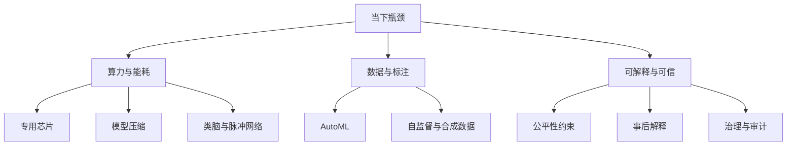

# 第 9 章：人工智能未来发展和趋势

- **难度**：★☆☆ | **预估学时**：1.5 小时 | **前置**：第 1—8 章

## 学习目标

学完本章，你能：

1. 说出类脑计算与深度学习在"模拟什么"上的根本差别。
2. 解释模型压缩的四种手段各自牺牲了什么。
3. 判断一个场景该不该用量子机器学习。
4. 说清算法伦理里"可解释"和"准确"为什么经常冲突。

## 一句话核心

这一章不给预测，只给一张"当下的瓶颈清单"：算力、能耗、数据、可解释性、治理。每一项都对应一类正在发生的工作。

## 零基础讲解

### 概念 1：类脑计算——照着大脑的结构造（难度：进阶）

深度学习的神经元是一个极度简化的模型：加权求和、过激活函数、反向传播。真实神经元不是这样：它有膜电位、有脉冲发放、有时间动态、有突触可塑性。

**类脑计算**（神经形态计算）试图在硬件层面模仿这些机制：

- **脉冲神经网络**（SNN）：神经元只在膜电位超过阈值时发放一个脉冲，平时不输出。信息编码在"脉冲的时间"上，不是数值大小。
- **事件驱动**：没有脉冲就没有计算，所以空闲时几乎不耗电。这是它在低功耗场景（传感器、可穿戴设备）上的核心优势。
- **存算一体**：把存储和计算放在同一位置，避免"数据在内存和处理器之间来回搬"的能耗。

书里也提到**类脑芯片**（如 Loihi、TrueNorth）的现状：功耗优势明显，但训练方法不成熟——反向传播不能直接用在脉冲上，现在的训练大多靠"人工神经网络训练完再转成脉冲网络"，精度会掉。

> 类比：深度学习像用计算器算账，每一步都要按；类脑像用算盘，只在需要拨珠的时候动手。
>
> 失效边界：大脑的真实机制还没搞清楚，"照抄结构"不等于"照抄智能"。目前的类脑系统在复杂任务上的精度仍落后于主流深度学习。

### 概念 2：自动化机器学习（难度：进阶）

调参、选模型、设计网络结构，过去靠人试。**AutoML** 把这些也变成搜索问题：

- **超参数搜索**：学习率、批大小、层数。方法有网格搜索、随机搜索、贝叶斯优化（用历史结果建代理模型，决定下一个试点）。
- **神经架构搜索**（NAS）：把"网络结构"当成搜索空间，用强化学习或进化算法找。代价是算力——早期的 NAS 要几百块 GPU 跑几周。
- **元学习**："学会学习"。在大量小任务上训练一个模型，让它面对新任务时只需几步梯度更新就能适应（few-shot learning 的理论基础之一）。

书里对这个方向的判断是谨慎的：AutoML 把"人的经验"变成了"机器的搜索"，但搜索空间是人定的，先验还是人给的。

### 概念 3：模型压缩——把大模型塞进小设备（难度：进阶）

一个 ResNet-50 有一千多万参数，直接放到手机上内存和电量都吃不消。四种常见手段：

| 手段 | 做法 | 牺牲了什么 |
|---|---|---|
| 剪枝 | 删掉权重接近 0 的连接或整个通道 | 结构变得不规则，硬件加速难 |
| 量化 | 32 位浮点换成 8 位整数 | 精度小幅下降，极端量化会崩 |
| 知识蒸馏 | 用大模型（教师）的输出训练小模型（学生） | 需要教师模型，训练成本前置 |
| 低秩分解 | 把大矩阵拆成两个小矩阵相乘 | 表达能力受限，压缩率有上限 |

这四种可以叠加，工业上常把"剪枝 + 量化 + 蒸馏"一起用，把模型压到原来的十分之一，精度只掉一两个点。

**为什么量化特别有效？** 8 位整数比 32 位浮点省 4 倍内存，而且整数运算在多数芯片上更快、更省电。代价是动态范围变窄，需要校准（用一批真实数据统计每层的取值范围）。

### 概念 4：人工智能芯片（难度：进阶）

CPU 擅长通用逻辑控制，GPU 擅长大量并行的乘加。深度学习的主要运算是矩阵乘法，正好是 GPU 的强项，这也是 2012 年 AlexNet 用 GPU 训练成功的技术背景。

专用芯片（ASIC/TPU）把矩阵乘法做成硬件电路，能效比更高，但只擅长这一件事。**存算一体**、**光计算**、**忆阻器**这些方向都在解决同一个问题：**内存墙**——算得快没用，数据搬不过来。

### 概念 5：量子机器学习（难度：高难）

量子计算的优势在特定问题上：大整数分解、量子系统模拟、某些搜索问题有理论加速。放到机器学习上，目前能证明加速的场景很窄：

- 量子版本的线性代数（HHL 算法）理论上能加速求解线性方程组，但需要满足"数据能高效加载进量子态"这个前提，而这个前提在现实中很难满足。
- 量子核方法、量子神经网络都还在早期，规模受量子比特数和噪声限制。

书里的态度是务实的：**量子机器学习不是"机器学习变快"，而是"某些特定子问题可能变快"**。把它当通用加速器是误解。

### 概念 6：伦理与治理（难度：进阶）

算法做决定时，会带进训练数据里的偏见。三个典型问题：

- **偏见放大**：招聘模型如果拿历史录用数据训练，而历史上男性录用率高，模型会学到"男性更合适"。
- **不可解释**：信贷拒贷、医疗诊断需要给出理由，黑箱给不出。
- **责任归属**：自动驾驶出事，责任在车主、厂商、还是算法设计者？

治理手段大致三层：技术层（公平性约束、可解释方法、差分隐私）、制度层（算法备案、影响评估、审计）、法律层（个人信息保护、算法推荐管理规定）。书里 9.6 节把这些归到"人工智能伦理与治理"。

**可解释与准确的冲突**是真实的：在很多任务上，最简单的模型（线性、决策树）可解释但精度低；最准的深度模型说不清理由。工程上的折中是用"事后解释"（如 SHAP、注意力可视化）给一个近似理由，但要清楚：事后解释不等于因果解释。

### 概念 7：开发框架（难度：基础）

书里 9.7 节点了主流框架：TensorFlow、PyTorch、PaddlePaddle、MindSpore 等。它们的共同抽象是"张量 + 自动微分 + 计算图"。选框架看三件事：生态（预训练模型和工具链）、部署（能否转到手机或服务器）、团队熟悉度。

## 图示

看图说明：这张图把技术趋势按"它想解决哪个瓶颈"归类。看的时候注意：同一个瓶颈有多条解法，彼此不替代——芯片解决速度，压缩解决体积，类脑解决能耗，它们可以同时上。

## 类比与实例

**类比**：模型压缩像把一本百科全书的排版改紧、去掉重复条目、把生僻字换成常用字——读起来还通顺，但极细节会丢。知识蒸馏像让老教授把毕生经验浓缩成一门课，讲给学生。

失效边界：压缩到极致时，模型的"长尾能力"最先消失——常见样本还行，罕见样本全错。这就是为什么医疗、司法这类场景不敢激进压缩。

**实例**（量化的账）：一个 100MB 的 32 位浮点模型，换成 8 位整数量化后约 25MB，手机端推理延迟通常降到 1/2 到 1/4，精度在 ImageNet 上一般掉 0.5 到 1.5 个百分点。这个交换在多数消费级应用里是划算的。

## 常见误解

- **别以为类脑计算会取代深度学习。** 它现在更像"低功耗推理"的补充方案，训练方法还没成熟。
- **别以为模型压缩没有代价。** 压缩一定会损失一部分表达能力，问题只是损失落在哪个分布上。
- **别以为量子计算一成熟 AI 就起飞。** 加速是任务相关的，数据加载和读出仍是瓶颈。
- **别以为"加个解释模块"就解决了可解释性。** 事后解释可能是错的，甚至自相矛盾。
- **别以为伦理只是道德问题。** 它同时是法律合规问题（个人信息保护、算法备案）和工程问题（公平性指标怎么算、怎么测）。

## 自测题

1. **单选**：类脑计算在哪个方面最有现实优势？
   - A. 训练速度
   - B. 低功耗推理
   - C. 大规模语言建模
   - D. 数据标注
   **答案**：B。解析：事件驱动、存算一体带来能效优势；训练方法仍是短板。

2. **填空**：把 32 位浮点权重换成 8 位整数，这种压缩手段叫________；用大模型输出训练小模型叫________。
   **答案**：量化；知识蒸馏。

3. **简答**：为什么说"内存墙"是芯片方向的核心问题？
   **答案**：算力增长快于内存带宽，矩阵乘法时数据搬运的耗时和能耗超过计算本身。存算一体、近存计算都是为减少搬运而设计的。

4. **多选**：下列关于可解释性的说法，正确的有：
   - A. 线性模型与决策树本身可解释
   - B. 事后解释一定反映真实因果
   - C. 医疗与信贷场景对可解释性要求高
   - D. 可解释与高精度常常需要权衡
   **答案**：A、C、D。解析：B 错，事后解释是近似，不保证因果正确。

## 复习锚点

- 五个瓶颈：算力能耗、数据、可解释、治理、部署。
- 类脑＝脉冲 + 事件驱动 + 存算一体，优势在功耗，短板在训练。
- 压缩四件套：剪枝、量化、蒸馏、低秩；代价是长尾能力。
- 量子加速是任务相关的，不是通用加速。
- 可解释与准确通常是权衡关系，事后解释不等于因果。
