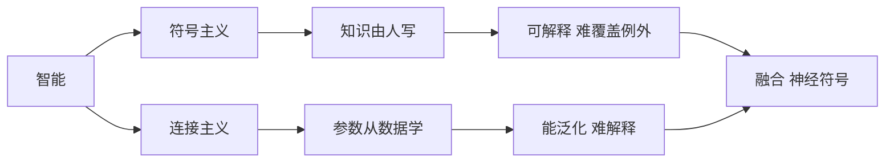

# 符号主义与连接主义

- **难度**：基础 | **涉及章节**：第 1、2、5、6 章，第 9 章

## 一句话定义

符号主义认为智能是"对符号做逻辑运算"，连接主义认为智能是"大量简单单元连起来后涌现的行为"。前者自上而下写规则，后者自下而上调参数。

## 为什么重要

这是人工智能七十年来最主要的一条裂缝。看清它，你才能理解为什么"专家系统"和"神经网络"会轮流坐庄，也才能判断一个新方法到底属于哪一派、继承了哪种优点和缺点。

## 图示

看图说明：两条路各有明确的长处和短处，而且正好互补——一个能说清、一个能泛化。所以近年出现"神经符号"这类融合尝试。

## 详解

符号主义的典型工作是写规则、建本体、做逻辑推理。它的前提是"知识可以被清楚地表达"。这个前提在数学、棋类、法律条文里成立，在"认出一张脸""听懂一句话"里不成立——你说不清自己是怎么认出熟人的。

连接主义的前提相反：知识不需要被表达，只需要被"拟合"。给足够多的样本，网络自己找映射。代价是它学到的东西存在几百万个参数里，没法翻译成人话。

## 常见误解

**别以为连接主义"不需要知识"**——训练数据、网络结构、损失函数，每一样都是人给的知识，只是形式从"规则"变成了"先验约束"。

## 在书中出现的脉络

| 章节 | 语境 | 关键结论 |
|---|---|---|
| 第 1 章 | 五种范式 | 符号主义是其中一支，不是全部 |
| 第 2 章 | 逻辑与知识图谱 | 符号路线的具体技术 |
| 第 6 章 | 深度学习 | 连接路线的当代形态 |
| 第 9 章 | 类脑计算 | 连接主义往硬件层面的延伸 |

## 相关概念

- 前置：无
- 后续：[状态空间与启发函数](#)、[反向传播](#)、[卷积与权重共享](#)
