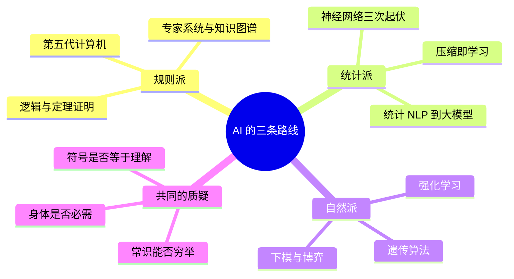

# 《人工智能简史》（尼克）点化学习系统

## 这本书在讲什么

它不写"技术怎么进步"，而写"**这个领域怎么一次次走错又走回来**"。作者的主张可以压成一句：人工智能的历史不是一条上升曲线，而是三条路线（规则、统计、自然）反复争夺解释权的过程，每一次失败都因为"当时的外部条件不支持"，而不是"想法本身错了"。

全书原分 16 章，作者说各章可独立阅读。本知识库按主题重排成 11 章，重排的理由见下面"章节索引"的映射说明：把同年份、同因果链的事件并在一起，读起来才是一条线，而不是一本编年史。

## 全书心智模型

看图说明：这张图的四个分支不是并列的四个话题，而是"三条技术路线 + 一条贯穿始终的质疑线"。读任何一章，都问它属于哪个分支、在回答哪条质疑。

## 学习路径（推荐顺序）

| 步骤 | 章节 | 主题 | 前置 | 检查点 |
|---|---|---|---|---|
| 01 | ch01 | 缘起：达特茅斯会议 | 无 | 能说清会议"发明"了什么 |
| 02 | ch02 | 自动定理证明的兴衰 | ch01 | 能解释组合爆炸为何致命 |
| 03 | ch03 | 专家系统与第五代计算机 | ch02 | 能说出知识获取瓶颈的三层 |
| 04 | ch04 | 神经网络三起三落 | ch01 | 能复述三次复兴各靠什么条件 |
| 05 | ch05 | 遗传算法与强化学习 | ch04 | 能手算一次 Q 更新 |
| 06 | ch06 | 下棋与博弈 | ch05 | 能区分深蓝与 AlphaGo 的方法 |
| 07 | ch07 | NLP：从规则到统计 | ch03 | 能说出统计翻盘的三个条件 |
| 08 | ch08 | 语言与思维 | ch07 | 能复述刺激贫乏论证与反驳 |
| 09 | ch09 | 计算的理论边界 | ch02 | 能用反证法说清停机问题 |
| 10 | ch10 | 大语言模型与学习 | ch07、ch08 | 能解释"预测下一个词"为何有效 |
| 11 | ch11 | 哲学质疑与智能进化 | ch09、ch10 | 能用自己的话说清三分法 |

## 章节索引

- 第 1 章 缘起：从图灵到 1956 年达特茅斯会议（难度 ★☆☆）→ `chapters/ch01-缘起与达特茅斯.md`（原书第 1 章）
- 第 2 章 自动定理证明的兴衰（★★☆）→ `chapters/ch02-自动定理证明.md`（原书第 2 章）
- 第 3 章 专家系统、知识图谱与第五代计算机（★★☆）→ `chapters/ch03-专家系统与五代机.md`（原书第 3、4 章）
- 第 4 章 神经网络的三起三落（★★★）→ `chapters/ch04-神经网络三起三落.md`（原书第 5 章）
- 第 5 章 向自然学习：遗传算法与强化学习（★★☆）→ `chapters/ch05-遗传算法与强化学习.md`（原书第 6 章）
- 第 6 章 下棋——人工智能的试金石（★★☆）→ `chapters/ch06-下棋与博弈.md`（原书第 7 章）
- 第 7 章 自然语言处理：从规则到统计（★★☆）→ `chapters/ch07-NLP从规则到统计.md`（原书第 8 章）
- 第 8 章 语言等于思维吗（★★★）→ `chapters/ch08-语言与思维.md`（原书第 9 章）
- 第 9 章 人是机器吗——计算的理论边界（★★★）→ `chapters/ch09-计算的理论边界.md`（原书第 10 章）
- 第 10 章 大语言模型——"学习"到底是什么（★★★）→ `chapters/ch10-大语言模型与学习.md`（原书第 11 章）
- 第 11 章 哲学质疑、教科书变迁与智能的进化（★★★）→ `chapters/ch11-哲学伦理与智能进化.md`（原书第 12—16 章）

## 前置知识（零基础缺口补讲）

| 缺口 | 对应补讲位置 | 学完标志 |
|---|---|---|
| 不知道"逻辑"是什么，分不清命题与谓词 | 第 2 章"零基础讲解 · 概念 1—2" | 能把一句中文翻成 `∀x (P(x) → Q(x))` |
| 不知道什么叫"算法复杂度"、为什么指数会爆炸 | 第 2 章"概念 4"、第 6 章"概念 3" | 能算出 b=3、d=20 时的节点数 |
| 没接触过梯度、求导 | 第 4 章"概念 5—6" | 能跟着走一遍一次权重更新的算术 |
| 不懂概率与期望 | 第 5 章"概念 4" | 能解释"价值＝奖励的期望" |
| 不懂什么是形式系统、可计算 | 第 9 章"概念 1—3" | 能画图灵机的三件套 |
| 不懂压缩、信息量 | 第 10 章"概念 1—2" | 能解释为什么规律串比随机串好压缩 |

## 术语表 / 模式库 / 速查表 入口

- 术语：`glossary.md`（约 80 条，按首现章节排列）
- 模式：`patterns.md`（5 个可复用的历史分析框架 + 6 条反模式）
- 速查：`cheatsheet.md`（时间线、方法对照、关键数字）
- 测验：`quiz.md`（每章 4 题 + 综合卷 + 最终检验）
- 卡片：`flashcards.md`（每章 5 张，共 55 张）

## 怎么读这本书最省力

先读 ch01 建立时间轴，再读 ch06（下棋）——它是全书最容易懂的一章，能立刻给你"AI 到底在做什么"的具体感。然后按学习路径走。ch08、ch09、ch11 属于"读得慢但值得"，可以放在第二阶段。

作者在前言里说各章可以独立读，这话是真的。所以卡住的时候不必硬啃，跳到下一章，回头再看，往往就通了。
