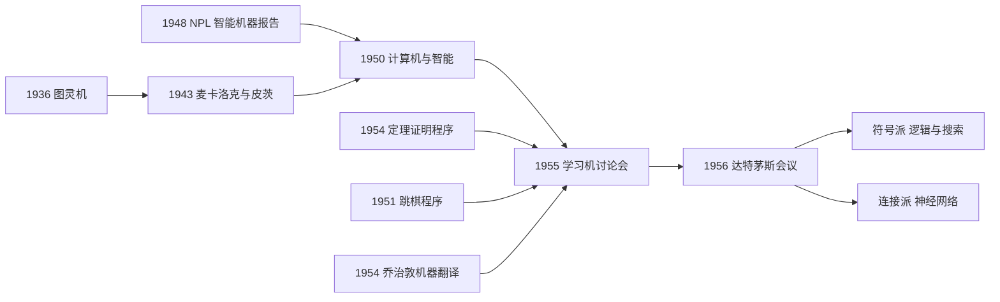

# 第 1 章：缘起——从图灵到 1956 年达特茅斯会议

- **难度**：★☆☆ | **预估学时**：1.5 小时 | **前置**：无
- **对应原书**：第 1 章

## 学习目标

学完本章，你能：

1. 说清 1956 年达特茅斯会议到底"发明"了什么，没发明什么。
2. 举出会议之前已经完成的三件事，说明这门学科不是凭空开始的。
3. 说出图灵 1950 年文章的贡献，以及它和 1948 年那份内部报告的区别。
4. 解释"符号派"与"神经网络派"的分裂从哪一天开始。

## 一句话核心

1956 年那场会议没有发明智能，它发明的是**一个名字和一套共同体**：把原本散在逻辑学、控制论、心理学、神经生理学里的人聚到一起，让"用机器模拟智能"变成一门可以申请经费、可以招学生、可以开会的学科。

## 零基础讲解

> 原书开篇引了莎士比亚的一句：What is past is prologue，过去只是序幕。这句话是本章的基调——达特茅斯会议是序幕之后的第一幕，不是第一声锣。

### 概念 1：前史——1955 年那场"会中会"（难度：基础）

1955 年，美国西部计算机联合大会在洛杉矶召开，会中套了一个"学习机讨论会"。两位关键参加者后来都去了达特茅斯：塞弗里奇（Oliver Selfridge）讲模式识别，纽厄尔（Allen Newell）讲计算机下棋。

主持人皮茨（Walter Pitts，神经网络的奠基者之一）当场做了总结：一派人试图模拟神经系统，纽厄尔则试图模拟心智，"但殊途同归"。

这句总结值钱的地方在于，它把此后几十年最主要的矛盾提前说了出来：**模拟大脑的硬件结构，还是模拟思维的符号过程**。两派都认为自己才是"真正的人工智能"。

### 概念 2：六个关键人物（难度：基础）

| 人物 | 当时的身份 | 后来 |
|---|---|---|
| 麦卡锡（John McCarthy） | 达特茅斯数学系助理教授，会议召集人 | 发明 LISP，提出"人工智能"一词 |
| 明斯基（Marvin Minsky） | 普林斯顿数学博士，与麦卡锡读书时相熟 | 麻省理工人工智能实验室创始人，写《感知机》 |
| 香农（Claude Shannon） | 贝尔实验室，信息论之父 | 为会议提供学术声望与经费支持 |
| 罗切斯特（Nathaniel Rochester） | IBM 第一代通用计算机 701 的主设计师 | 提供 IBM 的算力与背书 |
| 纽厄尔（Allen Newell） | 兰德公司研究员 | 与西蒙合作"逻辑理论家"，1975 年图灵奖 |
| 西蒙（Herbert Simon） | 卡内基理工学院的博导级人物 | 1975 年图灵奖、1978 年诺贝尔经济学奖 |

一个值得注意的细节：麦卡锡的博士导师是拓扑学家莱夫谢茨，他的博士论文不是逻辑；但他后半生都在用数理逻辑把常识形式化。明斯基的博士论文也不是逻辑，却写了一本很有影响力的计算理论教材。这两个人后来主导了符号派，但他们的学术出身并不是逻辑学。

### 概念 3：会议提案里那句关键的话（难度：基础）

1955 年，四位学者联名提交了《达特茅斯夏季人工智能研究项目提案》，第一次在正式文件里使用 "artificial intelligence" 这个词。提案的核心猜想是：**学习的每一个方面，或者智能的任何其他特征，原则上都可以被精确描述，以至于可以造一台机器来模拟它**。

这句话是整门学科的"立项理由"。它包含一个很强的假设：智能可以被形式化。后面几十年的争论，本质上都是在这句话上打补丁或者拆台。

### 概念 4：图灵的两份文本（难度：进阶）

一般认为学科的源头是图灵 1950 年发表在《心》（Mind）杂志上的《计算机与智能》。这篇文章提出了后来被称为"图灵测试"的模仿游戏：如果一个人通过文字对话分不出对面是人还是机器，就可以说机器具有智能。

但书里补了一个更早的文本：1948 年，图灵在英国国家物理实验室（NPL）写过一份内部报告《智能机器》，里面区分了"肉体智能"（embodied intelligence）和"无肉体智能"（disembodied intelligence）。机器人学家布鲁克斯认为这份报告比 1950 年那篇更重要，因为它预示了后来符号派与统计派之争——**智能到底要不要有身体**。

> 类比：1950 年那篇像"产品说明书"，告诉你什么样的机器算合格；1948 年那份像"设计草图"，里面有好几条互相冲突的技术路线，但还没定稿。
>
> 失效边界：图灵测试只测"行为上能否骗过人"，不测"内部是否真的理解"。这个区分后来成了塞尔"中文屋"论证的靶子（见第 11 章）。

### 概念 5：为什么说它是"学科的起点"而不是"概念的起点"（难度：进阶）

书里反复强调一件事：达特茅斯会议之前，机器翻译、定理证明、下棋、模式识别都已经有人在做。1954 年乔治敦-IBM 实验已经把几十个俄文句子翻成英文（见第 7 章）；1954 年戴维斯已经写出第一个可运行的定理证明程序（见第 2 章）；1951 年斯特雷奇已经写了跳棋程序（见第 6 章）。

所以会议真正的作用是"命名 + 组织"：给它一个名字，让分散的研究者意识到彼此在做同一件事，从此有了共同的语言、会议、期刊和评价标准。

> 原书用了一个很妙的说法：一门学科就是"学科共同体共同关注的东西"。这是从实用主义角度给的定义，比从内涵上下定义更管用。

## 图示

看图说明：这张图要看的不是时间顺序，而是"多条线汇到一个点，再分叉"。汇入点之前，各路工作彼此不知道对方存在；分叉之后，两派开始争夺"什么才算人工智能"的定义权。

## 类比与实例

**类比**：达特茅斯会议像一次行业标准的发布会。在它之前，各家都在自己做零件，接口不一样；会议之后，大家至少同意"我们做的是同一类东西"，于是可以互相比较、互相批评、互相引用。

失效边界：标准发布会能统一名字，不能统一方法。名字统一了，路线反而打得更凶——这正是后面几章的主题。

**实例**（名称的传播）：书里提到一个常被忽略的点：达特茅斯会议更多是"人工智能"这个词流行的源头，而不是学科的绝对起点。乔治敦-IBM 实验早于会议，就是证据之一。所以看到"1956 年是人工智能元年"这种说法，要理解它是"命名元年"，不是"第一行代码之年"。

## 常见误解

- **别以为 1956 年之前没人想过机器智能。** 图灵 1936 年就在定义"可计算"，1943 年麦卡洛克和皮茨就画出了神经元的逻辑模型。
- **别以为达特茅斯会议提出了统一的方法论。** 它提出的是一批松散的猜想，参会者各干各的，会后很快分成符号和连接两条路。
- **别以为图灵测试是图灵最看重的东西。** 他在 1948 年的报告里讨论的"肉体智能"才是他更关心的方向，与后来机器人学、具身智能一脉相承。
- **别以为"人工智能"这个词是麦卡锡随手起的。** 他刻意避开了"控制论"（cybernetics）这个词，因为不想让维纳的框架笼罩整个领域。

## 自测题

1. **单选**：达特茅斯会议最准确的定位是？
   - A. 第一台智能机器诞生
   - B. 人工智能这个名称与学术共同体形成的标志
   - C. 神经网络被发明的年份
   - D. 图灵测试提出的年份
   **答案**：B。解析：会议命名并组织了领域；图灵测试是 1950 年，神经网络模型是 1943 年。

2. **填空**：1955 年学习机讨论会上，主持人皮茨总结说，一派试图模拟________，另一派试图模拟________。
   **答案**：神经系统；心智。

3. **简答**：为什么说 1948 年图灵的 NPL 报告比 1950 年那篇文章更能预示后来的路线之争？
   **答案**：它区分了"肉体智能"与"无肉体智能"，即智能是否需要身体与感知。这正对应后来符号派（纯符号推理）与具身/连接派（靠感知与行动）的分歧。

4. **多选**：达特茅斯会议之前已经存在的工作有：
   - A. 可运行的定理证明程序
   - B. 跳棋程序
   - C. 乔治敦-IBM 机器翻译实验
   - D. 反向传播算法
   **答案**：A、B、C。解析：反向传播在 1980 年代才被系统推广。

## 复习锚点

- 1956 年达特茅斯会议＝命名 + 建共同体，不是技术起点。
- 会议提案的核心假设：智能可以被精确描述并模拟。
- 图灵：1936 定义可计算，1948 分肉体/无肉体智能，1950 提模仿游戏。
- 两派分裂从 1955 年那场会中会就已经摆上台面。
