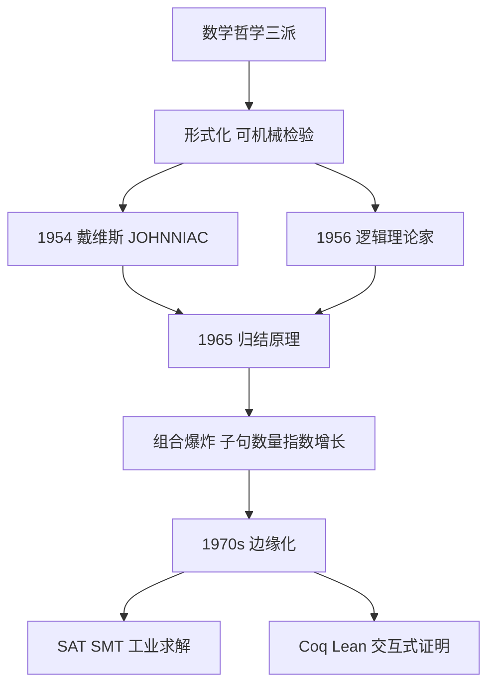

# 第 2 章：自动定理证明的兴衰

- **难度**：★★☆ | **预估学时**：2 小时 | **前置**：第 1 章
- **对应原书**：第 2 章

## 学习目标

学完本章，你能：

1. 说清逻辑主义、形式主义、直觉主义三派的差别，以及它们和机器证明的关系。
2. 说出"逻辑理论家"和戴维斯程序谁先谁后，以及为什么在后世的叙述里前者更有名。
3. 用一句话解释归结原理在做什么。
4. 说清定理证明为什么在 1970 年代衰落，又在 2000 年代以什么形式回来。

## 一句话核心

自动定理证明是符号派的技术地基：如果"证明"能被机械化，那么"推理"就能被机械化；它衰落不是因为逻辑错了，而是因为**组合爆炸**——逻辑上可行，算力上不可行。

## 零基础讲解

> 原书这一章开篇引用约翰逊："就像机器能省体力一样，符号演算能省脑力。演算越完美，付出的脑力就越少。"

### 概念 1：三派数学哲学（难度：基础）

| 派别 | 代表 | 主张 | 对机器证明的意义 |
|---|---|---|---|
| 逻辑主义 | 罗素 | 数学可以归约到逻辑 | 把数学问题变成逻辑问题，逻辑能机械算 |
| 形式主义 | 希尔伯特 | 数学是把一串符号变成另一串符号 | 只要设计出统一算法，所有数学问题都能解 |
| 直觉主义 | 布劳威尔 | 数学是心智构造，排中律不能随便用 | 拒绝"非真即假"的机械判定 |

希尔伯特那个"大一统算法"的梦想，被哥德尔 1931 年的不完备定理击碎：任何足够强的一致系统里，都存在既不能证明也不能证伪的命题。但机器定理证明没有因此消亡——它换了个更谦虚的目标：**在能证明的问题上，把证明找出来**。

### 概念 2：符号的来历（难度：基础）

日常写的 `∀`（对所有）和 `∃`（存在）不是自古就有的。书里给了一条清楚的谱系：

- 亚里士多德：三段论，最早的推理形式化。
- 弗雷格、罗素：现代逻辑的奠基，用函数表示谓词。
- 皮亚诺、约翰逊：用 `(x)` 表示全称，`∃x` 表示存在。
- 根岑（Gerhard Gentzen）1935 年：取 All 的首字母倒过来造成 `∀`，取 Exist 的首字母反写造成 `∃`。

根岑是证明论的奠基者之一，也是希尔伯特的逻辑助手。他的身世很曲折：纳粹冲锋队早期成员，战时参与 V-2 导弹研发，1945 年饿死在布拉格的战俘营。这类细节在书里很多，读的时候可以当人物志看，但技术上只需要记住：**证明论给了"证明"一个可以操作的定义**。

### 概念 3：谁写出了第一个程序（难度：基础）

这里有个常见的叙述偏差。

- 纽厄尔和西蒙的"逻辑理论家"（Logic Theorist）在人工智能圈子里开风气之先，它证明了《数学原理》里的若干定理。他们给罗素写信，罗素回信说："我相信演绎逻辑里的所有事，机器都能干。"
- 但**第一个可运行的定理证明程序**是逻辑学家戴维斯（Martin Davis）1954 年做的，跑在普林斯顿高等研究院那台以冯诺依曼昵称命名的电子管计算机 JOHNNIAC 上。文章迟至 1957 年才发表。

为什么后人记住的是"逻辑理论家"？因为它被当成了"机器能做人以为只有人才能做的事"的标志性事件，叙事价值大于技术首创。

> 类比：第一个做出电灯的人不一定是最有名的那个；爱迪生赢在系统化、商业化和叙事。
>
> 失效边界：这个类比不是说"逻辑理论家"没技术含量，它的启发式搜索思想后来影响很大；只是提醒"第一"这个头衔要看定义。

### 概念 4：归结原理——把证明变成机械消去（难度：进阶）

1965 年，鲁滨逊（John Alan Robinson）提出**归结原理**：把所有的公式化成子句形式（一堆文字的析取），然后反复做一件事——如果两个子句里有互补的文字（一个 `P`、一个 `¬P`），就把它们消掉，剩下的部分合并成新子句。推到出现空子句，就说明矛盾，反证成立。

它的价值在于：**只用一条规则**，就能完成一阶逻辑的全部推理。这比"人设计一堆推理规则"优雅得多，也让程序实现变得简单——一个循环加匹配就够了。

代价是**组合爆炸**：每一步都可能产生大量新子句，子句数量指数增长。所以后来的研究都在"怎么少生成无用子句"上做文章：设置文字顺序、支持集策略、单元优先等等。

### 概念 5：为什么衰落，又怎么回来（难度：进阶）

1970 年代之后，定理证明在人工智能里逐渐边缘化，原因有三个：

1. **算力不够**：组合爆炸让中等难度的定理都跑不动。
2. **知识不够**：很多证明需要领域知识（比如数学归纳法该用在哪一步），纯逻辑搜索找不到。
3. **目标转移**：专家系统证明了"把知识直接喂给程序"比"让程序自己推"更划算。

但它没有死，而是换了名字和场景回来了：

- **SAT/SMT 求解器**：把问题编码成布尔可满足性或带理论的判定问题，工业界用它做芯片验证、软件漏洞检测、调度排程。今天的 SMT 求解器能处理几十万变量的工业实例。
- **交互式定理证明**：Coq、Isabelle、Lean。人给大方向，机器检查每一步。2013 年 Gonthier 团队用 Coq 完成了四色定理的形式化验证；Lean 社区正在形式化整个数学基础。
- **数学竞赛**：把形式化证明和搜索结合，让机器在有限时间内找证明。

> 原书对这段历史的评价很克制：定理证明的衰落不是"逻辑不行了"，而是"当年想要的通用推理太贵了"。今天的复兴，是把目标从"通用"降到"特定领域 + 强约束"，代价小了，就能跑起来。

## 图示

看图说明：从"哲学上的形式化"到"程序上的消去规则"，中间只隔了一步；但从"规则"到"能跑"隔了一座算力的山。看这张图要抓住中间那个瓶颈节点——它解释了一切兴衰。

## 类比与实例

**类比**：归结原理像一台只会做减法的机器。你给它两个式子，它把能抵消的部分抵消掉，剩下的吐出来；一直减到空，就证明完了。它不需要会加法、乘法、除法——只要这一种操作，就够表达所有推理。

失效边界：只会一种操作意味着"路径很长"。人做证明会跳步、会用直觉、会类比，机器只能一步一步消，所以步数爆炸。

**实例**（子句消去）：前提是 `P ∨ Q` 和 `¬P ∨ R`。

- 两个子句里有互补的 `P` 和 `¬P`
- 归结得到 `Q ∨ R`

这就是一步。如果还能和 `¬Q` 归结，得到 `R`；再和 `¬R` 归结，得到空子句，矛盾成立，原命题得证。

## 常见误解

- **别以为哥德尔定理"杀死了"机器证明。** 不完备性说明有些命题证不出来，但没说"能证的证不出来"。机器证明的目标本来就限定在可证的部分。
- **别以为"逻辑理论家"是第一个程序。** 第一个可运行的是戴维斯的程序，早两年。
- **别以为定理证明已经死了。** 它变成了 SMT 求解器和形式化验证，藏在芯片设计、编译器验证、操作系统内核验证的背后。
- **别以为归结原理只对数学有用。** 任何能写成"前提-结论"的问题都能编码，包括法律条款推理、电路等价性检查。

## 自测题

1. **填空**：希尔伯特的形式主义想把数学变成"把一串________变成另一串________"。
   **答案**：符号；符号。

2. **单选**：第一个可运行的定理证明程序是谁做的？
   - A. 纽厄尔和西蒙
   - B. 戴维斯
   - C. 鲁滨逊
   - D. 王浩
   **答案**：B。解析：1954 年在 JOHNNIAC 上运行；"逻辑理论家"名气更大但不是第一。

3. **简答**：归结原理为什么"优雅但低效"？
   **答案**：优雅在于只用一条消去规则就能完成一阶逻辑推理，实现简单；低效在于每步会产生大量新子句，搜索空间指数增长。

4. **多选**：定理证明在当代以哪些形式存在？
   - A. SAT/SMT 求解器
   - B. Coq、Lean 等交互式证明器
   - C. 芯片与软件形式化验证
   - D. 图像分类
   **答案**：A、B、C。解析：图像分类属于统计学习，与定理证明无直接关系。

## 复习锚点

- 三派哲学：逻辑主义归约、形式主义符号操作、直觉主义拒排中律。
- 第一个程序是戴维斯的，名气和首创不是一回事。
- 归结原理：一条规则完成全部推理，代价是组合爆炸。
- 衰落因算力与知识，复兴靠 SAT/SMT 与形式化验证。
