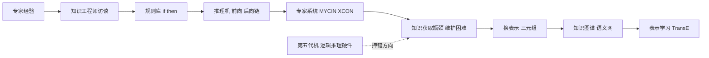

# 第 3 章：专家系统、知识图谱与第五代计算机

- **难度**：★★☆ | **预估学时**：2.5 小时 | **前置**：第 2 章
- **对应原书**：第 3、4 章合并

## 学习目标

学完本章，你能：

1. 说清专家系统的基本结构，以及它为什么在 1980 年代能卖钱。
2. 说出"知识获取瓶颈"是什么，并解释它为什么难以绕过。
3. 解释第五代计算机计划的赌注押在哪，为什么输了。
4. 说清知识图谱与专家系统的承继关系：换了存储形式，没换问题本质。

## 一句话核心

这三件事是同一条思路的三个阶段：把专家的知识抽出来写成显式规则，让机器照着推。专家系统是它的小型化，第五代计算机是想把它塞进硬件，知识图谱是把它改成网络并放大到全网规模。

## 零基础讲解

> 原书这一章讲费根鲍姆时用了一个词："知识就是力量"。他的主张是：通用推理机没有用，真正的智能来自领域知识。

### 概念 1：专家系统是怎么搭起来的（难度：基础）

一个典型专家系统有三个部件：

| 部件 | 作用 | 类比 |
|---|---|---|
| 知识库 | 一堆"如果…那么…"的规则 | 老医生的经验笔记 |
| 推理机 | 拿事实去匹配规则，推出新结论 | 一个只会照笔记查的实习生 |
| 解释器 | 说明"为什么得出这个结论" | 实习生把引用过的笔记页码报给你 |

关键差别在这里：**通用问题求解程序什么都不懂，专家系统什么都懂一点但只懂一个领域**。

书里讲的第一个成功例子是斯坦福的 DENDRAL。它是费根鲍姆、遗传学家莱德伯格（Joshua Lederberg，1958 年诺贝尔生理学或医学奖）、化学家翟若适（Carl Djerassi，口服避孕药的主要发明者）合作做出来的，任务是根据质谱数据推断有机分子的结构。这个任务有明确的判定标准——分子结构可以被实验验证，错了立刻知道。

### 概念 2：MYCIN 与"专家级表现"（难度：基础）

1970 年代斯坦福做的 MYCIN 是更著名的一个：诊断血液感染并推荐抗生素。它大约有 450 条规则，在测试中的表现被认为达到了专家水平。

但它从没在临床上真正用起来。原因不是准确率，而是：

- 当时的机器太贵，医院没有终端；
- 医生不信任一个不能解释清楚的黑箱（MYCIN 的解释器能说明规则链，但链条太长时人看不懂）；
- 责任归属不清——机器开错药谁负责。

这三点今天依然成立。**这是本章最有现实价值的一段**：技术指标过关不等于产品能用。

### 概念 3：知识获取瓶颈（难度：进阶）

专家系统最贵的一步不是写代码，是"把专家的知识问出来"。书里把这个障碍叫**知识获取瓶颈**，它有三个层次：

1. **专家说不出**：很多判断是模式识别式的直觉，他自己也讲不清依据。
2. **专家说的不准**：人对自己决策的解释常常是事后编的，与真实依据不一致。
3. **规则会冲突**：不同专家给的规则互相矛盾，需要仲裁机制。

于是出现了一个行业：知识工程师。他们的工作是坐在专家旁边，一遍遍问"这种情况你会怎么处理""为什么"，然后把回答翻译成规则。这个过程慢、贵、不可复用。

> 类比：知识获取像给一位老师傅录口述史。他干了一辈子，但你问"你怎么知道这个零件该换了"，他只能说"听声音不对"。你得自己把"声音不对"拆成频率、振幅、时长。
>
> 失效边界：有些领域的知识确实是可形式化的（配置、诊断、税务），有些不是（写作、谈判、诊断罕见病）。瓶颈的严重程度取决于领域。

### 概念 4：第五代计算机——一次押错方向的豪赌（难度：进阶）

1981 年，日本通产省启动"第五代计算机"计划。背景是 1978 年委托元冈达做的调研，1981 年发布了一份 89 页的报告，提出 6 种并行体系结构方案。主导者是渕一博，执行机构是 ICOT。

赌注的核心有两个：**并行逻辑推理硬件 + Prolog 作为核心语言**。逻辑是：如果智能等于推理，那么把推理做得又快又便宜，智能就自然来了。整个计划投入约 4.5 亿美元，1992 年结束，没有产出可商用的成果。

失败的原因可以拆成三层：

- **技术层**：专用逻辑推理机打不过通用微处理器。摩尔定律让"专门为推理造的芯片"在几年内就落后于便宜得多的通用 CPU。
- **方法论层**：把智能等同于逻辑推理，忽略了感知、学习、不确定性。
- **组织层**：全国一盘棋的集中研发，缺乏市场竞争的反馈回路。

同一时期，美国走了另一条路：不造专用硬件，让 AI 跑在通用工作站上（Symbolics、LMI 这些 Lisp 机后来也死于此）。教训是一样的：**不要在通用算力快速进步的年代押注专用架构**。

### 概念 5：知识图谱——把规则换成三元组（难度：进阶）

专家系统的规则库有个致命缺陷：只能处理预先想到的情况，加一条新知识可能和旧规则冲突，规模一大就维护不动。

知识图谱换了表示方式：用（头实体，关系，尾实体）这样的**三元组**存事实，比如（吴飞，任职于，浙江大学）。一堆三元组连起来就是一张网。查询变成"沿边找路径"，扩展变成"加新的三元组"，不冲突。

这条线索的谱系是：

- 语义网（Tim Berners-Lee 2001 年提出）：给网页加机器可读的语义标注。
- 谷歌 2012 年提出 Knowledge Graph，把搜索结果从"字符串匹配"变成"实体理解"。
- 学术界：Freebase、DBpedia、Wikidata、YAGO；中文有 CN-DBpedia、OwnThink。
- 推理方法：路径排序（把关系路径当特征，学习哪条路径更可信）、FOIL（归纳规则）、以及后来的表示学习（TransE 把实体和关系嵌入向量空间，让"头 + 关系 ≈ 尾"）。

> 注意一个容易误解的点：知识图谱没有解决知识获取瓶颈，它只是把成本从"写规则"转成"抽三元组 + 对齐实体"。信息抽取的准确率、实体消歧、schema 设计，仍然是硬骨头。

## 图示



看图说明：左边是"人把知识搬进机器"，右边是"机器把知识连成网"。中间的断点标注了两个失败点：知识获取太贵、专用硬件打不过通用芯片。

## 类比与实例

**类比**：专家系统像一本装订好的操作手册 + 一个严格照手册执行的实习生；知识图谱像维基百科的链接网络 + 一个会顺着链接找答案的搜索者。前者精确但僵，后者灵活但可能不准。

失效边界：手册能覆盖的场景有限，一旦遇到手册没写的情况就卡住；网络能覆盖的场景多，但"顺着链接找到的答案"未必有推理保证。

**实例**（规则链）：一条简化版的感染诊断规则链：

```
R1: IF 病人有发热 AND 白细胞升高 THEN 可能存在细菌感染
R2: IF 可能存在细菌感染 AND 培养结果为革兰氏阳性 THEN 考虑链球菌
R3: IF 考虑链球菌 AND 病人对青霉素不过敏 THEN 推荐青霉素
```

前向链：从已知事实出发，反复匹配规则，推出结论（数据驱动）。后向链：从目标"推荐什么药"出发，倒推需要哪些条件（目标驱动）。前者适合监控告警，后者适合诊断问答。

## 常见误解

- **别以为专家系统失败是因为算力不够。** MYCIN 在 1970 年代的机器上就能跑，问题是责任、信任、部署成本。
- **别以为规则越多越聪明。** 规则之间会冲突，规模上千条后维护成本爆炸，这是"知识获取瓶颈"的另一面。
- **别以为知识图谱是新技术。** 它继承了语义网和描述逻辑，形式化基础在 1990 年代就成熟了。
- **别以为第五代计算机是纯失败。** 它在并行推理、约束逻辑编程上留下了技术遗产，只是没有形成产业。

## 自测题

1. **填空**：专家系统最贵的环节不是编程，而是________，它指的是把专家知识问出来并形式化的困难。
   **答案**：知识获取。

2. **单选**：第五代计算机计划的核心赌注是？
   - A. 通用 CPU 加统计学习
   - B. 并行逻辑推理硬件加 Prolog
   - C. 神经网络加 GPU
   - D. 大规模分布式存储
   **答案**：B。

3. **简答**：为什么第五代计算机在技术上输给了通用微处理器？
   **答案**：摩尔定律让通用 CPU 性价比快速提升，专用逻辑推理机几年内就落后；同时把智能等同于逻辑推理的方法论假设本身站不住。

4. **多选**：知识图谱相对规则库的优势包括：
   - A. 加新知识不必担心规则冲突
   - B. 天然支持多跳查询
   - C. 完全解决了知识获取成本
   - D. 便于与实体对齐、跨源融合
   **答案**：A、B、D。解析：知识获取从"写规则"变成"抽三元组"，成本转移而非消失。

## 复习锚点

- 专家系统三件套：知识库、推理机、解释器。
- MYCIN 准确率够但没落地，卡在信任与责任。
- 知识获取瓶颈三层：说不出、说不准、规则冲突。
- 第五代机输在"专用硬件 vs 摩尔定律"。
- 知识图谱＝三元组网络，换了表示，没换成本问题。
