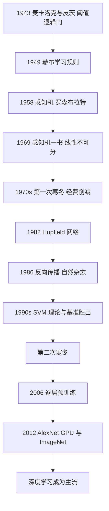

# 第 4 章：神经网络的三起三落

- **难度**：★★★ | **预估学时**：3 小时 | **前置**：第 1 章
- **对应原书**：第 5 章

## 学习目标

学完本章，你能：

1. 说清 1943 年麦卡洛克-皮茨模型在数学上做了什么，为什么它重要。
2. 解释 1969 年《感知机》一书的批评到底说了什么，以及它被误读成了什么。
3. 说出反向传播解决的是什么问题，为什么它没能立刻赢得认可。
4. 列出三次"寒冬"与三次"复兴"各自的触发条件。

## 一句话核心

神经网络的历史不是"技术逐渐变好"，而是"**每一次复兴都靠一次外部条件变化**"：算力、数据、或者一个能解释旧失败的新工具。模型本身的想法，1943 年就基本齐了。

## 零基础讲解

### 概念 1：1943 年的那篇论文做了什么（难度：基础）

麦卡洛克（Warren McCulloch）和皮茨（Walter Pitts）1943 年发表《神经活动中内在思想的逻辑演算》。他们做的事可以概括成一句：**把一个神经元抽象成一个带阈值的逻辑门**。

具体地：一个神经元接收若干输入，每个输入有权重；把所有输入加权求和，超过阈值就输出 1，否则输出 0。这在数学上就是 `y = 1[Σ w_i x_i ≥ θ]`。

这一步的意义不在于"模拟了大脑"，而在于它证明了一件事：**神经活动可以被写成命题逻辑**。既然是逻辑，就能用逻辑的方法分析它的能力边界。这才是它进入人工智能史的原因。

书里还记了皮茨的悲剧：他是个天才，十几岁就与罗素通信，后来在麻省理工与维纳合作，晚年酗酒、1956 年后逐渐离开学术界，1969 年去世，年仅 46 岁。

### 概念 2：维纳与控制论（难度：基础）

1948 年维纳（Norbert Wiener）出版《控制论》，把"动物与机器中的通信与控制"统一起来研究。这本书影响极大，以至于 1950 年代很多研究者自称在做"控制论"而不是"人工智能"。

麦卡锡刻意选择了"人工智能"这个词，一部分原因就是要与维纳的框架划清界限。这是学科政治，但它造成了长期后果：**人工智能与认知科学、神经生理学在体制上分家了**，两边的评价标准不同，互相看不上。

### 概念 3：感知机与它的承诺（难度：基础）

1958 年，罗森布拉特（Frank Rosenblatt）做出感知机（Perceptron），并造了硬件 Mark I。它的学习规则简单到可以一句话说完：

> 如果分类正确，不动；如果错了，把权重往正确方向挪一点。

这就是后来所有梯度方法的雏形。当时媒体把它吹成"能走路、说话、看见东西的计算机胚胎"，《纽约时报》1958 年的报道说它将来能"认人、叫出名字"。

罗森布拉特与明斯基当时都在麻省理工附近，两人的关系紧张。这段个人恩怨在后来的历史叙述里被放大，成了"明斯基打压连接主义"的故事。

### 概念 4：1969 年那本书到底说了什么（难度：进阶）

明斯基与西摩·帕波特（Seymour Papert）1969 年出版《感知机》（Perceptrons）。书里有两个结论：

1. **单层感知机只能解决线性可分的问题**，连异或（XOR）都做不了。
2. **多层感知机的表达能力虽然更强，但他们证明不出它需要多少层、也证明不出它能学到什么**——这是一个开放问题，不是否定。

第二条是关键，也是最常被误读的地方。书的原意是"我们证明不了多层网络的能力"，而流传的版本变成了"多层网络没用、这条路死了"。这个误读让神经网络研究在 1970 年代失去了大部分经费。

历史上更准确的描述是：**经费的消失是多重因素**——英国方面有James Lighthill 1973 年的报告质疑 AI 的整体进展，美国 DARPA 削减无明确军事目标的基础研究，加上《感知机》给出的理论悲观结论，三件事叠加。

### 概念 5：异或为什么做不了（难度：进阶）

异或的真值表：

| x1 | x2 | XOR |
|---|---|---|
| 0 | 0 | 0 |
| 0 | 1 | 1 |
| 1 | 0 | 1 |
| 1 | 1 | 0 |

单层感知机的判定是"加权和过阈值"，几何上是一条直线把平面分成两半。而 XOR 的两个 1 在对角，两个 0 在另一条对角——**没有任何一条直线能把它们分开**。这就是"线性不可分"。

解决方式：加一层。两层网络可以先画两条线把平面切成三块，再在第三层组合。这是几何直觉，也是后来的"深度"概念的最早动机。

> 类比：一层网络像只用一把直尺在纸上划线；两层网络可以先划两刀切出小块，再对小块贴标签。刀越多，能切出的形状越复杂。
>
> 失效边界：层数多了会带来"梯度消失"和"训练不动"的问题，这就是 1980 年代要解决的下一关。

### 概念 6：1986 年反向传播与它的迟到（难度：进阶）

反向传播不是 1986 年才发明的。它的数学基础是微积分里的链式法则，1970 年代就有人在控制论、自动微分领域用过。1986 年让·鲁梅哈特（David Rumelhart）、杰弗里·辛顿（Geoffrey Hinton）、罗纳德·威廉姆斯（Ronald Williams）在《自然》上发表的文章，价值在于：**给出了一个完整、可复现、在多任务上都有效的训练流程**，并把它和"内部表示"这个概念绑在一起。

但它仍然没有立刻赢。原因很实际：

- 数据太少：MNIST 是 1990 年代才有的，ImageNet 是 2009 年。
- 算力太弱：1990 年代的 CPU 跑一个小网络要几小时。
- 对手太强：1990 年代 SVM 有漂亮的统计学习理论（VC 维、结构风险最小化），在基准上稳定胜出，而且有理论保证。

### 概念 7：三次复兴分别靠什么（难度：高阶）

| 复兴 | 年份 | 外部条件 | 标志事件 |
|---|---|---|---|
| 第一次 | 1980s | 反向传播 + 专家系统的失败让人重新看学习 | Hopfield 网络（1982）、联结主义复兴 |
| 第二次 | 2006 | 逐层预训练让深层网络能训得动 | 深度信念网络 |
| 第三次 | 2012 | GPU + ImageNet 数据 | AlexNet 在 ImageNet 上大幅领先 |

看清楚这条线：**每一次复兴都不是"模型变强了"，而是"训练条件变好了"**。这也是为什么 2020 年代的大模型爆发，直接原因是 Transformer + 海量数据 + 集群算力，而不是某个新的神经元模型。

## 图示

看图说明：看两件事——每段上升之前都有一个"条件变化"的箭头（不是模型变好）；每段下降都伴随"理论与基准的竞争"。这是理解整段历史的关键结构。

## 类比与实例

**类比**：神经网络的历史像一种被反复放弃又反复捡起的工艺。每次放弃都是因为"当时做不出来"（算力、数据、训练方法），每次捡起都是因为"当初卡住的那个条件变了"。

失效边界：这个类比会让人误以为"只要等条件，想法总会赢"。实际上有些方向是真的错了（比如把智能等同于逻辑推理的第五代机），不是等来的。

**实例**（一次权重更新，手算）：单层感知机，输入 x=1，权重 w=2，目标 y=3，学习率 0.1，损失取平方差的一半：

- 预测：2×1 = 2
- 误差：2 − 3 = −1
- 梯度：误差 × 输入 = −1
- 更新：w = 2 − 0.1 × (−1) = 2.1

再算一次：预测 2.1，误差 −0.9，w 变成 2.19。可以看到它朝 3 靠近。感知机学习规则和梯度下降在这里是同一件事。

## 常见误解

- **别以为《感知机》一书"宣判了神经网络死刑"。** 它证明的是单层网络的局限，对多层网络说的是"我们证不出来"。
- **别以为反向传播是 1986 年发明的。** 数学上是链式法则，工程上是自动微分，1986 年的贡献是可复现的训练流程与"内部表示"的实证。
- **别以为寒冬只发生了一次。** 1970 年代和 1990 年代各一次，诱因不同：前者是理论悲观 + 经费削减，后者是 SVM 在基准和理论上双重压制。
- **别以为深度学习是"新东西"。** 它的核心构件（阈值神经元、反向传播、卷积）分别在 1943、1986、1989 年就有了。

## 自测题

1. **填空**：单层感知机无法解决________问题，因为它在几何上只能画一条________。
   **答案**：异或（XOR）；直线。

2. **单选**：1986 年反向传播论文的主要贡献是？
   - A. 发明了链式法则
   - B. 给出了可复现的多层网络训练流程并验证了内部表示
   - C. 证明了神经网络一定收敛
   - D. 提出了卷积结构
   **答案**：B。

3. **简答**：为什么 1990 年代 SVM 能压过神经网络？
   **答案**：SVM 有完整的统计学习理论（VC 维、结构风险最小化）提供泛化保证，且在当时的基准上稳定胜出；神经网络缺理论支撑、训练不稳定、算力与数据都不足。

4. **多选**：深度学习 2012 年爆发的直接条件包括：
   - A. GPU 算力
   - B. ImageNet 级别的大规模标注数据
   - C. 一个新的神经元模型
   - D. 能训得动深层网络的工程技巧（ReLU、Dropout 等）
   **答案**：A、B、D。解析：神经元模型没有本质变化，变的是训练条件。

## 复习锚点

- 1943：神经元＝阈值逻辑门，智能可写成逻辑。
- 1969：《感知机》证单层局限，被误读成整条路死了。
- 1986：反向传播给出可复现训练流程，但缺数据与算力。
- 三次复兴都靠外部条件变化，不靠模型创新。
