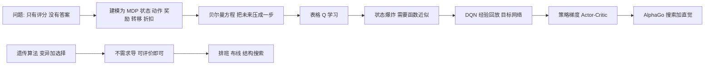

# 第 5 章：向自然学习——遗传算法与强化学习

- **难度**：★★☆ | **预估学时**：2.5 小时 | **前置**：第 4 章
- **对应原书**：第 6 章

## 学习目标

学完本章，你能：

1. 说清遗传算法的四个基本操作，并解释它为什么不需要求导。
2. 说出"没有免费午餐定理"对进化算法的限制。
3. 解释强化学习和监督学习的本质差别：反馈是"评价"而不是"答案"。
4. 说出 Q 学习和时序差分在做什么，为什么它能在不知道环境模型的情况下学。

## 一句话核心

这两条路都不从"人怎么想"出发，而从"自然怎么筛"出发：遗传算法靠**变异加选择**，强化学习靠**试错加回报**。共同点是不需要正确答案，只需要一个能打分的机制。

## 零基础讲解

### 概念 1：遗传算法的四个操作（难度：基础）

霍兰德（John Holland）1975 年出版《自然系统与人工系统中的适应》，把进化论写成算法。四个操作：

| 操作 | 做什么 | 类比 |
|---|---|---|
| 编码 | 把解写成一串（0/1 串、实数串、树结构） | 把设计方案写成基因 |
| 选择 | 按适应度高的优先留下 | 环境淘汰 |
| 交叉 | 两个父代各取一段拼成子代 | 有性繁殖 |
| 变异 | 随机改一位 | 基因突变 |

为什么它能用？因为它**不需要梯度**。只要你能给一个解打分，它就能搜。这对那些"可评价但不可求导"的问题特别有用：排班、布线、参数调优、神经网络结构搜索。

书里提到的扩展是遗传编程（Genetic Programming）：把"树"当基因，交叉就是交换子树，于是能自动生成程序表达式。Koza 在 1990 年代把它推成一套完整方法。

### 概念 2：没有免费午餐（难度：进阶）

"没有免费午餐定理"（No Free Lunch）说的是一件很扫兴的事：**如果把所有可能的问题一视同仁地平均，任何优化算法的平均表现都一样**。

推论：遗传算法不比随机搜索更好的前提，是你对它要解的那类问题有先验知识（比如"好解在空间里是成簇的"）。如果你的问题没有结构，任何算法都退化成随机。

> 这一段是本章的"防忽悠"部分。很多教程会说"遗传算法能解一切优化问题"，正确的说法是"遗传算法在你对它做了编码设计的前提下能解"。

### 概念 3：强化学习的问题设定（难度：进阶）

强化学习把学习写成一个五元组：

- **状态** S：现在处在什么情况
- **动作** A：能做什么
- **奖励** R：做了之后拿到什么分数
- **转移** P：做了之后会到哪
- **折扣** γ：未来分数折算到今天的比率

和监督学习的关键差别：监督学习每个样本都有正确答案，告诉你"该做什么"；强化学习只有一个分数，告诉你"做得好不好"，而且这个分数可能延迟很久才来。

这就是"信用分配问题"：赢了棋，是哪一步下得好？没人告诉你。

### 概念 4：贝尔曼方程与 Q 学习（难度：高阶）

价值函数的定义是"从某个状态出发，未来能拿到的折扣累计奖励的期望"。贝尔曼把它写成递推：

`V(s) = 当下奖励 + γ × 下一状态的价值`

这一步把"无限长的未来"压成了"一步 + 一个数"。有了它，价值可以用迭代算。

Q 学习把它变成可执行的更新规则：

`Q(s,a) ← Q(s,a) + α[ r + γ max Q(s',·) − Q(s,a) ]`

方括号里那项叫**时序差分误差**（TD 误差）："实际拿到的 + 对未来的新估计"减去"原来的估计"。α 是学习率。

为什么它重要？因为它用**采样**代替了对环境的完整知识：你不需要知道转移概率 P，只要真的走一步、看到 r 和 s' 就行。

> 类比：Q 学习像在没有地图的城市里认路。你不知道每条路通向哪，但你走一次就能更新一次"这条路大概值多少"。走得多了，估值就收敛。
>
> 失效边界：如果状态太多（比如围棋），表格存不下，就要用函数近似（DQN），而函数近似会带来不稳定性——这是 2015 年 DQN 要用经验回放和目标网络的原因。

### 概念 5：从 TD 到 DQN 到策略梯度（难度：高阶）

- **TD 学习**（Sutton 1988）：用下一步的估计更新当前估计，是 Q 学习的前身。
- **Q 学习**（Watkins 1989）：证明在表格情形下收敛到最优。
- **DQN**（2015）：用卷积网络近似 Q，加经验回放（打散样本相关性）和目标网络（固定更新目标），在 49 个 Atari 游戏上达到人类水平。
- **策略梯度 / Actor-Critic**：不学价值再取最大，而是直接调策略参数，提高高回报动作的概率。
- **AlphaGo / AlphaZero**：把 MCTS 当搜索、把网络当直觉，两者交替强化。

书里记了一个细节：巴托和萨顿因为强化学习的工作获得了图灵奖（书中提到 2025 年颁出）。这是对一条"慢路线"的迟到认可——强化学习从 1980 年代就在做，一直不是主流，直到算力和深度网络把它托起来。

## 图示

看图说明：上半支是"试错路线"的技术演进，每一步都在解决上一步的失效（状态太多→函数近似，近似不稳→回放与目标网络）。下半支是"进化路线"，它的优点是通用，缺点是依赖编码设计。

## 类比与实例

**类比**：遗传算法像养一群鸽子去送信，飞得快的多留后代，偶尔有鸽子飞错方向反而发现新路；强化学习像训狗，做对了给零食，但它不知道"为什么对"，只能靠反复试。

失效边界：鸽子的例子忽略了"编码决定一切"——如果基因里没写"会飞"，怎么选都没用。训狗的例子忽略了延迟奖励——如果零食在十分钟后才给，狗无法建立联系，这正是信用分配问题。

**实例**（一次 Q 更新，手算）：Q(s,a)=0.2，执行后得到 r=0，进入 s'，s' 上最大 Q 为 0.5，γ=0.9，α=0.1。

- TD 目标 = 0 + 0.9 × 0.5 = 0.45
- TD 误差 = 0.45 − 0.2 = 0.25
- 更新 = 0.2 + 0.1 × 0.25 = 0.225

可以看到一次更新只挪了一小步，因为 α 小。这也解释了为什么强化学习训练慢：信息一次只进一点点。

## 常见误解

- **别以为遗传算法"总能找到全局最优"。** 它是随机搜索，只有概率保证，且强烈依赖编码与适应度设计。
- **别以为强化学习是"无监督学习的一种"。** 它有监督信号（奖励），只是信号是评价性的、延迟的、稀疏的。
- **别以为 Q 学习需要知道环境模型。** 这正是它的卖点：用采样替代模型。
- **别以为奖励设计是小事。** 奖励函数写错，智能体会精确地学会错误行为（奖励黑客）。

## 自测题

1. **填空**：遗传算法的四个基本操作是编码、________、________、变异。
   **答案**：选择；交叉。

2. **单选**：强化学习与监督学习最关键的区别是？
   - A. 强化学习不需要数据
   - B. 强化学习的反馈是评价性的、可能延迟，而不是标准答案
   - C. 强化学习只能用于游戏
   - D. 强化学习不需要神经网络
   **答案**：B。

3. **简答**：为什么 Q 学习能在不知道转移概率的情况下工作？
   **答案**：它用实际走一步得到的 r 和 s' 作为采样估计，用 max Q(s',·) 作为未来价值的估计，从而用采样替代了对转移模型的期望计算。

4. **多选**：DQN 为了稳定训练用了哪些技巧？
   - A. 经验回放
   - B. 目标网络
   - C. 逐层预训练
   - D. 奖励裁剪/归一化
   **答案**：A、B、D。解析：逐层预训练是 2006 年深度信念网络的做法，与 DQN 无关。

## 复习锚点

- 遗传算法＝编码 + 选择 + 交叉 + 变异，不需求导。
- 没有免费午餐：算法好坏取决于问题的先验结构。
- 强化学习＝MDP + 评价性反馈，核心难题是信用分配。
- Q 学习用采样替代模型，靠 TD 误差一点点更新。
