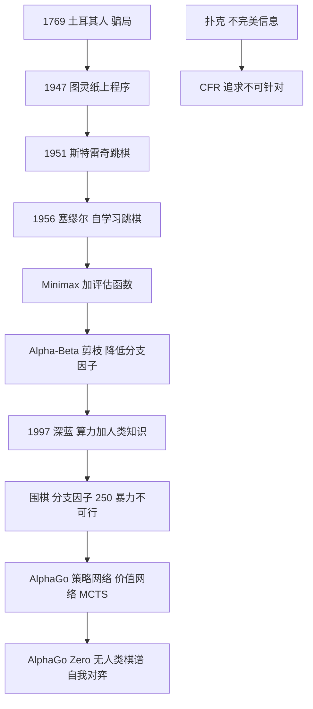

# 第 6 章：下棋——人工智能的试金石

- **难度**：★★☆ | **预估学时**：2 小时 | **前置**：第 4 章
- **对应原书**：第 7 章

## 学习目标

学完本章，你能：

1. 说出"土耳其人"骗局与真正的下棋程序之间的分界线在哪里。
2. 解释 Minimax 与 Alpha-Beta 剪枝在做什么，剪枝为什么不改变结果。
3. 说出深蓝与 AlphaGo 的方法差别：一个靠什么，另一个靠什么。
4. 解释 AlphaGo 的"直觉"是从哪来的，为什么它不需要穷举。

## 一句话核心

下棋之所以是试金石，是因为它规则清晰、胜负明确、又复杂到无法穷举。它把人工智能的核心矛盾暴露得最干净：**搜索的深度有限，所以必须靠评估；评估不准，所以必须靠学习。**

## 零基础讲解

### 概念 1：从骗局开始（难度：基础）

1769 年，匈牙利工程师肯佩伦（Wolfgang von Kempelen）造了一个"土耳其人"：一个穿土耳其服装的木偶，坐在箱子前下棋，能赢大多数对手，包括拿破仑和富兰克林。

真相是箱子里藏了一个人。这个骗局维持了八十多年，被拆穿多次又被重新组装。

书里把它放在开篇是有用意的：**在下棋这件事上，"看起来会"和"真的会"长期无法区分**。这比图灵测试早了 180 年提出同一个问题。

### 概念 2：图灵与斯特雷奇的最早程序（难度：基础）

图灵 1947 年写过一个下棋程序的手稿，但当时没有机器能跑它，他就自己充当 CPU，一步一步执行，被同事称为"纸上机器"。

1951 年，斯特雷奇（Christopher Strachey）在曼彻斯特的 Ferranti Mark I 上写了跳棋程序，能完整跑完一局。

1956 年，塞缪尔（Arthur Samuel）的跳棋程序第一次展示了"自我学习"：它和自己下，从胜负中调整评估函数的权重。这是机器学习的早期标志性成果，也是"机器学习"这个词流行起来的源头。

### 概念 3：Minimax 与剪枝（难度：进阶）

下棋是双方交替决策。Minimax 的思路是：**我方走的时候取最大，对手走的时候取最小**。一直推到叶子（终局或评估值），再把值一层层往回传。

问题在于节点数：分支因子 b，深度 d，节点数是 b^d。国际象棋 b≈35，d=10 就是 2.7 万亿个节点，算不动。

Alpha-Beta 剪枝的作用：在搜索过程中维护两个边界——α（我方已能保证的下界）、β（对手已能保证的上界）。一旦发现某个分支的估值不可能影响最终结果，就整枝剪掉，不再评估。

关键性质：**剪枝不改变搜索结果，只减少计算量**。最优情况下可以把有效分支因子从 b 降到 √b，相当于同样时间能搜两倍深度。

> 类比：你在挑餐厅，已经找到一家 8 分的，现在看第二家，发现它第一道菜只有 3 分。你不需要尝完所有菜——因为平均分不可能超过 8 了。这就是剪枝。
>
> 失效边界：剪枝依赖"评估值的上下界"，如果评估函数噪声很大，剪枝可能剪掉实际更好的分支。这是"评估不准"的代价。

### 概念 4：深蓝赢在哪里（难度：进阶）

1997 年，IBM 深蓝以 3.5:2.5 战胜卡斯帕罗夫。它的方法很"传统"：

- 专用硬件（480 个专用芯片）做并行搜索；
- 每秒评估约 2 亿个局面；
- 评估函数由大师级棋手参与调校；
- 开局库和残局库硬编码了大量人类知识。

深蓝赢的是**算力 + 人类知识**，没有学习。它下一盘棋要消耗大量电力，通用性几乎为零。

### 概念 5：AlphaGo 换了什么（难度：高阶）

2016 年 AlphaGo 以 4:1 战胜李世石。它的结构是两套网络 + 一个搜索：

| 部件 | 作用 |
|---|---|
| 策略网络 | 给定局面，直接给出"下哪里比较好"的概率分布，替代了穷举候选 |
| 价值网络 | 给定局面，直接估计"这局最后我赢的概率"，替代了评估函数 |
| 蒙特卡洛树搜索 | 用上面两个网络引导搜索，把算力集中在少数候选上 |

关键在于：围棋的分支因子约 250，深蓝那种暴力搜索完全不可行。AlphaGo 的做法是**用学习把搜索空间先砍掉 99%**，再在剩下的部分做有限搜索。

2017 年的 AlphaGo Zero 更进一步：不用人类棋谱，只靠自我对弈，从零学起，几天内超过所有版本。这证明了"人类知识"在围棋上不是必需的。

> 设计动机：为什么用 MCTS 而不是纯 Minimax？因为围棋的评估函数极难写准，而 MCTS 可以用"模拟到终局看胜负"来绕过评估——虽然方差大，但配合神经网络引导后收敛很快。

### 概念 6：扑克与不完美信息（难度：高阶）

棋类是"完全信息"：双方都能看到整个棋盘。扑克不是：你看不到对手的牌，还涉及诈唬。

2017 年 Libratus 在无限注德州扑克上战胜四位顶级职业选手，2019 年 Pluribus 在六人桌战胜人类。方法核心是**反事实遗憾最小化**（CFR）：

- 对每个"我本可以怎么做"计算遗憾；
- 按遗憾大小调整下一次的策略概率；
- 反复迭代，逼近期望意义上的纳什均衡。

这和棋类的思路完全不同：棋类追求"找到最好的那一步"，扑克追求"让对手无法针对我"。

## 图示

看图说明：主线是"搜索 → 搜索加剪枝 → 学习加搜索"。分叉点在围棋：分支因子太大，逼出了"用网络当直觉"的路线。扑克那条支线提醒我们，信息不完全时目标函数本身变了。

## 类比与实例

**类比**：深蓝像一个背了十万局棋谱、算得极快的棋手，但它不会举一反三；AlphaGo 像一个棋感极好、但只算几十步的棋手，靠"感觉哪里重要"来决定往哪算。

失效边界：这个类比会让人低估 AlphaGo 的搜索量——它仍然每步算几万种变化，只是候选被网络砍到了几十个。

**实例**（Minimax 手算）：根是 MAX，三个 MIN 子节点分别取 min(3,5)、min(2,9)、min(1,7)。

- 第一个 MIN = 3，第二个 = 2，第三个 = 1
- 根取 max(3,2,1) = 3

剪枝版：搜到第一个 MIN 得 3，α=3。看第二个 MIN，它的第一个孩子是 2，β=2，此时 β<α，后面那个 9 不用看了——因为 MIN 只会取 ≤2 的值，不可能超过 3。这就是一次剪枝。

## 常见误解

- **别以为深蓝"理解"棋。** 它是搜索 + 人类调好的评估函数，没有学习，换一个游戏就废。
- **别以为 AlphaGo 靠穷举。** 围棋穷举不可能，它靠网络把候选砍到几十个。
- **别以为 AlphaGo Zero 证明"人类知识没用"。** 它证明的是"在规则明确、可自我对弈的领域，人类知识可以被替代"。规则不明确、无法快速验证的领域不成立。
- **别以为下棋解决了就等于通用智能。** 棋类是封闭、完全信息、有明确胜负的问题，现实问题大多不是。

## 自测题

1. **填空**：Alpha-Beta 剪枝不改变________，只减少________。
   **答案**：搜索结果；计算量（评估的节点数）。

2. **单选**：深蓝与 AlphaGo 最本质的差别是？
   - A. 深蓝用 CPU，AlphaGo 用 GPU
   - B. 深蓝靠算力与人类知识，AlphaGo 靠学习出的策略与价值网络引导搜索
   - C. 深蓝下国际象棋，AlphaGo 下围棋
   - D. 深蓝能学习，AlphaGo 不能
   **答案**：B。

3. **简答**：为什么扑克不能用 Minimax 那套"找最优一步"的思路？
   **答案**：扑克是不完美信息博弈，存在诈唬与隐藏信息，无法通过穷举确定对手的手牌。正确的目标是求"不可被针对"的均衡策略，而不是单方面最优。

4. **多选**：AlphaGo 的组成部分包括：
   - A. 策略网络
   - B. 价值网络
   - C. 蒙特卡洛树搜索
   - D. 硬编码开局库为主
   **答案**：A、B、C。解析：AlphaGo 并未依赖硬编码开局库，那是深蓝的做法。

## 复习锚点

- "土耳其人"骗局：看起来会 ≠ 真的会，比图灵测试早 180 年。
- Minimax 取最大最小，Alpha-Beta 剪枝不改结果只省算力。
- 深蓝＝算力 + 人类知识；AlphaGo＝学习 + 有限搜索。
- 扑克逼出 CFR：目标从"最优"变成"不可针对"。
