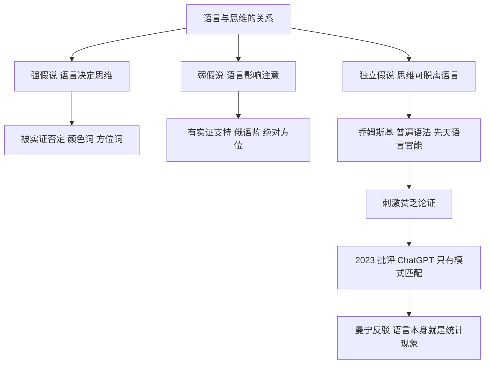

# 第 8 章：语言等于思维吗

- **难度**：★★★ | **预估学时**：2 小时 | **前置**：第 7 章
- **对应原书**：第 9 章

## 学习目标

学完本章，你能：

1. 说清乔姆斯基 2023 年那篇批评的三个论点。
2. 解释"刺激贫乏"这个论证的结构与它的争议点。
3. 区分"柏拉图之问"与"奥威尔之问"：它们分别问的是什么问题。
4. 说出"语言决定思维"（萨丕尔-沃尔夫假说）有哪些实证反驳。

## 一句话核心

这一章讨论的不是"机器会不会说话"，而是"**语言能力是不是思维能力的全部**"。乔姆斯基说不是，且认为大模型根本没有语言能力；他的批评者说，能用就够了，不必先有理论。

## 零基础讲解

> 原书这一章写得很有现场感：2023 年 3 月，乔姆斯基在《纽约时报》发文批评 ChatGPT，随后语言学界在社交媒体上吵成一团。作者把这个场面当作案例来分析，而不是当结论。

### 概念 1：乔姆斯基那篇文章说了什么（难度：基础）

2023 年 3 月 8 日，乔姆斯基与语言学家伊恩·罗伯茨、计算机科学家杰弗里·瓦图穆尔在《纽约时报》发表评论《ChatGPT 的虚假承诺》。三个论点：

1. **大模型只是在做模式匹配**，没有真正的语言理解。它学的是"什么词后面常跟什么词"，不是"句子为什么合法"。
2. **它无法区分"可能"与"不可能"**。人能判断"无色的绿色想法愤怒地睡觉"语法合法但语义荒谬；模型只会给一个概率。
3. **它没有道德判断能力**，因为道德需要基于因果与意图的推理，而不是统计关联。

文章的结论很尖锐：这类系统的成功让人误以为"工程上的可用"等于"理论上的理解"。

### 概念 2：反驳来得很快（难度：基础）

斯坦福语言学家曼宁（Christopher Manning）在社交平台上回应：语言学的科学已经被这些模型改变。他的核心论点是：**语言能力本身就是一个统计现象**，人脑处理语言时也在做概率预测；要求模型先具备"理解"才能处理语言，是设了一个不必要的门槛。

另一条反驳更尖锐：乔姆斯基自己提出的语法理论，也从未给出一个能跑的程序。批评一个"能用但解释不清"的系统，用一个"解释得多但跑不起来"的理论，说服力有限。

书里对这个争论的呈现是平衡的：它没有站队，而是把双方的前提摊开——**争论的根不是技术，而是"什么算理解"这个定义**。

### 概念 3：刺激贫乏论证（难度：进阶）

这是乔姆斯基理论的核心经验证据，结构如下：

1. 儿童接触到的语言输入是有限的、残缺的、充满错误的。
2. 但儿童在几岁内就能掌握复杂的语法规则，包括从未听过的结构。
3. 因此，语法知识不可能全部来自输入。
4. 结论：人脑有先天的"语言官能"，提供了一套普遍的语法框架（普遍语法）。

反驳有三类：

- **输入其实没那么贫乏**：儿童每天听到的句子数量巨大，且有大量重复结构。
- **学习机制比想象中强**：统计学习能从分布里提取结构，不需要先天规则。
- **结论过强**：就算有先天成分，也不能推出"必须有一套具体语法的先天模板"。

> 类比：刺激贫乏像"我只给了你十块积木，你却搭出了整座城堡，所以你一定自带图纸"。反驳是"也许十块积木的信息量比看上去大，也许搭法本身就能生成城堡"。
>
> 失效边界：这个类比弱化了"儿童从不出错地掌握某些规则"这一点——如果确实有规则从未在输入中出现却被普遍掌握，先天论的证据就更强。

### 概念 4：柏拉图之问与奥威尔之问（难度：进阶）

书里用两个"问题"来框定讨论：

- **柏拉图之问**：我们怎么在经验如此贫乏的情况下知道这么多？（对应先天论）
- **奥威尔之问**：我们怎么在证据如此充分的情况下错得这么离谱？（对应认知偏差、意识形态扭曲）

前者问"知识从哪来"，后者问"人为什么拒绝相信眼前的事实"。作者把这两个问题并列，是想说：智能不只是"能推出正确答案"，还包括"为什么会推错"。

> 这一小节是全章最有哲学味的地方，也是考试常考的点：这两个"问"出自不同的传统，一个认识论，一个政治心理学。

### 概念 5：语言决定思维吗（难度：进阶）

萨丕尔-沃尔夫假说（Sapir-Whorf hypothesis）主张语言结构影响甚至决定思维。它的强版本（语言决定思维）基本被否定，弱版本（语言影响注意与记忆）有实证支持。

几个经典证据：

- **颜色词**：俄语区分深浅蓝（goluboy / siniy），俄语母语者在区分深浅蓝时比英语母语者更快。但一旦加入干扰任务，差异消失——说明影响的是"注意习惯"，不是"知觉能力"。
- **空间方位**：某些语言用绝对方位（东南西北）而非相对方位（左右），说这类语言的人方位感更强，能保持更好的方向感。
- **数字词**：语言里没有精确数词的人群（如 Pirahã），在精确计数任务上表现弱，但在近似数量估计上正常。

结论：语言影响**被强迫注意的维度**，但不封锁思维能力。人可以在没有对应词的情况下思考一个概念，只是会更费力。

### 概念 6：这一章真正的论点（难度：高阶）

把上面几条合起来看，作者想说的是：

1. "语言"和"思维"不是一回事。语言是思维的一种编码方式，不是思维本身。
2. 大模型擅长语言的**表层统计**，这能通过大量考试，但不等于具备因果推理与意图理解。
3. 语言学的争论提醒我们：**评价一个系统，要先明确"用什么标准"**。用考试成绩评价，大模型很强；用"能否解释为什么"评价，它很弱。两个评价都对，只是问的问题不同。

## 图示

看图说明：这张图有三条平行假设，不要读成一条演进线。关键是底部那条冲突：先天论与统计学习论对"语言能力从哪来"给出了互斥答案，而两边都还没有决定性证据。

## 类比与实例

**类比**：把语言能力想成"开车"。乔姆斯基要求先懂发动机原理才算会开车；曼宁认为能安全把车开到目的地就算会开。两个人说的"会"不是同一个意思，所以吵不出结果。

失效边界：开车有明确的验收标准（不出事故），语言理解没有。"能对话"是不是"理解"，本身就是待定义的东西。

**实例**（一个让大模型出错的句子）：考虑"约翰太固执了，没法跟他说话"（John is too stubborn to talk to）。这句的表面结构是"约翰太固执，以至于（某人）没法跟（约翰）说话"，但机器很容易解析成"约翰太固执，不去跟（别人）说话"——主语和宾语的指向错了。

这类句子是句法理论的经典测试材料：它说明"表面词序"不足以确定意义，需要隐式的句法结构。大模型在大量此类句子上会出错，正是乔姆斯基那篇文章举例的类型。

## 常见误解

- **别以为乔姆斯基"反对人工智能"。** 他反对的是"统计关联等于理解"这个主张，不是反对技术本身。
- **别以为曼宁的反驳证明了大模型有语言能力。** 他论证的是"语言能力可以只由统计机制实现"，这是一个关于机制的主张，不等于已经实现。
- **别以为萨丕尔-沃尔夫假说完全错了。** 强版本错，弱版本有支持。语言确实会改变你习惯注意什么。
- **别以为这一章是"哲学闲谈"。** 它直接影响评价标准：如果你接受"能通过考试就算懂"，大模型已经达标；如果你要求"能解释为什么"，它远没达标。

## 自测题

1. **填空**：乔姆斯基论证人脑有先天语言官能的核心经验证据叫________论证。
   **答案**：刺激贫乏。

2. **单选**：柏拉图之问与奥威尔之问分别问的是？
   - A. 知识从哪来；人为何在证据充分时仍会错
   - B. 语言是否决定思维；机器能否思考
   - C. 语法是否先天；语义是否后天
   - D. 人为何会错；知识从哪来
   **答案**：A。

3. **简答**：曼宁反驳乔姆斯基的核心论点是什么？
   **答案**：语言能力本身可以是统计现象，人脑处理语言也依赖概率预测；要求系统先具备"理解"才能处理语言，是额外加了不必要的门槛。

4. **多选**：关于语言与思维的关系，实证支持的有：
   - A. 语言影响注意的维度（如颜色词、绝对方位）
   - B. 语言完全决定思维，没有对应词就无法思考
   - C. 思维可以在缺少对应词汇时进行，只是更费力
   - D. 语言与思维完全无关
   **答案**：A、C。

## 复习锚点

- 乔姆斯基三论点：模式匹配、无法区分可能与不可能、缺道德推理。
- 刺激贫乏：输入有限却掌握复杂规则，故有先天官能。
- 柏拉图之问问知识来源，奥威尔之问问责备证据时的固执。
- 语言影响注意，不封锁思维。
