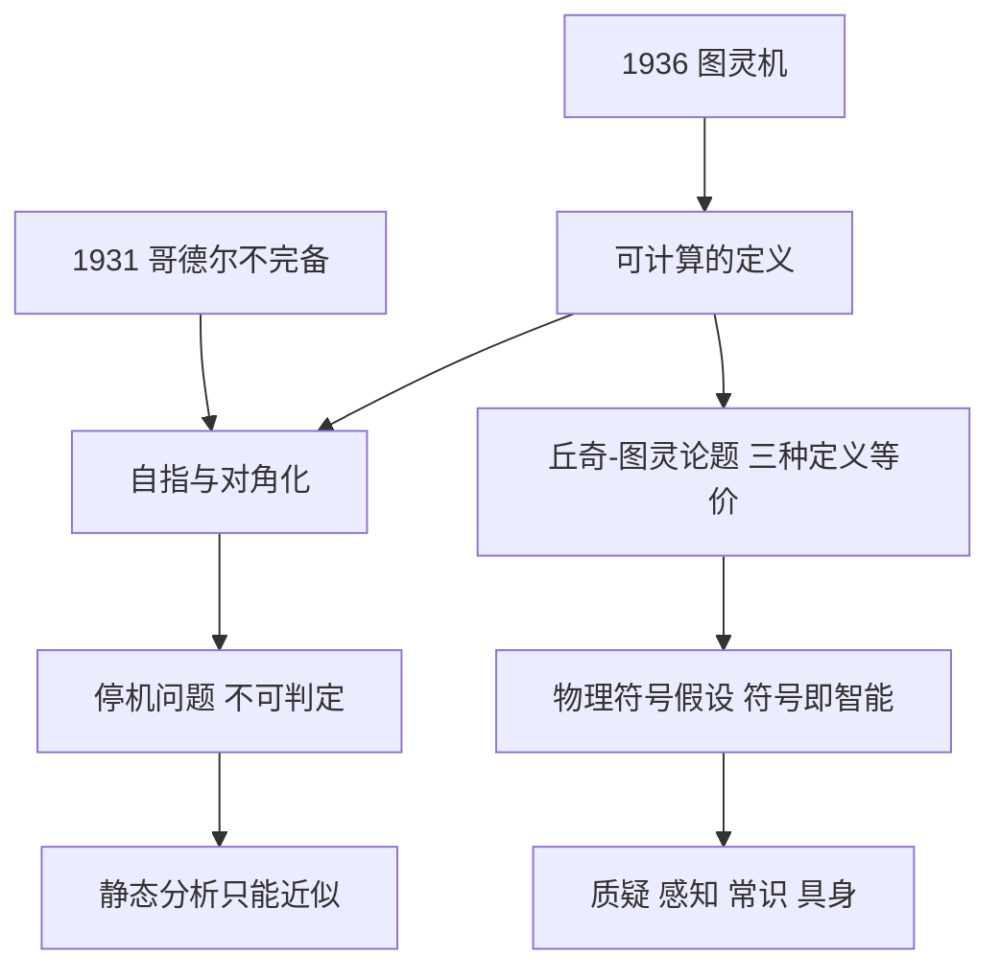

# 第 9 章：人是机器吗——计算的理论边界

- **难度**：★★★ | **预估学时**：2.5 小时 | **前置**：第 2 章
- **对应原书**：第 10 章

## 学习目标

学完本章，你能：

1. 画出图灵机的三个部件，并说清"可计算"在这里的确切含义。
2. 陈述丘奇-图灵论题，并说出它为什么是"论题"而不是"定理"。
3. 用反证法复述停机问题的证明。
4. 解释物理符号假设的内容，以及它今天为什么被质疑。

## 一句话核心

图灵在 1936 年做了一件比"造机器"更彻底的事：**他先定义了什么叫"能被机械地算出来"**。这个定义划出了所有计算机（包括人脑若被视作计算装置）的能力边界。

## 零基础讲解

> 原书这一章把"人是机器吗"当作标题，因为它要讨论的不是工程问题，而是本体论问题：如果思维是计算，那么计算的边界就是思维的边界。

### 概念 1：图灵机的三个部件（难度：基础）

图灵机是一个思想实验装置，只有三样东西：

| 部件 | 作用 | 类比 |
|---|---|---|
| 纸带 | 分成格子，每格写一个符号，可无限延伸 | 无限长的草稿纸 |
| 读写头 | 停在某一格，能读、能写、能左右移动 | 一支会走路的笔 |
| 状态表 | 一张"当前状态 + 读到符号 → 写什么、怎么移、变成什么状态"的表 | 操作手册 |

就这三样。没有内存、没有指令集、没有操作系统。图灵证明了：**凡是"能按固定规则一步步算出来"的东西，这台机器都能算**。

这个抽象的价值在于它**去掉了实现细节**。你的笔记本、手机、超算，在"能算什么"这个层面上，与图灵机等价——只是快慢和内存不同。

### 概念 2：可计算的确切含义（难度：进阶）

"可计算"在数学上的定义是：存在一台图灵机，对任意输入，能在有限步内停机并给出正确答案。

注意三个限定词：

- **任意输入**：不是某些输入能算，是所有合法输入都能算。
- **有限步**：允许跑很久，但不允许永远跑下去。
- **正确答案**：不是"大概对"，是确定对。

违反任何一条，就不叫可计算。这个定义比日常说的"能算"严格得多。

### 概念 3：丘奇-图灵论题（难度：进阶）

1936 年前后，三个人用三种完全不同的方式定义了"可计算"：

- 图灵：图灵机（机械步骤）
- 丘奇：λ 演算（函数抽象与替换）
- 哥德尔、克莱尼：递归函数

三者被证明**能力完全等价**——凡一个能算的，另两个也能算。这个等价性引出了丘奇-图灵论题：**凡是直觉上"可机械计算"的函数，都是图灵可计算的**。

为什么叫"论题"（thesis）而不是"定理"？因为它的前半句"直觉上可机械计算"没有数学定义，无法证明。它是一个**关于"计算"这个词的外延主张**，我们接受它，是因为至今没有任何反例。

> 类比：这就像"凡是能用尺规作图画出来的正多边形，都可以用代数方法构造"。等价性可以证明，但"能用尺规画"本身是个直观概念。
>
> 失效边界：如果有人造出某种物理过程能算出图灵机算不出的东西（比如某些量子或超计算模型），这个论题就会被推翻。目前没有可靠证据。

### 概念 4：停机问题（难度：高阶）

问题：给定一个程序 P 和输入 x，能不能写一个程序 H，判断 P 在 x 上会不会停机？

图灵的回答：不能。证明用反证法：

1. 假设存在这样的 H，它输出"停"或"不停"，且总能给出正确答案。
2. 构造一个新程序 D：拿 D 自己当输入。如果 H 说"D 会停"，就让 D 死循环；如果 H 说"D 不会停"，就让 D 立刻停。
3. 问：D 在输入 D 上会停吗？
   - 若会停 → 按定义 H 说它会停 → D 死循环 → 不停，矛盾。
   - 若不停 → H 说它不停 → D 立刻停 → 停，矛盾。
4. 两种情况都矛盾，故 H 不存在。

这个证明的美在于它只用一个自指构造，不涉及任何具体实现。它和哥德尔不完备定理、罗素悖论是同一个"对角化"家族。

**它的实际意义**：不可能有一个万能的程序检查器，能提前告诉你"这段代码会不会死循环"。所以所有静态分析工具都只能给出"可能有问题"的近似答案，不能给保证。

### 概念 5：哥德尔不完备定理（难度：高阶）

1931 年，哥德尔证明：任何足够强（能表达算术）、一致（不自相矛盾）的形式系统，都存在一个命题，它在该系统中既不能被证明也不能被证伪。

通俗版：**系统里有一句真话，系统自己说不出来**。

它和停机问题的关系：都是"系统无法完全把握自己"。哥德尔用的是"这句话不可证"的自指句；图灵用的是"这个程序不停"的自指程序。

但要小心一个常见误读：不完备定理**不否定**"机器能思考"，它只说明"没有哪个形式系统能证明所有真理"。人也会遇到同样的限制——人也不能证明所有真理。

### 概念 6：物理符号假设（难度：高阶）

纽厄尔和西蒙 1976 年提出：**一个物理系统要表现出智能，必要且充分的条件是它能操作符号**。

这个假设是符号派的哲学纲领。它包含两个强主张：

- **必要**：不操作符号，就不可能有智能，因此否定纯连接主义。
- **充分**：只要操作符号，就能有智能，因此认为实现细节（硅、碳、神经元）无关。

它今天被质疑的地方：

1. **感知与行动**：机器人学发现，很多智能不需要符号操作（布鲁克斯的"无表征智能"）。
2. **常识**：符号系统需要把所有常识编码，成本极高（Cyc 的教训）。
3. **具身性**：意义的接地可能需要身体与环境的交互，纯符号没有"意义"只有"语法"。

## 图示

看图说明：上面三个节点（哥德尔、图灵机、停机问题）汇到同一个技术手段——自指。看这张图要理解：它们不是三个孤立结论，而是同一个数学结构在不同对象上的三次应用。

## 类比与实例

**类比**：图灵机像一台只有"读一格、写一格、左移或右移、换状态"四个动作的机器。它慢得可怕，但理论上能模拟任何其他计算机——包括你现在用的这台。

失效边界：它能模拟任何"可计算"的东西，但代价是时间。用图灵机模拟现代 CPU 跑一个程序，可能需要宇宙年龄那么长。所以"能算"和"算得动"是两件事。

**实例**（停机问题的日常版）：你写了一个 `while` 循环，想知道它会不会永远转下去，希望有个工具能告诉你答案。停机问题说：不存在能对所有程序都给出正确答案的工具。现实中的折中：工具只对某一类程序给保证（比如限定循环变量单调递减），或者给"可能不停"的警告。这就是为什么代码检查器总有一堆误报。

## 常见误解

- **别以为图灵机是"一台具体的机器"。** 它是数学抽象，用来定义可计算性，不是工程图纸。
- **别以为丘奇-图灵论题"被证明"了。** 它是关于"计算"外延的主张，只能被反例推翻，不能被证明。
- **别以为不完备定理证明"人比机器强"。** 它对人同样成立：人也不能证明所有真理。
- **别以为物理符号假设已经过时。** 它在需要精确推理的领域仍然有效（定理证明、编译器），只是不再是"智能的唯一路径"。

## 自测题

1. **填空**：图灵机的三个部件是纸带、________、________。
   **答案**：读写头；状态表。

2. **单选**：停机问题不可判定的意思是？
   - A. 目前算力不够，以后能算
   - B. 不存在对所有程序都能给出正确判断的通用算法
   - C. 只有部分程序无法判断
   - D. 只有量子计算机能判断
   **答案**：B。

3. **简答**：为什么丘奇-图灵论题不是定理？
   **答案**：它连接"直觉上的可机械计算"与"图灵可计算"，前者没有严格的数学定义，因此无法证明；它只能通过反例被推翻。

4. **多选**：物理符号假设受到质疑的理由包括：
   - A. 感知与行动中的智能可能不需要符号操作
   - B. 常识编码成本极高
   - C. 符号缺乏与世界的"接地"
   - D. 图灵机已被证明不存在
   **答案**：A、B、C。解析：图灵机是抽象模型，不存在"被证明不存在"的问题。

## 复习锚点

- 图灵机三件：纸带、读写头、状态表，抽象掉一切实现细节。
- 可计算＝存在图灵机在有限步内对所有输入给出正确答案。
- 停机问题用自指反证，与哥德尔同源。
- 物理符号假设：符号操作是智能的必要且充分条件，今天两头都被质疑。
