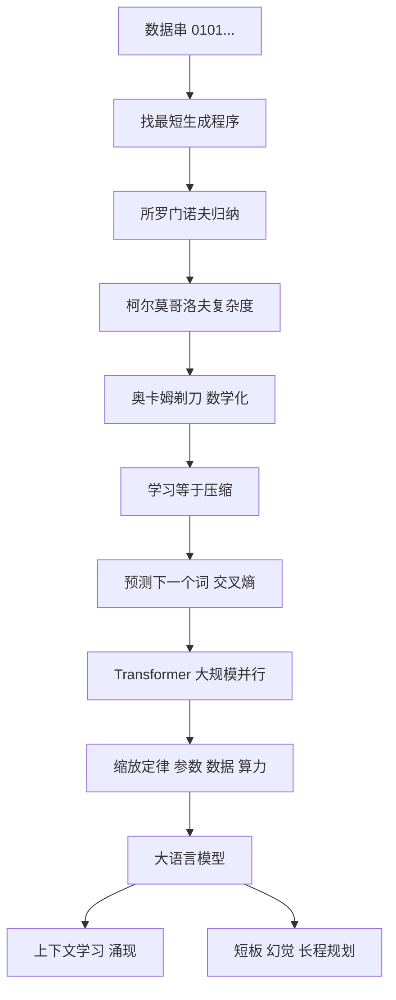

# 第 10 章：大语言模型——"学习"到底是什么

- **难度**：★★★ | **预估学时**：3 小时 | **前置**：第 4、7 章
- **对应原书**：第 11 章

## 学习目标

学完本章，你能：

1. 用一句话说清"学习＝压缩"这个命题的直觉来源。
2. 说出所罗门诺夫归纳与奥卡姆剃刀的关系。
3. 解释为什么"预测下一个词"这个目标能产生看似推理的能力。
4. 说出大模型能力的三个来源与两个已知短板。

## 一句话核心

如果所有可能的模型都能拟合训练数据，那么"最好的模型"就是**最短的那个描述**。这就是学习＝压缩；而大语言模型在做的"预测下一个词"，本质是在找一个能最短描述人类文本的压缩器。

## 零基础讲解

> 原书这一章从一位几乎被遗忘的人开始：所罗门诺夫（Ray Solomonoff）。他 1956 年整个暑假都待在达特茅斯，是会议最早的参与者之一，但他的工作几十年后才被真正理解。

### 概念 1：所罗门诺夫归纳（难度：进阶）

问题：看到一串数据（比如 0101010101…），下一个是什么？

朴素做法是统计频率。但所罗门诺夫提出了一个更彻底的做法：**在所有能生成这串数据的程序里，找最短的那个**，然后用这个程序去预测。

理由是这样的：既然"最短程序"能生成已见数据，它大概率也能生成接下来要出现的部分——因为短程序不会浪费描述长度去记住无关的细节，它倾向于捕捉规律。

这就是**所罗门诺夫归纳**，也叫"最小描述长度"（MDL）思想的源头。它的理论最优性基于一个惊人的假设：所有可能的数据生成程序，按 2^−长度 的先验概率分布。这个先验是不可计算的（不可枚举），所以它只能当理论基准。

### 概念 2：柯尔莫哥洛夫复杂度与奥卡姆剃刀（难度：进阶）

柯尔莫哥洛夫（Andrey Kolmogorov）独立提出了几乎相同的概念：**一个对象的最短描述长度**就是它的复杂度。随机串复杂度高（没有规律，只能逐字描述），规律串复杂度低。

这和奥卡姆剃刀的"如无必要，勿增实体"是同一件事的数学化：**在同等解释力下，选假设更少的那个**。区别在于奥卡姆剃刀是方法论建议，柯尔莫哥洛夫复杂度是可定义的量（虽然也不可计算）。

书里给了一句很好的总结："我压缩，故我在。"意思是：一个系统能理解世界，表现为它能用很短的规则描述大量现象；不能压缩，说明没找到规律。

> 类比：你把一本小说存成 zip，文件小说明小说有大量重复结构；如果压不小，说明它近乎随机。学习就是一个不断找更好压缩方式的过程——找得越准，需要的描述越短。
>
> 失效边界：压缩率不能完全等同于理解。一段文本可以因为"用词重复"而被高度压缩，但读者可能完全不懂它的意思。压缩是必要条件的代理指标，不是理解本身。

### 概念 3：为什么"预测下一个词"就够了（难度：高阶）

大语言模型的训练目标简单到不可思议：给定前文，预测下一个 token。用交叉熵损失，等价于最小化"用模型分布编码真实文本"的平均长度。

这就是压缩目标的直接实现：

- 模型对下一个词的分布越准，编码真实文本所需比特越少；
- 损失下降 = 压缩率提升 = 对文本规律的掌握变强。

为什么这件事能产出推理能力？因为要准确预测下一个词，模型必须隐式地学到：

- 语法（哪些结构合法）
- 事实（谁是谁、什么在哪）
- 推理模式（"因为…所以…"后面通常接什么）
- 甚至任务格式（"求…"后面通常接解题步骤）

这些都不是人教的，是"要压低损失就必须学"的副产品。

> 这一点解释了一个常见困惑：为什么没有人教它"做数学题要分步"，它却会分步？因为训练语料里的解题文本就是分步写的，要预测得准，就得学会那个模式。

### 概念 4：规模、数据、架构三件事（难度：进阶）

2020 年前后，研究者发现了一个经验规律（缩放定律）：模型性能随参数量、数据量、计算量按幂律提升。这带来一个简单粗暴的策略：把三样都放大。

三个条件同时到位才有 2022 年的爆发：

- **架构**：Transformer（2017）让训练可以大规模并行，GPU 利用率高。
- **数据**：互联网级别的文本，几万亿 token。
- **算力**：大规模 GPU/TPU 集群，训练一次要几个月。

而"对齐"（RLHF 等）解决的是另一个问题：预训练模型会续写，但不一定会"回答问题"。用人类偏好数据做强化学习，把它调成助手。

### 概念 5：能力的来源与边界（难度：高阶）

**三个来源**：

1. **压缩带来的规律掌握**：语法、事实、常见推理链。
2. **上下文学习**：给几个例子，它能在前向计算中"临时学会"任务模式，不需要改参数。
3. **规模带来的涌现**：某些能力（多步推理、代码、翻译）在小模型上几乎没有，过某个规模突然出现。

**两个短板**：

1. **事实性**：它优化的是"像人写的文本"，不是"真的世界"。所以它会流畅地编造。
2. **因果与规划**：它能复现语料中的推理模式，但遇到需要真正因果模型或长程规划的任务，容易崩。

> 这也解释了为什么"再加数据"不能解决幻觉：幻觉不是数据不足，而是目标函数不区分"真"和"像真的"。要解决它，需要外部知识、工具调用、验证机制。

## 图示

看图说明：这条链把"哲学上的简洁性原则"一路推到"工程上的训练目标"。看的时候注意 F 点：它是整条链的枢纽，前面是理论，后面是实现。

## 类比与实例

**类比**：想象你要用最少的字数向朋友描述一部长篇小说。如果你只能说"一个男人经历了很多事"，字数少但信息丢光；如果要逐字复述，字数多但没压缩。好的描述是"一个被冤枉入狱的人越狱后复仇"——短，且能生成大部分情节。学习就是找这种描述。

失效边界：小说有主题和结构，所以能压缩；随机噪声不能。现实世界的观测里，有大量真正随机的成分，压缩有下限。

**实例**（压缩率与困惑度）：假设一个模型对某段文本的平均交叉熵是 1 bit/token，另一个是 3 bit/token。前者意味着它平均只要 1 个比特就能编码一个词的选择，后者要 3 个。比特越少，说明模型越"懂"这段文本的规律。这就是为什么语言模型的评价指标叫"困惑度"（perplexity）——它本质上是平均编码长度的指数形式。

## 常见误解

- **别以为"预测下一个词"是个低级目标。** 要预测得准，必须掌握语法、事实、推理模式；这个目标的难点在数据规模上，不在目标本身。
- **别以为参数量越大越好。** 缩放定律是三件事同时放大，只加参数不加数据会欠训练。
- **别以为幻觉是"记错了"。** 它是目标函数的性质：模型被优化成"生成像人写的东西"，不是"生成真的东西"。
- **别以为涌现是玄学。** 它指的是某些能力在小规模上测不出来、过了阈值才显现；机制仍未完全解释，但现象可复现。

## 自测题

1. **填空**：所罗门诺夫归纳的核心是：在所有能生成数据的程序里，找________的那个。
   **答案**：最短。

2. **单选**："学习＝压缩"这个命题最接近下列哪种表述？
   - A. 学习就是把数据存下来
   - B. 好的模型能用更短的描述生成更多数据
   - C. 压缩率越高参数越少
   - D. 压缩就是降维
   **答案**：B。

3. **简答**：为什么"预测下一个词"能带来推理能力？
   **答案**：要压低交叉熵，模型必须掌握文本中的语法、事实与推理模式；这些是准确预测的必要条件，因此作为副产物被学到。

4. **多选**：大模型幻觉的成因包括：
   - A. 训练目标是"像人写的"，不是"符合事实"
   - B. 缺乏外部知识校验机制
   - C. 参数量太大
   - D. 长尾事实在训练数据中出现次数少
   **答案**：A、B、D。

## 复习锚点

- 学习＝压缩：最短描述能生成最多数据。
- 所罗门诺夫归纳 → 柯尔莫哥洛夫复杂度 → 奥卡姆剃刀的数学化。
- 预测下一个词＝最小化编码长度，副产品是语法、事实、推理模式。
- 爆发靠架构、数据、算力三件事同时到位；短板是事实性与长程规划。
