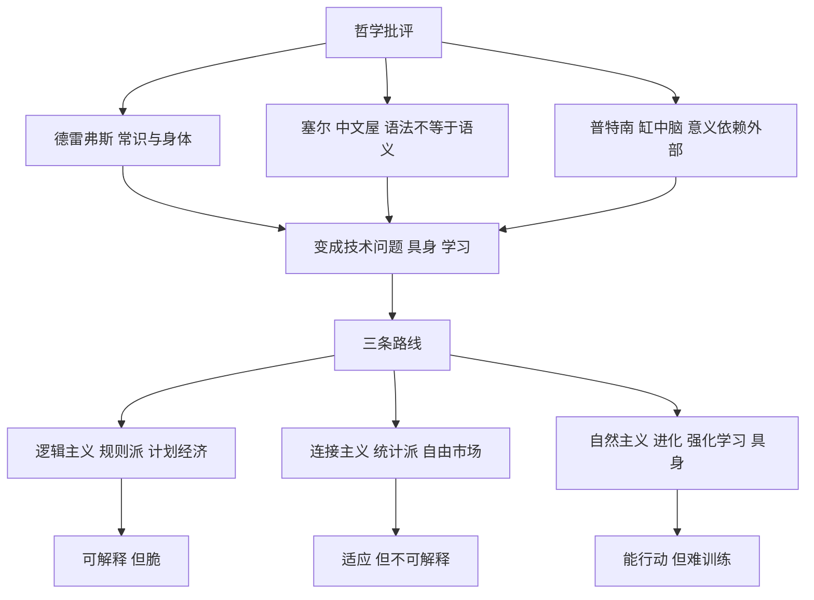

# 第 11 章：哲学质疑、教科书变迁与智能的进化

- **难度**：★★★ | **预估学时**：3 小时 | **前置**：第 9、10 章
- **对应原书**：第 12、13、14、15、16 章合并

## 学习目标

学完本章，你能：

1. 复述德雷弗斯、塞尔、普特南三家对"机器能思考"的批评，并指出各自的薄弱处。
2. 说出教科书四十年变迁说明了什么。
3. 用数字说明人脑的规模与能耗，并解释"皮层神经元数量"为什么比"总神经元数"更重要。
4. 复述作者的三分法与那个"计划经济/市场经济"的比喻。

## 一句话核心

哲学家的任务是不断指出"你还差什么"，工程界的任务是"先用起来再说"。这两件事永远对不齐，但正是这种不对齐推动了领域前进——**每一次哲学批评，后来都变成了一个具体的技术问题**。

## 零基础讲解

> 原书最后几章把哲学、教科书、脑科学、作者自己的判断放在一起，其实是在收束一条线：人工智能到底是什么。作者最后的答案是三分法，不是选一个赢家。

### 概念 1：德雷弗斯——"不能做什么"（难度：基础）

休伯特·德雷弗斯（Hubert Dreyfus）1972 年出版《计算机不能做什么》，源自他 1965 年在兰德公司的报告。核心论点：

1. **常识无法穷举**：人做判断依靠大量背景知识，这些知识无法全部写成规则。
2. **情境依赖**：同一个动作在不同情境下意义不同，规则无法覆盖。
3. **身体的作用**：人的技能建立在身体与世界的互动上，没有身体的机器学不会"熟练"。

书里还提到他的兄弟斯图尔特·德雷弗斯写的《人定胜机》，以及他们合作的一本书。这两兄弟的观点后来被"专家系统失败"和"机器人学需要身体"两件事部分验证了。

薄弱处：他们的批评精准指出了符号派的困难，但没有给出替代方案；而"熟练技能"这件事，深度强化学习在某种程度上绕过去了（不用显式规则，直接从试错中学）。

### 概念 2：塞尔的中文屋（难度：基础）

1980 年，塞尔（John Searle）提出中文屋思想实验：

> 你被关在房间里，不懂中文，但有一本规则手册，告诉你"看到这种形状的符号，就输出那种形状的符号"。外面的人递进中文问题，你按手册操作，输出中文答案。外面的人看来，你"懂中文"；但你自己知道，你只是照规则搬符号。

塞尔的结论：**符号操作不等于理解**。语法（符号的形式规则）不能产生语义（符号的意义）。所以"强人工智能"（真正理解）不可能通过纯符号程序实现。

这个论证的争议点：

- **系统反驳**：房间里的你不是理解者，整个"房间 + 手册 + 你"才是；系统整体可能理解。
- **机器人反驳**：如果这个系统还与世界互动（有感知和行动），符号就有了接地。
- **模拟与复制之争**：塞尔说"模拟消化不等于消化"，反驳者说"那要看你怎么定义消化"。

书里的评价是：中文屋把"理解"这个词的模糊性暴露得最彻底。它没有证明机器不能理解，它证明的是**我们说不清"理解"是什么**。

### 概念 3：普特南的缸中脑（难度：进阶）

普特南（Hilary Putnam）在《理性、真理与历史》（1981）里提出：如果一个人的大脑被取出放在营养液里，由计算机输入虚假的感官信号，他会不会知道自己在缸里？

他的论证（后来他自己也部分放弃）是：如果"缸"这个词的意义来自我们与真实世界的因果联系，那么缸中脑说的"缸"根本指不到任何东西。由此推出"指称依赖于外部世界"。

这条论证对 AI 的意义在于：**意义可能不是纯内部的东西**。一个只在文本里学词的模型，其"意义"是否成立，取决你接受哪种意义理论。这和第 8 章乔姆斯基的争论是同一个问题的两个侧面。

### 概念 4：教科书四十年（难度：基础）

书里列了尼尔森（Nils Nilsson）四本教科书的变迁，这条线索很有意思：

| 年份 | 书名 | 主题重心 |
|---|---|---|
| 1965 | 《学习机器》 | 机器学习 |
| 1971 | 《问题求解方法》 | 搜索与问题求解 |
| 1980 | 《人工智能原理》 | 符号推理、知识表示 |
| 1998 | 《人工智能：新的综合》 | 学习重新成为主线 |

四十年正好走了一个圈：从学习出发，绕到符号推理，再回到学习。书里用一句话概括："从机器学习起，到机器学习终。"

为什么绕这一圈？因为中间那三十年，符号方法在工程上更可行；而到了 1998 年，算力和数据让统计方法重新占优。

### 概念 5：人脑的规模与能耗（难度：进阶）

书里引了埃尔库拉诺-乌泽尔（Suzana Herculano-Houzel）的"大脑汤"方法：把脑组织溶解成细胞悬液，直接数细胞核，比传统切片估算准得多。测出来的数字：

- 人脑约 **860 亿**个神经元，其中皮层约 **160 亿**。
- 大象约 **2570 亿**个神经元，但 **98% 在小脑**，皮层只有约 **56 亿**。

这个对比推翻了一个流行说法"神经元越多越聪明"。关键在**皮层神经元的数量**，不在总数。人脑的皮层神经元数量在哺乳动物里是最高的之一。

能耗方面：人脑约占体重的 2%，却消耗约 25% 的能量。这个能效比今天的 GPU 高得多——这也是类脑计算（第 3 章之外的另一条线）的动机。

书里还提到一个有趣的观点：**烹饪**是人类超越其他物种的关键之一。加热让食物更易消化，把能量从消化系统转移到大脑，为大脑的扩张提供了物质基础。这个说法来自人类学，不是 AI，但作者用它说明"智能不是纯算法，它依赖物质条件"。

### 概念 6：作者的三分法（难度：高阶）

这是全书的收尾判断。作者把人工智能分成三派：

1. **逻辑主义 / 规则派**：智能＝符号推理。代表：逻辑理论家、专家系统、Prolog。
2. **连接主义 / 统计派**：智能＝从数据中拟合分布。代表：神经网络、深度学习、大模型。
3. **自然主义**：智能＝在环境中适应的行为。代表：进化算法、强化学习、机器人学、具身智能。

然后是一个很妙的比喻：

> **规则派像计划经济，统计派像自由市场经济。**

计划经济：自上而下制定规则，覆盖已知情况，遇到没规定的就僵住。自由市场：自下而上从数据中涌现规律，适应性强，但不可解释、可能失控。

这个比喻点出了本书的核心判断：**没有哪一派能单独解决智能问题**。规则派的可解释性、统计派的适应性、自然主义的具身性，各自解决不同层面的问题。

作者还提到一句常被引用的话：深度学习不过是层数多一些；所有神经网络模型都是宽的，而不是深的。这句话是在提醒：不要被"深"这个字迷惑，真正的能力来自规模与数据的配合，而非某个架构上的玄机。

### 概念 7：图灵的生死与《斐多篇》（难度：基础）

书里有一章专门写图灵的死：1952 年因同性恋被定罪，被迫接受化学阉割，1954 年吃下浸过氰化物的苹果去世，年仅 41 岁。英国 2013 年给予皇家赦免。

作者借苏格拉底《斐多篇》里关于灵魂不朽的对话，讨论"机器能否不死"。这一段的用意不是技术，而是提醒：这个领域从一开始就有人在问"机器与人到底差在哪"，而这个问题从来没有标准答案。

## 图示

看图说明：上半部分是"批评如何转化成问题"，下半部分是"三条路线各自的强项与弱点"。看这张图要接受一个结论：三条路线不是替代关系，是分工关系。

## 类比与实例

**类比**：三条路线像三种治国方式。规则派是法典治国，什么都写清楚，但新情况一来就要修法；统计派是市场调节，效率高，但危机来了没人能解释为什么；自然主义是生态演化，能适应，但慢且不可控。

失效边界：国家可以同时有法律、市场、生态，而一个 AI 系统往往只能选一条主路线，混合的代价很高（可解释性与性能常常互相牵制）。

**实例**（一个混合系统）：现代自动驾驶就是一个三层混合：规则层（交规、安全兜底，属于逻辑主义）、感知层（神经网络识别行人车辆，属于连接主义）、决策层（强化学习或规划算法优化乘坐舒适性，属于自然主义）。它说明工程上早就在混合，只是学术叙述喜欢分成派别。

## 常见误解

- **别以为中文屋证明"机器永远不能理解"。** 它证明的是"纯符号操作不等于理解"，以及"理解"这个词本身没有清晰定义。
- **别以为神经元越多越聪明。** 关键在皮层神经元数量与连接结构；大象总数是人脑的三倍，皮层却少得多。
- **别以为三分法是"谁赢了"的结论。** 作者明确说三派各解决不同层面，是分工不是替代。
- **别以为"深度学习只是层数多"是贬低。** 它是在纠正一种神秘化叙述：能力来自规模、数据、训练方法的配合。

## 自测题

1. **填空**：塞尔的中文屋论证想说明，________操作不等于________。
   **答案**：语法（符号）；语义（理解）。

2. **单选**：人脑皮层神经元数量约为？
   - A. 860 亿
   - B. 160 亿
   - C. 2570 亿
   - D. 56 亿
   **答案**：B。解析：860 亿是总神经元数，2570 亿是大象总数，56 亿是大象皮层数。

3. **简答**：作者用"计划经济"和"自由市场经济"分别比喻哪两派？各自的弱点是什么？
   **答案**：计划经济比喻规则派（逻辑主义），自上而下写规则，遇到未覆盖的情况就僵住；自由市场比喻统计派（连接主义），从数据中涌现规律，适应性强但不可解释、可能失控。

4. **多选**：尼尔森四本教科书的主题演变说明：
   - A. 领域重心从学习转向符号推理，再回到学习
   - B. 学科的技术可行性随算力变化而摆动
   - C. 符号方法从未被使用过
   - D. 统计方法在 1990 年代末重新成为主线
   **答案**：A、B、D。

## 复习锚点

- 三家哲学批评各自打中一个要害：常识、语义、意义的外部性。
- 教科书四十年：从学习出发，绕一圈回到学习。
- 人脑 860 亿神经元、皮层 160 亿，能耗占身体 25%。
- 三分法：规则派＝计划经济、统计派＝自由市场、自然主义＝生态演化。
